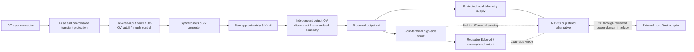
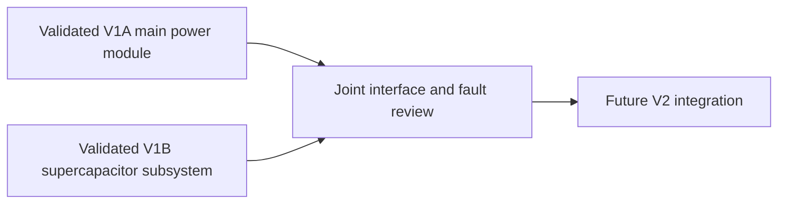

# V1A architecture recommendation

Date: 2026-09-11. **RECOMMENDED FOR R2 REVIEW — NOT APPROVED / FROZEN.**

**NOT FOR FABRICATION — ENGINEERING REVIEW REQUIRED**

## Product boundary

V1A is the standalone Project II Smart DC Power Module. [Requirements](00_REQUIREMENTS.md) control the scope. V1B is a separate teammate-owned supercapacitor subsystem. Future V2 combines the validated subsystems; WBR/HAT research remains optional future reference.

## Recommended functional chain

The diagram allocates functions, not final device order or connector pins. TVS placement/polarity must be coordinated with the fuse and reverse-input circuit. The exact output protection solution is a schematic-entry blocker.

**Engineering rationale:** one buck stage avoids the extra loss and supercapacitor assumptions of Sailor Hat's two-stage design. Electrical regulation and fault protection operate without Linux or an MCU. A single output shunt measures delivered load current; input and output bench instruments measure efficiency. Independent output OV disconnect addresses a buck high-side failure that converter control cannot correct. [Sources](01_REFERENCE_AUDIT.md): C1/C1E, M1/M2, P1/P2 and predecessor A1.

## Block responsibilities and unresolved interfaces

| Block | Recommended responsibility | Must close before capture |
| --- | --- | --- |
| Input connector/fuse/TVS | Admit specified DC source, interrupt catastrophic faults and constrain defined transients | Source envelope, polarity, fuse interrupt/I²t, TVS clamp at actual current, cable inductance |
| Input protection | Reverse-input survival; adjustable UV/OV cutoff, current/inrush limiting if using eFuse path | TPS26630/31 external Q1/Q2 arrangement or justified simpler path; tolerances, SOA, startup and retry |
| Buck | Regulate approved setpoint and load envelope | TPS56837 leads conditionally; TPS56637 or LM61460 alternatives. L/C compensation, mode, frequency, dropout and assembly process |
| Output protection | Interrupt damaging OV independently; define externally powered output behavior | Precision threshold/window, delay and let-through energy; back-to-back FET orientation/rating, possible additional overcurrent limiting |
| Shunt/monitor | High-side differential current and load-side bus voltage; I2C measurements | Range/accuracy, shunt resistance/package, polarity, filtering and calibration |
| Telemetry supply/interface | Supply monitor without tying local power to host 3.3 V; handle any unpowered combination | LDO rating/disable/reverse behavior; buffer/isolator or proven partial-power-down-safe connection and pull-up ownership |
| Load connector/test points | Reusable, rated output and reliable measurement boundary | Contact resistance, wire/return budget, fault coordination and test access |

The buck feedback should initially sense its local regulated rail before the disconnect/shunt. Moving feedback beyond a switch can make an open output look like a regulation error and drive the raw rail upward; remote sensing is not implicitly approved. Load-side droop must be budgeted separately. The monitor's VBUS location does not define the buck feedback location.

Telemetry power branches before the load shunt but after output OV protection, so the reported load power excludes local telemetry consumption. If OV protection removes monitor power, energy accumulation resets; document the gap. Monitor ALERT is diagnostic, not the sole OV/short protection path.

## Layout, grounding and manufacturing intent

**PROPOSED:** a four-layer board with a substantial uninterrupted return reference, appropriate local AGND/PGND connection as specified by the chosen converter, wide high-current copper and a qualified thermal spreading area. TPS56837's example uses 76 × 76 mm and 2/1/1/2 oz copper; these are reference conditions, not approved V1A dimensions.

Keep the input capacitor–switch–power-ground switching loop short. Minimize SW copper area consistent with current/thermal needs; keep feedback and shunt sense traces away from it. Route the Kelvin pair from the actual sense terminals with no shared load-current copper; place differential filtering at the monitor. Do not split planes in a way that forces signal return currents around the switching loop. Follow the selected manufacturer's net-tie and pad rules; exposed pads are not universally ground.

Assembly feasibility matters: the leading buck is a 3 × 3 mm HotRod QFN. Confirm stencil/reflow and inspection access; a student hand-solder-only process may require a different device, footprint or assembly service. Do not convert an EVM into a tiny board while retaining its thermal claims.

## Future integration without designing V1B

Preserve clear power boundaries and accessible EN/PG/fault/test nodes, but do not add an unagreed V1B connector or power stage. The full [TBD interface register](00_REQUIREMENTS.md#future-v1av1b-interface-register) must be jointly resolved.

Charging/inrush allowance must coexist with the load; balancing is a V1B responsibility; OR-ing and reverse blocking need one explicit owner at each boundary. Prebiased startup and buck output discharge may interact with backup power: analyze both input-off/output-live and source-return cases. Power-fail detection alone supplies no hold-up energy. Graceful shutdown requires an agreed load-time profile and sufficient energy. V1A promises neither backup nor guaranteed source-loss shutdown.

## Verification, risk and rollback

No project schematic or electrical test exists. R1 verification comprises source/provenance checks, transparent calculations and manager review. R2 will require pin/package checks and ERC; R3 requires DRC and visual layout review; neither proves electrical safety. R5 must measure regulation, efficiency, ripple, temperature, startup, load transients, fault response and telemetry using dummy loads before SBC integration.

The principal architecture risks are an unbounded input source, an unclosed output-protection window, inadequate thermal area and an unreviewed externally powered output. Resolve them in [component selection](03_COMPONENT_SELECTION.md) and the manager review before implementation. All work here is documentary; revising the recommendation does not require undoing hardware. Preserve superseded rationale with dated corrections rather than erasing source evidence.
