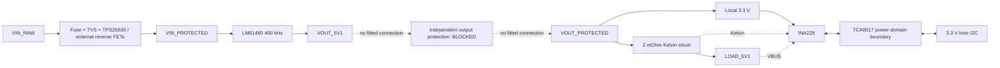

> Context note (2026-09-26): this dated document preserves earlier requirements/review history. Read [current engineering state](context/03_ENGINEERING_STATE.md) and [current architecture](context/02_V1A_ARCHITECTURE.md) before interpreting selections or release claims. Local cache/scratch paths mentioned below are archived external evidence; see [reference restoration](../third_party/README.md).

# R2 schematic review — V1A

Date: 2026-09-12. **STATUS: BLOCKED.** R2 capture/review draft is delivered;
the circuit is not electrically complete. **NOT FOR FABRICATION — ENGINEERING
REVIEW REQUIRED. R3 PCB layout remains BLOCKED.**

## Recovered state and authority

The user explicitly passed R0/R1 and authorized schematic-only R2. This supersedes
older documentary gate blocks, TPS56837 preference and unfrozen numerical proposals.
Frozen basis: regulated 9-24 V normal input; 5.1 V nominal, 5 A continuous,
25.5 W; >=90% whole-module efficiency at representative 12/24 V medium/high load;
<=50 mV peak-to-peak steady-state ripple under a defined high-load test;
approximately 25 C initial ambient, natural convection; INA228, 2 mOhm Kelvin
shunt; 3.3 V I²C, 100 kHz; no MCU. Four layers are later design intent.

[Recovery evidence](evidence/r2/RECOVERY.md) records the dirty tree, original
generator/specification and explicit conflicts. No authored CAD/ERC/PDF/R2 packet
existed. Existing source caches and all earlier reports were preserved.
HEAD remains `a9fe716`; branch `feat/r2-schematic-recovery`; all work is uncommitted.

## Captured architecture and evidence



Project: [V1A.kicad_pro](../hardware/kicad/V1A.kicad_pro), root
[V1A.kicad_sch](../hardware/kicad/V1A.kicad_sch), five hierarchical sheets,
project symbol library/table. **76 symbols including five nonphysical power
flags**, with exact IC pin identities and specification placeholders for unresolved
parts. Symbols and passives are connected using explicit local/hierarchical net
labels; package pin rectangles for ICs/MOSFETs make pin audit explicit. This is
a review capture, not an approved production schematic/BOM.

- [Buck selection/calculations](evidence/r2/BUCK_DESIGN.md): exact catalog
  LM61460, duty/on-time, L/C/current limits, reference thermal evidence, BIAS
  correction and unqualified effective component bounds.
- [Input protection](evidence/r2/INPUT_PROTECTION.md): exact eFuse/FET topology,
  calculated UV/OV/PG/current/ramp settings, latch behavior and open fuse/surge/SOA.
- [Output blocker](evidence/r2/OUTPUT_PROTECTION.md): comparator tolerance,
  response/let-through example, candidate reverse-feed/trip/recovery and missing
  acceptance limits. **No bypass component connects the two output domains.**
- [Monitor/power states](evidence/r2/MONITOR_POWER_DOMAINS.md): load-side VBUS,
  four physical shunt terminals, local/host supply separation, filter, address,
  calibration and externally supplied LOAD current/energy boundary.
- [Pin/footprint audit](evidence/r2/PIN_AND_FOOTPRINT_REVIEW.md),
  [source identities](evidence/r2/source_register.json) and
  [recomputed values](evidence/r2/calculations.json).

Every substantial sheet contains SOURCE, FUNCTION, MODIFICATION and RATIONALE.
Manufacturer functional circuits were adapted with original project symbols;
no predecessor board, CAD artwork or PCB layout was copied. No CAN, HAT, WBR,
V1B storage, MCU, charger, USB-PD or D435i circuitry was introduced.

## Validation actually performed

KiCad **9.0.6** parsed the hierarchy and exported
[XML netlist](evidence/r2/V1A.net.xml) and
[six-page schematic PDF](evidence/r2/V1A_SCHEMATIC.pdf). All six final pages were
rendered and visually inspected for pin labels, sheet names, clipping, page
boundaries and explicit open-output warning. Package/source diagrams, including
Q101's otherwise misleading extracted pin order, were also visually reviewed.

**ERC: 1 error, 0 warnings, 0 exclusions; exit code 5**, in
[ERC.json](evidence/r2/ERC.json). The sole error is
`power_pin_not_driven`, U402 pin 1, VOUT_PROTECTED, sheet 04. It is the real
missing supply caused by the open sheet 03. This is **not ERC PASS** and is not
suppressed by a power flag. The first draft's duplicate U101 OUT17/18 power-driver
declaration was corrected by representing OUT18 as the same supply's passive pin.

All other captured pin-to-net contracts and hierarchical connections passed the
exported-netlist checker. **Five regression tests passed**, including deliberate
Kelvin reversal, wrong Q102 source, host pull-up back-power connection and output
boundary corruption. These checks verify capture, not analog behavior.

Export logs contain pre-existing Fontconfig configuration warnings. CLI PDF
export succeeded and final glyphs were inspected; no system configuration was
changed. No authored `.kicad_pcb`, placement/routing or fabrication export exists.
Third-party PCB files remain references. No DRC is applicable to this R2 capture.

## Release blockers and limitations

| Item | Evidence / next closure |
| --- | --- |
| Independent output OVP/disconnect | Load normal/fault voltage-time limits, capacitance/ESR, fault source envelope, recovery and external-output limits; then select detector/FETs and prove let-through/SOA |
| Input coordination | Select fuse/connector/mating wire; source fault/surge envelope; exact TVS source revision, energy/clamp, cutoff delay and negative-clamp behavior; hot MOSFET SOA |
| Inductor/capacitor qualification | Guaranteed biased/hot L, current-limit margin versus duty, effective C including aging, ripple/thermal and load-step stability; small passive MPNs |
| Footprints | Exact RJR, SON power FET, four-terminal shunt and TDK lands; cleared unsupported inductor assignment; final passive/connector matches |
| Host interface | Actual host pull-ups/capacitance and low-level margin; leakage for every off/prebias state; connector/pinout approval |
| Performance | Efficiency/ripple/temperature remain targets; no board measurements or thermal/layout validation exist |

R0/R1 PASS does not close these newly detailed R2 implementation questions.
No major architectural replacement was implemented. No manufacturing order,
purchase, commit or push occurred.

## Reproduction and manual review

From repository root, with KiCad CLI on PATH (macOS installed binary is
`/Applications/KiCad/KiCad.app/Contents/MacOS/kicad-cli`):

```sh
python3 scripts/calculate_r2.py
python3 scripts/check_r2_schematic.py --netlist docs/evidence/r2/V1A.net.xml
python3 -m unittest discover -s tests -v
python3 scripts/check_r0_r1_docs.py
```

Expected: arithmetic JSON matches saved values; capture checker PASS with R2
BLOCKED; five tests pass; documentary integrity check passes. Arithmetic output
is deterministic. A missing cache, changed source hash or mismatch is a failure
to investigate, not permission to regenerate old evidence.

To build a **new** capture and fresh checks without overwriting a manually edited
project or saved evidence:

```sh
r2_review_dir=$(mktemp -d)
python3 scripts/build_r2_schematic.py --output-dir "$r2_review_dir/cad"
kicad-cli sch erc --format json --severity-all --exit-code-violations \
  --output "$r2_review_dir/ERC.json" "$r2_review_dir/cad/V1A.kicad_sch"
kicad-cli sch export netlist --format kicadxml \
  --output "$r2_review_dir/V1A.net.xml" "$r2_review_dir/cad/V1A.kicad_sch"
python3 scripts/check_r2_schematic.py --netlist "$r2_review_dir/V1A.net.xml"
kicad-cli sch export pdf --output "$r2_review_dir/V1A.pdf" \
  "$r2_review_dir/cad/V1A.kicad_sch"
```

Expected ERC exit is **5** with exactly the known U402 error until output
protection is completed. Any additional error/warning requires manual review;
zero errors alone also does not release a still-open power path. The generator
refuses a nonempty output directory. Review diffs before transferring generated
files after any manual edits. Its deterministic UUIDs support readable diffs.

Manual review: open the root schematic, visit all five child sheets, cross-probe
VIN_PROTECTED/VOUT_5V1/VOUT_PROTECTED/LOAD_5V1, confirm output separation, trace
Q101/Q102 body-diode/gate references, both buck input bypass pairs, Kelvin force
and sense terminals, load-side VBUS and each host/local pull-up. Compare IC pin
numbers with manufacturer diagrams. Failure symptoms include wrong shared net,
accidental bypass, swapped shunt sense, GPIO backfeed or unverified footprint.

Physical bring-up remains R5 after R2-R4 approval: inspection → shorts/continuity
→ current-limited supply → no-load rail check → low dummy load → load steps →
thermal → ripple → transients → fault tests → telemetry → SBC last. Record source,
load/cables, instruments, configs, ambient/airflow, raw data, uncertainty, commit
and dirty-state evidence. Do not build this incomplete draft or use an SBC first.
