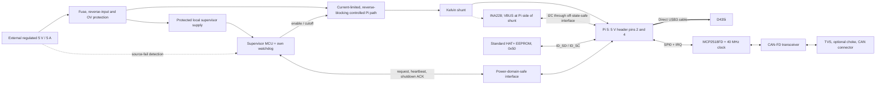
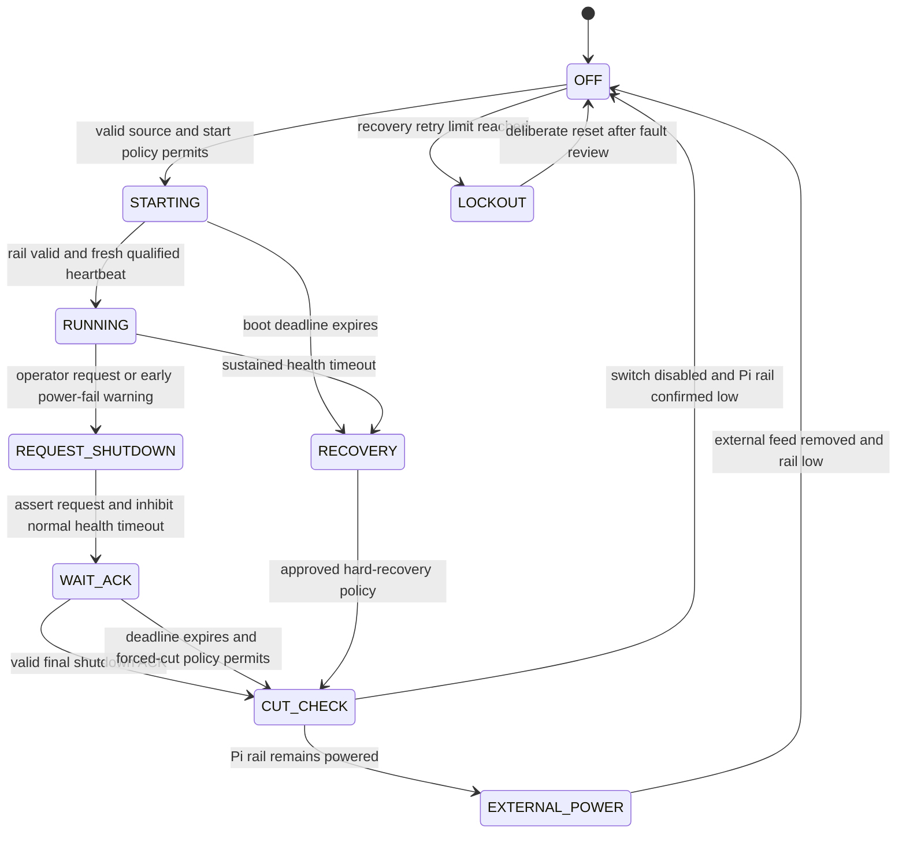

# WBR Edge Supervisor HAT v1 feasibility

> **FUTURE WBR REFERENCE — NOT PROJECT II V1 REQUIREMENTS**
>
> Scope correction, 2026-09-11: the primary project is standalone Project II V1A. V1B is the teammate's separate supercapacitor subsystem; future V2 integrates both after validation. The historical proposal below is retained and does not impose CAN, HAT geometry, supervisor MCU or WBR sequencing on V1A. See [current requirements](00_REQUIREMENTS.md) and [manager report](FINAL_MANAGER_REPORT.md).
>
> Evidence correction: the historical `CAN_HARDWARE_REVIEW.md` and `LINUX_CAN_HAT_REVIEW.md` reports were not present at recovery. References to those reports below are explicitly marked unavailable; their claimed completion is not verified. The source pack now linked is the current **V1A** pack, not evidence that the earlier WBR source-pack mission was completed. Historical gate conclusions below apply only to that proposal and confer no V1A approval.

Date: 2026-09-11. Baseline: `a9fe716`; investigation branch: `docs/r0-r1-engineering-audit`. Documentary investigation only; no hardware measurements or implementation.

**NOT FOR FABRICATION — ENGINEERING REVIEW REQUIRED**

## Finding and project boundary

**DECISION PROPOSAL: conditionally feasible.** Use an external regulated 5 V/5 A source, one SPI CAN-FD controller, a high-side power monitor, and an independent supervisor controlling the Pi supply. Keep the D435i directly on a Pi 5 USB3 port. Do not include robot-battery conversion, USB routing, or energy storage on this v1 board.

The repository's existing Project II v1 remains a standalone DC power module. **“WBR v1” below means this separate HAT proposal**, not approval to replace that project. Previous audit examples using 9–28 V are not WBR requirements. No battery voltage, motor power architecture, CAN protocol, or final connector interface is frozen here. R2 requires architecture approval and closure of the entry conditions in section 14.

Feasibility has three qualifications:

- A 5 A **source capability** is shared by the Pi, D435i, cooling, and HAT. It is not 5 A available to the Pi plus unlimited peripherals.
- Graceful shutdown after an intentional request is feasible while power remains. Graceful shutdown after abrupt source removal is **not guaranteed without stored energy or upstream warning and hold-up**.
- A HAT switch cannot cold-cycle a Pi still powered by USB-C or another backfeed path. Electrical coexistence and exclusive power-control authority are separate requirements.

## 1. Requirements and unresolved inputs

| ID / class | Requirement or open item | Consequence / verification |
|---|---|---|
| R01 REQUIREMENT | Raspberry Pi 5 + D435i perception computer | Test the actual board revision, OS image, cooler, camera mode and cable |
| R02 REQUIREMENT | D435i directly connected to Pi USB3 | No USB3 connector, hub, switch, PHY, or data traces on HAT |
| R03 REQUIREMENT | Compatible with external regulated nominal 5 V/5 A | No minimum robot-battery voltage or onboard buck prerequisite |
| R04 REQUIREMENT | One CAN-FD interface with 3.3 V host logic | SocketCAN, protected physical bus, independently selectable termination |
| R05 PROPOSAL | Measure delivered branch voltage/current/power/energy | Define sensor boundary; calibrate shunt and record reset/data gaps |
| R06 PROPOSAL | Independent supervision and controlled shutdown/restart | Supervisor remains active while its input is valid and Pi branch is disabled |
| R07 REQUIREMENT | Safe powered/unpowered GPIO behavior | All Pi/HAT/USB-C power combinations; no local 3.3 V tied to Pi 3.3 V |
| R08 REQUIREMENT | Fabrication and validation gates remain sequential | Study is not electrical validation or R2 approval |
| O01 OPEN | Source tolerance, cable length, transient response, fault current | Needed for allowable total path resistance, UV/OV settings, fuse and TVS |
| O02 OPEN | Pi + camera peak/continuous load, shutdown time | Needed for 5 A budget and any later backup sizing |
| O03 OPEN | CAN peers, nominal/data rates, harness length, grounding and stubs | Needed before selecting isolation, termination and protection ratings |
| O04 OPEN | HAT stack height, cooler/enclosure, temperature and vibration | Needed for mechanical and thermal acceptance |
| O05 OPEN | Restart policy, retry limit, forced-cut policy, robot interlock | Linux recovery must not autonomously re-enable robot motion |
| O06 OPEN | Accuracy, ripple and transient acceptance limits | Set numeric limits at R1 review; no unmeasured performance claims |

## 2. Proposed system block diagram



**PROPOSAL:** power CAN logic/transceiver only when Pi 3.3 V indicates the host is active, using a local regulated supply and qualified isolation/enable sequencing. The diagram shows functional responsibilities, not a final ordering of every protection device. A low-power supervisor branch needs protection even while the high-current branch is off. “Supervisor supply” is not a UPS: it dies if its source disappears.

An MCU avoids making Linux responsible for switching off its own power after a hang. It does not become the robot's balance controller, motor controller, or safety controller. Robot-side command timeout and safe-state enforcement remain independent of this HAT.

## 3. Pi HAT+ electrical and mechanical constraints

**EVIDENCE:** [HAT+ specification](https://datasheets.raspberrypi.com/hat/hat-plus-specification.pdf), build `6df06cc-clean`, 2024-12-05, chapters 2–6. Detailed interpretation and pinned software sources: [Pi review](evidence/wbr_hat/PI_POWER_WATCHDOG_REVIEW.md).

- GPIO2–27 usage requires **Standard** EEPROM class at `0x50`. The power-only MODE0/MODE1 classes at `0x52`/`0x53` prohibit those GPIO connections. This combined CAN/I2C supervisor cannot use MODE1 as a shortcut for 5 A configuration.
- The power-sourcing function must tolerate another supply on Pi USB-C and must not sink current from the Pi 5 V rail. Provide reverse blocking; do not depend on the Pi to protect an arbitrary HAT supply.
- STANDBY can leave Pi 5 V present with Pi 3.3 V absent. Pull-ups, MISO, IRQ, ACK, EEPROM, and supervisor connections all need domain-by-domain review. Open-drain signaling alone does not prove partial-power-down safety.
- Use the standard 40-pin geometry and published mounting-hole locations. Check the actual Pi 5 and Active Cooler drawings for component keep-outs, standoff height, airflow, connector access and cable bend radius. Do not copy an older HAT's underside component envelope or treat a nominal board outline as cooler clearance evidence.
- Propose a board within the familiar 65 × 56 mm envelope, with cut-outs/clearances as required by the verified mechanical stack. This dimension is a packaging proposal, not a claim that HAT+ requires that exact rectangular shape. Full mechanical fit remains OPEN.

Call the prototype a **HAT-form-factor engineering board** until EEPROM content, electrical behavior and mechanical conformance have been reviewed. No HAT+ compliance claim is made by this study.

## 4. GPIO / I2C / SPI pin budget

All GPIO numbers below are **BCM**; physical header numbers are separate. Allocation is proposed, not implemented.

| Function | BCM GPIO | Physical pin | Direction at Pi / power rule |
|---|---:|---:|---|
| 5 V branch feed | — | 2, 4 | HAT → Pi; use both contacts; qualified connector required |
| Ground return | — | 6, 9, 14, 20, 25, 30, 34, 39 | Common reference; multiple return contacts and broad copper |
| Pi 3.3 V status / host-side pull-ups | — | 1, 17 | Pi rail only; never bridge to local 3.3 V |
| HAT EEPROM ID_SD / ID_SC | 0 / 1 | 27 / 28 | Reserved ID bus, EEPROM `0x50`; not application I2C |
| I2C1 SDA / SCL | 2 / 3 | 3 / 5 | INA228 proposed `0x40`; supervisor address OPEN if I2C control added |
| SPI0 MOSI / MISO / SCLK | 10 / 9 / 11 | 19 / 21 / 23 | MCP2518FD, 3.3 V; short routes |
| SPI0 CE0 | 8 | 24 | MCP2518FD chip select |
| CAN interrupt | 25 | 22 | Input, active-low level interrupt; off-state-safe pull-up |
| SHUTDOWN_REQ_N | 17 | 11 | Input from supervisor; host-domain pull-up |
| HEALTH_HEARTBEAT | 27 | 13 | Output; toggled only after health checks pass |
| SHUTDOWN_ACK | 24 | 18 | Output from external-cut shutdown mechanism; qualified by boot state |
| Optional monitor ALERT | 22 | 15 | Input; reserve, not sole fault protection |
| Optional transceiver standby control | 23 | 16 | Reserve; preferably locally gated against Pi-off state |
| UART debug reserve | 14 / 15 | 8 / 10 | Preserve where possible; actual Pi 5 UART mapping/image must be checked |
| SPI0 CE1 reserve | 7 | 26 | Future expansion; no second CAN channel in v1 |

Budget: 10 GPIO2–27 lines used by I2C, CAN and supervision; 2 optional lines reserved; 14 remain unallocated, including UART/CE1 reserves. ID bus uses two additional dedicated pins. INA228 address straps must match device tree; do not add pull-ups without checking effective parallel resistance and host-off behavior. Initial I2C proposal: 100 kHz, increased only after bus-capacitance/rise-time checks.

## 5. Power-path concept and budget

The HAT passes and supervises regulated 5 V. It does not convert an unknown robot battery to 5 V. The previously studied TPS56637/TPS56837 and Sailor Hat conversion chains are sources for a separate power module or V2, not prerequisites for WBR v1.

**EVIDENCE:** [Pi 5 USB-PD paper](https://pip-assets.raspberrypi.com/categories/685-app-notes-guides-whitepapers/documents/RP-009856-WP-1-USB%20Power%20delivery%20on%20Raspberry%20Pi%205.pdf), Release 1, build `1026f0c6e305` (2026-03-17), printed pp. 5, 7–8: supplying 5 V is distinct from advertising 5 A. A GPIO power feed does not negotiate USB-PD. EEPROM setting `PSU_MAX_CURRENT=5000` can declare a verified non-PD supply capability and enables the larger peripheral allowance; `usb_max_current_enable=1` is the alternative peripheral-limit override, not a source upgrade. Use one deliberate, documented configuration on the target Pi; neither was applied here.

Pi's default peripheral allowance is 600 mA, increasing to 1.6 A with the appropriate supply configuration; this budget includes USB peripherals and the fan. Verify the D435i stream and cooling combination rather than assuming enumeration proves sufficient power.

**CALCULATION:** `V_Pi = V_source − I × R_path`, where `R_path` includes both supply and return wiring, connector contacts, fuse, FETs, shunt and PCB. If a *proposed* Pi-rail test floor is 4.75 V, a source delivering exactly 5.00 V permits at most 50 mΩ at 5 A, before transient allowance. At 5.10 V the arithmetic ceiling is 70 mΩ. These are budget examples, not asserted Pi absolute ratings. Actual source minimum and host acceptance limits remain OPEN; v1 must be assessed at nominal 5.0 V and must not silently require a 5.1 V source.

The 2 mΩ candidate shunt consumes 10 mV/50 mW at 5 A. A TPS25947 path using 28.3 mΩ typical adds about 142 mV/0.71 W at 5 A. That leaves little allowance for cabling at 5.0 V and becomes worse at maximum resistance/hot conditions. **PROPOSAL:** compare a compact eFuse solution with a lower-resistance external-FET path; freeze neither until voltage-drop and thermal budgets close. Use maximum component data for acceptance, not these typical screening values. [TPS25947 datasheet](https://www.ti.com/lit/ds/symlink/tps25947.pdf), SLVSFC9C, §§4, 6, 7.3, 8.4.

`I_source = I_Pi_branch + I_supervisor + I_HAT_aux`; D435i current through Pi USB is already included in `I_Pi_branch`. Do not double-count it. Conversely, a full 5 A Pi branch leaves no guaranteed headroom for upstream HAT loads on a 5 A source. Measure combined worst-case operation or reduce the supported workload; report the source and branch envelopes separately.

**Protection requirements:** independent OV disconnect, reversed-input survival within a specified fault envelope, reverse-current blocking in enabled/disabled/unpowered conditions, current limiting, controlled inrush, thermal protection and a coordinated fuse. Establish `I_inrush = C_load × dV/dt`, FET SOA, current-limit tolerance, source foldback interaction and retry behavior. A fixed 5.7 V clamp is not automatically adequate Pi protection. TVS clamping voltage at actual surge current must coordinate with downstream ratings; source transient/fault energy is OPEN.

When USB-C is connected, reverse blocking protects the HAT input but does not grant cutoff authority over the Pi. Observe Pi-side voltage after commanding OFF; if still energized, enter EXTERNAL_POWER state. Do not enable active rail discharge against another supply. A local 5 V rail short cannot necessarily be isolated from USB-C by the HAT's own input switch.

## 6. Monitoring concept

**PROPOSAL:** INA228 supplied by protected local 3.3 V, with a four-terminal 2 mΩ shunt in the Pi-feed high side; VBUS senses the Pi side. This measures the HAT-delivered Pi/camera branch, excluding upstream auxiliary loads and losses. If USB-C supplies part or all of the load, it does **not** measure total Pi consumption. Label every log with the power-source configuration.

Authoritative circuit/layout sources: [INA228 SLYS021A](https://www.ti.com/lit/ds/symlink/ina228.pdf), §§8–10; [EVM SBOU241E](https://www.ti.com/lit/ug/sbou241e/sbou241e.pdf), Fig. 6-1, p. 23, layout/BOM pp. 27–30; [Vishay WSL2726](https://www.vishay.com/docs/30131/wsl2726.pdf), document 30131, 2026-06-29. Detailed calculations remain in the [existing monitor review](evidence/r0/MONITOR_PROTECTION_SOURCE_REVIEW.md); its high-voltage input assumptions do not transfer here.

| Quantity | Screening result / decision |
|---|---|
| Shunt candidate | `WSL27262L000FEA`, 2 mΩ, ±1%, four-terminal, 3 W at stated derating point, ±25 ppm/°C component TCR |
| 5 A / 6 A examples | 10 / 12 mV, 50 / 72 mW; 6 A is arithmetic headroom, not permitted continuous source loading |
| Analog range | ±40.96 mV setting gives nominal ±20.48 A analog range; calibrated digital current range may be smaller |
| First-order uncalibrated current error | About `1.05% of reading + 0.5 mA` at specified datasheet conditions, before layout/noise/temperature effects; not a ≤1% system |
| Routing | Separate Kelvin traces from sense terminals; differential filtering near IC, short matched routes, no load copper in sense path |
| Filtering | Start from manufacturer options; EVM's 10 mΩ shunt is DNP, not a compulsory installed design value |

Use continuous conversion for energy accumulation. Handle monitor reset, overflow, configuration/calibration restore and unlogged energy loss. ENERGY is not a signed bidirectional import/export total. Calibration and accumulated-energy tests are separate from fault protection. Die temperature is not automatically shunt or connector temperature. The monitor cannot capture all fast rail transients; use a scope.

## 7. CAN topology and hardware candidates

```text
120 Ω endpoint -- twisted CAN_H/CAN_L trunk -- WBR short stub -- trunk -- 120 Ω endpoint
                                                 |
                                      optional HAT termination OFF
                                      unless HAT is an endpoint
CAN_GND accompanies the bus; shield/chassis policy is a separate decision.
```

Only the two physical bus ends are terminated. Two nominal 120 Ω terminations yield approximately 60 Ω across CAN_H/CAN_L with the network powered off, subject to other circuitry. Do not place 120 Ω at every node. Classical CAN and CAN-FD compatibility depends on every active node's behavior: an FD-capable HAT does not make legacy nodes accept FD frames. Nominal bitrate, data bitrate, sample points, bus length and allowed stub length remain OPEN.

The leading reference combination is MCP2518FD at 3.3 V + MCP2562FD with 5 V VDD and 3.3 V VIO. “3.3 V compatible” refers to the logic interface; it does not mean the transceiver runs from a 3.3 V bus supply. A true 3.3 V transceiver is an alternative, subject to mixed-network and timing validation.

| Function | Candidate | Assessment / source |
|---|---|---|
| CAN-FD controller | MCP2518FD | Mainline `mcp251xfd` family; 40 MHz reference clock proposed. See hardware review (`evidence/wbr_hat/CAN_HARDWARE_REVIEW.md` — historical report unavailable) |
| CAN transceiver | MCP2562FD | Leading manufacturer-reference path: 5 V bus supply, 3.3 V VIO; verify suffix/package/pins |
| CAN transceiver alternative | TI TCAN3413 | True 3.3 V CAN-FD option; qualify transceiver timing, standby and bus interoperability |
| Power monitor | INA228 | Preferred measurement capability; target-kernel support gate below |
| Monitor fallback | INA226 | Mature simpler option; no hardware energy accumulator; software integration needed |
| Supervisor | ATtiny1616 class | Predecessor uses ATtiny1616-MNR; bounded state machine/I2C/GPIO viable concept, firmware and pinout still to be designed |
| Independent watchdog option | TPS3431 | Programmable watchdog with enable, 1.8–6.5 V supply; [SNVSB66A](https://www.ti.com/lit/ds/symlink/tps3431.pdf), §§7–8. Not itself a shutdown sequencer |
| Integrated protected path | TPS259470/474 variant | Adjustable OV cutoff alternatives; 5 A thermal/drop and ±10% current-limit tolerance need closure; no suffix chosen |
| External-FET reverse-block/load-disconnect path | LM74800-Q1 + back-to-back NFETs | Lower FET resistance can be selected; separate current limiting needed. [SNOSD95C](https://www.ti.com/lit/ds/symlink/lm7480-q1.pdf), application/layout sections |
| EEPROM / isolation / LDO / TVS | OPEN exact parts | Select only after standby, host-off leakage, transient envelope and package checks |

**EVIDENCE:** [MCP2518FD errata DS80000789F](https://ww1.microchip.com/downloads/aemDocuments/documents/APID/ProductDocuments/Errata/MCP2518FD-Silicon-Errata-and-Data-Sheet-Clarification-DS80000789.pdf), January 2025, tightens SPI to `f_SPI ≤ 0.85 × f_SYSCLK / 2`: 17 MHz at 40 MHz. Start at **10 MHz**; the bare 20 MHz rating is insufficient justification. Review CRC retry, FIFO-index and wake/oscillator errata against the selected driver and operating modes.

At the connector place CAN-rated ESD/TVS protection with a short return path. Evaluate optional common-mode choke and split termination against signal integrity/EMC results; avoid populating filters by habit. Keep CAN_H/L paired over an uninterrupted reference, avoid long branches and stubs at protection components, and place the oscillator/decoupling close to the controller. Motor return currents must not flow through the HAT's CAN_GND or precision-sense reference.

**OPEN isolation decision:** a short, controlled common-ground robot harness may support non-isolated CAN. Unknown ground offsets, noisy power returns or external cabling may require galvanic isolation and an isolated supply, with area/power consequences. This is an R1 decision, not an automatic V2 deferral if the real harness needs it.

## 8. Reference design inspection

The CAN hardware review (`evidence/wbr_hat/CAN_HARDWARE_REVIEW.md` — historical report unavailable) records exact manufacturer files, revisions, BOM/layout observations and access limitations. The Linux/open-HAT review (`evidence/wbr_hat/LINUX_CAN_HAT_REVIEW.md` — historical report unavailable) records pinned original repositories and license boundaries. Those records distinguish actual schematic/BOM/Gerber inspection from a product-page claim. No reference PCB, schematic block or CAD artwork was copied into project hardware.

Microchip's ADM00576 is an evaluation platform with a host MCU and daughterboard interfaces; it is not a complete Pi HAT. Trace the controller/transceiver daughterboard separately from the motherboard power, USB and host logic. Use manufacturer electrical assumptions over GitHub examples and evaluate only the needed CAN block. Open HAT layouts help with GPIO assignment, connector placement, termination and decoupling; they do not establish Pi 5 standby or power compliance.

For power-related predecessors, see [compact hardware source pack](CODEX_HARDWARE_SOURCE_PACK.md). Sailor Hat's two-stage supercapacitor architecture and the 1026 board's 24 V/4 A buck are references, not interchangeable 5 V/5 A WBR modules. Historical artifacts remain unmodified under ignored `third_party/` caches.

## 9. Watchdog and shutdown state machine

**PROPOSAL:** the supervisor owns the high-current path, source-good detection, boot qualification and bounded recovery attempts. Linux owns application quiescence, filesystem shutdown and the final ACK. Hardware OV/short protection preempts software. Timeout values remain OPEN until boot/shutdown and fault tests measure them.



Any state can lose power on abrupt source collapse; that event is an **uncontrolled power loss** unless a verified backup supply maintains the rail. Add fast independent fault cutoff for OV/shorts; do not wait for filesystem ACK during a damaging electrical fault.

Rules needed before firmware:

1. Arm heartbeat supervision only after a new boot is qualified; a static high signal or boot-time pull state is not health or ACK. Heartbeat must reflect camera/CAN/application checks, not merely a free-running GPIO timer.
2. For requested shutdown, stop new robot commands and perception work, notify upstream robot control, flush logs, then shut down Linux. Preserve an independent maximum shutdown deadline even after suspending ordinary heartbeat supervision.
3. Accept ACK only in the expected shutdown phase and with defined polarity/qualification. MCU brownout/reset must produce a documented switch state; avoid unintended repetitive boot loops.
4. After cutoff, confirm Pi rail discharge before restart. Establish minimum off time experimentally. Remain in EXTERNAL_POWER if another source prevents cutoff; never report a completed cold restart from elapsed time alone.
5. If power returns during shutdown, finish the shutdown and perform a clean, qualified restart. Use source-good hysteresis/debounce and bounded retries. Robot motion requires its separate authorization/interlock.

Two distinct Linux power modes must be evaluated:

| Mode | Mechanism | Limit |
|---|---|---|
| Native Pi halt/standby | `POWER_OFF_ON_HALT=1`, `WAIT_FOR_POWER_BUTTON=0` proposed EEPROM policy | 5 V remains present; Pi 5 uses power button/J2 for wake. A J2 harness is separate from the 40-pin header |
| Supervisor physically removes supply | `gpio-shutdown` request plus `gpio-poweroff` final ACK on selected GPIO | `gpio-poweroff` changes normal poweroff behavior and requires functioning external cutoff; do not treat it as a harmless standby indicator |

Linux internal watchdog and MCU supervision serve different failure cases. Pi watchdog can reboot a hung host while power exists; it cannot preserve energy or guarantee removal of a stuck USB peripheral's power. Bootloader watchdog coverage ends at its configured handoff unless kernel/userspace takeover is arranged. Current Pi documentation describes `kernel_watchdog_timeout`; configure and verify the systemd watchdog owner first. Inspect `/dev/watchdog*`, `wdctl`, boot logs and actual driver rather than assuming all Pi generations expose the same watchdog. Sources and precise configuration caveats are in the [Pi review](evidence/wbr_hat/PI_POWER_WATCHDOG_REVIEW.md).

**Hold-up sizing for a separate module:** `E_required ≥ P_shutdown × t_shutdown / η`; for a regulated capacitor supply, `C ≥ 2 P_shutdown t_shutdown / [η (V_high² − V_low²)]`, plus ESR, aging, temperature, imbalance and reserve. A direct 5 V capacitor has little usable voltage swing. Illustratively, 25 W for 10 s, 90% efficiency and 5.10→4.75 V requires about **161 F effective** before those margins. This is not a capacitor selection or a promised shutdown duration. Stop/disable the camera during orderly shutdown if measurements justify the reduced-power profile.

## 10. Connector and test-point proposal

| Connector | Proposed function / allocation | Qualification required |
|---|---|---|
| J_PWR, keyed locking 2-way | 1 = regulated +5 V, 2 = return; label voltage prominently | Molex Micro-Fit family is a candidate; choose exact housing/header/terminal/wire together, derate at enclosure temperature |
| J_PI, 2×20 female | Standard Pi header; both 5 V contacts and multiple grounds | Contact current sharing, insertion height, plating, mounting strain and resistance; generic Dupont wiring is not a 5 A qualification |
| J_CAN, keyed locking 3-way | Proposed 1 = CAN_GND, 2 = CAN_L, 3 = CAN_H | Private proposal, not asserted CAN connector standard; final robot pinout OPEN |
| JP_TERM | Clearly marked selectable 120 Ω endpoint termination | Default unpopulated/open for a middle node; mechanically reliable selection |
| J_CTRL, keyed low-current header | Request, ground, optional upstream source-good | 3.3 V logic only; no battery or motor power; debounce/ESD/interface envelope OPEN |
| J_DEBUG | Supervisor programming/debug; UART test access | Match selected MCU programming interface; prevent programmer backfeed |
| Optional J2 harness | Pi power-button contact interface | Only after Pi-native wake mode is selected; use qualified contact/open-drain interface |

Manufacturer connector guidance: [Molex Micro-Fit product specification PS-43650-001](https://www.molex.com/content/dam/molex/molex-dot-com/products/automated/en-us/productspecificationpdf/436/43650/PS-43650-001.pdf), temperature-rise/derating tables. Family headline current is not a guaranteed rating for every pin count, wire and mating pair. Exact ordering codes remain OPEN.

Provide labeled test points for raw/protected 5 V, Pi-side 5 V with adjacent ground spring pad, local 3.3 V, Pi 3.3 V, switch EN/fault, source-good, both Kelvin sense nodes, I2C SDA/SCL/ALERT, SPI clock/CS/MOSI/MISO/IRQ, CAN_H/L/GND, heartbeat/request/ACK, supervisor reset/programming. Keep probe stubs short; avoid loading the crystal pins with normal probes. Add thermal observation access at FETs, fuse, shunt and power connector.

## 11. Linux driver and software implications

**EVIDENCE:** pinned Pi kernel branches and original source filenames in Linux review (`evidence/wbr_hat/LINUX_CAN_HAT_REVIEW.md` — historical report unavailable). MCP2518FD uses `mcp251xfd`, not `mcp251x`. Device tree must describe chip select, clock frequency, active-low level IRQ, SPI speed and any supplies/enable control. Do not leave spidev bound to the same chip select. The overlay parameter is `speed=`, not the MCP2515-specific example often copied online.

Illustrative `/boot/firmware/config.txt` entries for the proposed pins; **not applied and not a tested board configuration**:

```ini
dtparam=spi=on
dtparam=i2c_arm=on
dtoverlay=mcp251xfd,spi0-0,interrupt=25,oscillator=40000000,speed=10000000
dtoverlay=gpio-shutdown,gpio_pin=17,active_low=1,gpio_pull=up
# Add ONLY when the external cutoff circuit is installed and verified:
# dtoverlay=gpio-poweroff,gpiopin=24
```

Before use, confirm the installed overlay's `dtoverlay -h mcp251xfd` output and ensure its regulator assumptions match the actual power domains. If EEPROM loads the overlay later, do not instantiate a duplicate through `config.txt`.

**INA228 support is kernel-dependent.** The inspected Pi `rpi-6.12.y` driver lacks INA228 matching; newer upstream/other Pi branches differ. Do not bind INA228 as INA226 or assume `ina2xx` is the correct family. Review the selected kernel's `ina238` implementation/binding and available channels. Native energy/charge hardware does not imply every kernel exports both. Options are a supported kernel, a reviewed backport, or a single-owner userspace I2C service. No kernel change is authorized by this study.

SocketCAN bench smoke test, using **illustrative** 500 kbit/s arbitration / 2 Mbit/s data, on an isolated test network with a second FD-capable node:

```sh
uname -a
cat /etc/os-release
vcgencmd bootloader_version
sudo dtoverlay -h mcp251xfd
dmesg | rg -i 'mcp251|spi|can|ina|watchdog|under.voltage'
ip -details -statistics link show can0
sudo ip link set can0 down
sudo ip link set can0 type can bitrate 500000 dbitrate 2000000 fd on berr-reporting on restart-ms 0
sudo ip link set can0 up
candump -tz -e can0
# In another terminal; peer configured identically and able to acknowledge:
cansend can0 123##10011223344556677
ip -details -statistics link show can0
```

Expected: correct controller binding and clock, ERROR-ACTIVE link, received FD frames at the peer, and no unexplained error/drop growth. Missing ACK can raise error counters/bus-off without proving SPI failure. Wrong clock, IRQ polarity, pin ownership, absent transceiver power or termination can prevent operation. Start recovery disabled so faults are visible; enable a measured recovery policy later. Loopback alone does not validate the transceiver, cable or peer.

Software scope: use systemd service ownership; report timestamps, health state and cause of shutdown; avoid simultaneous raw I2C and kernel access. Record frame age, camera disconnects/dropped frames, CAN RX/TX/drop/error counters, bus-off events, SPI/IRQ failures, queue overflow, CPU/RAM, workload latency and power. ROS2 integration is outside this study; no ROS graph or message format is changed.

## 12. Bring-up and validation plan

No hardware build is required for these Markdown deliverables. R2 will need a KiCad schematic with successful ERC; R3 requires DRC plus visual layout review. Rule-check passes are not proof of electrical safety.

| Stage | Procedure | Expected result / failure symptoms |
|---|---|---|
| 1 Visual inspection | Check assembly, packages, pin 1, polarity, solder bridges, mounting/clearance | Matches reviewed BOM/drawings; reject wrong packages, contact interference or blocked cooler |
| 2 Continuity | Check shorts and net continuity, header orientation, unpowered reverse paths | No unexplained low-resistance rail path; investigate before powering |
| 3 Current-limited supply | Test HAT without Pi, camera or live robot CAN | Supervisor supply stable; unexpected current/heat means stop |
| 4 No-load startup | Observe raw/protected/Pi rail, EN, fault and 3.3 V sequencing | No unqualified boot pulses or overshoot; local controls behave at reset |
| 5 Verify output | Scope and DMM at header-equivalent load connector | Meets approved rail envelope in all switch states |
| 6 Low-current dummy load | Validate switching and telemetry at low current | Expected direction/scaling; offset or spontaneous cutoff investigated |
| 7 Increasing load | Step through approved range to 5 A combined budget | Stable source/rail; no connector overload or nuisance trips |
| 8 Thermal | Soak at enclosure ambient and load limits | Component/junction estimates within approved derating; record connector/fuse/FET temperatures |
| 9 Ripple | Short-ground scope measurement at Pi feed | Within agreed bandwidth/limit; no false claims from long probe leads |
| 10 Transients | Startup, load steps, cable/hot-plug and source collapse with dummy load | Quantify droop/overshoot/inrush; confirm source foldback interaction |
| 11 Protection | Controlled OV/reverse-input/short/reverse-feed tests within planned fault-energy limits | Measured trip thresholds, response, let-through and restart match ratings; use no expensive load |
| 12 Telemetry and interface | Calibrated current/power/energy, rollover/reset tests; CAN peer tests; all power-domain combinations | Correct calibration and gaps; no host backpower, stuck-dominant CAN or unexplained errors |
| 13 Pi integration | Pi first, then direct USB3 D435i; full perception + CAN workload and cooling | No undervoltage/disconnect/throttling beyond approved limits; record full source current |
| 14 Recovery validation | Kill service, withhold heartbeat, boot failure, shutdown/reboot, source return, USB-C coexistence | Bounded transitions/retries; distinguish graceful completion, forced cut and EXTERNAL_POWER |

On the Pi, verify `lsusb -t` reports the camera on a SuperSpeed path, and log `vcgencmd get_throttled`, camera frame counters and relevant kernel logs during combined load. Test requests/ACK before enabling real cutoff. Watchdog fault injection must use a prepared recoverable test image and physical recovery access. A hard source-pull test in no-backup v1 is expected to lose power; do not report it as a graceful-shutdown pass.

Each future experiment must retain goal/hypothesis, hardware identifiers, OS/kernel/EEPROM/firmware versions, input source, load/camera configuration, exact commands, metrics/raw logs, interpretation, limitations, reproduction steps and project commit. Link each reported result to its experiment, config, raw data and figure/table. No new experiment format is imposed here.

## 13. V1 versus V2 scope

| WBR v1 proposal | Separate supercap module / V2 after requirements |
|---|---|
| Regulated external 5 V/5 A input and low-loss protected Pi feed | Robot-battery conversion after actual battery/surge envelope exists |
| One MCP2518FD CAN-FD channel | Additional CAN channels or gateway functions only if measured need |
| INA228 monitoring with verified software path | Multi-rail/input-output measurement if system energy accounting needs it |
| Independent supervisor, orderly powered shutdown, bounded recovery | Guaranteed source-loss shutdown using characterized backup energy |
| Direct Pi USB3 connection to D435i | D435i remains direct; USB3 routing remains outside this project |
| Evaluated common-ground or required isolated CAN | More demanding isolation/EMC qualification driven by actual harness |
| Manual verified non-PD supply configuration and correct EEPROM class | Automated provisioning after stable deployment requirements |

Do not add a charger, balancing network, large capacitor bank, DC/DC converter, PD controller, second CAN port, or robot-control MCU functionality simply because a predecessor includes it. Each adds a separate validation burden. If guaranteed blackout shutdown becomes a v1 requirement, reopen R1 and include the required backup module explicitly.

## 14. Risks and R2 entry conditions

| Priority | OPEN RISK | Closure before implementation/fabrication |
|---|---|---|
| High | Source/cable/FET loss at 5 A leaves inadequate Pi voltage | Specify source minimum and load envelope; complete worst-case drop/thermal budget |
| High | Unknown source hold-up; shutdown time exceeds stored energy | Accept no-backup v1 limitation or approve separate backup architecture |
| High | USB-C/backfeed bypasses supervisor | Review coexistence circuit and EXTERNAL_POWER detection/policy |
| High | GPIO or I2C powers sleeping Pi / HAT | Select devices with explicit off-state specifications; power-sequencing tests |
| High | CAN ground offsets/noise exceed non-isolated design | Resolve harness/grounding and isolation decision |
| High | MCU/ACK/watchdog ambiguity causes premature cutoff | Freeze state ownership, startup qualification, deadlines and fault policy |
| Medium | MCP2518FD errata or Pi image mismatch | Pin target kernel/overlay/clock and review required workarounds |
| Medium | INA228 unavailable on selected kernel | Choose and verify driver/backport/userspace ownership plan |
| Medium | Cooler obstruction, connector heating or vibration faults | Mechanical fit and thermal/current-rating review |
| Medium | Predecessor licenses/old assumptions carried forward | Use documented reference boundaries; approve any later adaptation explicitly |

**R0/R1 study conclusion: CONDITIONAL PASS as a feasibility proposal. R2 remains BLOCKED pending architectural review and the high-priority requirement decisions.** This is not a refusal to complete the study: both requested documents and supporting evidence are the current deliverables. No schematic, PCB, configuration, purchases, commits or pushes were made for this mission.

## Source trail

- [Pi electrical/mechanical/power/watchdog review](evidence/wbr_hat/PI_POWER_WATCHDOG_REVIEW.md): official specification revisions and pinned Pi code.
- CAN hardware review (`evidence/wbr_hat/CAN_HARDWARE_REVIEW.md` — historical report unavailable): controller/transceiver documents and actual evaluation artifacts.
- Linux and open-source CAN HAT review (`evidence/wbr_hat/LINUX_CAN_HAT_REVIEW.md` — historical report unavailable): exact branches/commits, bindings and hardware license scope.
- [Hardware source pack](CODEX_HARDWARE_SOURCE_PACK.md): predecessor blocks and selected manufacturer reading targets.
- [Earlier monitor/protection evidence](evidence/r0/MONITOR_PROTECTION_SOURCE_REVIEW.md) and [Pi PDF hash manifest](evidence/r0/raspberry_pi_sources.json): preserved historical audit material; their earlier architecture proposals are not adopted implicitly.
