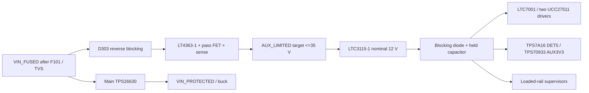

# TASK 2 — independent surge-limited control supply

**FIX3 precedence:** retained round-1/2 analysis below is historical where superseded. Current source, interlock and external-fixture circuits/status are [GATE4A_FREEZE.md](GATE4A_FREEZE.md), [FIX3_SOURCE_TRIGGER.md](FIX3_SOURCE_TRIGGER.md), [FIX3_INTERLOCK.md](FIX3_INTERLOCK.md) and [FIX3_FIXTURE.md](FIX3_FIXTURE.md). Old missing-circuit statements and retired controls are not current wiring instructions.

**ROUND-1 ANALYSIS — current charging circuit is F2-02 in [FIX2_RESOLUTIONS.md](FIX2_RESOLUTIONS.md). Retained findings below are historical where superseded. NOT FOR FABRICATION — ENGINEERING REVIEW REQUIRED.** Existing source exposure and proposed supply independence have been analyzed; startup, dynamic limiting, usable-rail thresholds and hold duration remain OPEN.

**OBSERVATION:** pinned PR15 exported netlist has D303 anode on VIN_FUSED, cathode on VIN_AUX; VIN_AUX feeds both U306/U307 IN and EN, C307 and 10 kΩ R323. It is upstream of U101. A SMCJ36CA 58.1 V pulse clamp therefore reaches this branch despite main-eFuse shutdown. The TVS's 36 V standoff is not a 36 V regulated supply. See [pinned identities](INPUT_PROVENANCE.json) and [primary register](SOURCES.md).

**EVIDENCE:** TPS7A16 recommends IN ≤60 V and EN ≤40 V; C307 is specified as 1 µF/50 V. At an ASSUMED 0.5 V D303 drop the old node is CALCULATED 57.6 V, exceeding the EN recommendation and capacitor rating; IN alone remains within its 60 V recommendation. Old R323 dissipates CALCULATED 331.8 mW nominal at that voltage, before tolerance, beyond an ordinary 100 mW 0603 construction. An absolute-maximum IN/EN headline is not operating permission. [TI TPS7A16](https://www.ti.com/lit/ds/symlink/tps7a16.pdf).

**DECISION:** keep a separate adjustable surge stopper followed by the 12 V buck-boost, upstream of the main eFuse. Feeding this branch solely from VIN_PROTECTED would remove control power precisely when source isolation acts; hold-up could cover a short interval but not sustained source-off status or deliberate re-arm. No connection from raw/protected 5 V output or host power is credited.

Candidate connection/order details, including exact MPNs, are S03-11…15/17 in [FREEZE_TABLE.md](FREEZE_TABLE.md). D303 is retained; proposed U316 LT4363HMS-1#PBF controls Q316 FDB33N25TM. Use 100 kΩ/4.32 kΩ OUT-to-GND FB divider, 0.33 Ω sense, gate resistor and fault timer following manufacturer pin-specific SNS/OUT placement. Do not swap SNS/OUT or leave SHDN/UV control undefined. [ADI LT4363 Rev C](https://www.analog.com/media/en/technical-documentation/data-sheets/4363fb.pdf) is the reference for the functional block; exact pins/lands and startup are not captured.

**CALCULATED static screen:** `Vlimit = VFB(1+Rt/Rb) ± |IFB|Rt`. With the published 1.25…1.30 V table values/±1 µA and ASSUMED independent ±0.25% hot resistors, the screen is **29.940620…31.643683 V**, nominal **30.788889 V**. These are test-conditioned transfers, not a dynamic/hot limit. A ≤35 V implementation leaves **3.356317 V** above that upper screen for dynamic overshoot and unmodeled errors. Qualification must prove the complete maximum ≤35 V; the 40 V buck-boost operating ceiling leaves another 5 V but is not the permitted branch target. C307 becomes a real 50 V candidate on AUX_LIMITED; R323 becomes a real 1206 candidate there; U306 IN and EN both move to DRV_HOLD, while U307/divider are DNP in the proposed driver path. EN must never exceed IN. The change register's old EN destination must not be read as permission to leave EN on AUX_LIMITED while IN moves lower.

**CALCULATED current/thermal screens:** nominal 50 mV/0.33 Ω ≈151.5 mA. Separate published 12/48 V threshold test points yield a transferred upper sensitivity 58 mV/(0.33 Ω·0.99)=177.533 mA; no guaranteed full 9…58.1 V threshold envelope is inferred. At ASSUMED 40 mA/12 V control, 80% conversion efficiency and 8 V after branch losses, input is 75 mA before stopper/converter consumption and startup. At 58.1 V input/31.644 V limited output/177.533 mA, pass-FET dissipation is about 4.70 W while limiting. `Epass=integral(VDS·ID dt)` and the actual hot SOA/time/repetition must be reviewed; 250 V breakdown alone does not establish linear survival. [onsemi FDB33N25/D Rev 3](https://www.onsemi.com/pdf/datasheet/fdb33n25-d.pdf). Actual D303 peak/reverse current, raw pass-device/control-pin exposure, downstream short and branch backfeed remain OPEN.

**PROPOSED 12 V block:** adapt the LTC3115 Rev E p38 6…40 V/12 V example with 4.7 µH 7447789004, 1 MΩ/90.9 kΩ feedback, 23.7 kΩ frequency setting and the specified compensation/bootstrap/decoupling. Full exact C/pin assignment and biased effective input/output C are required. RUN must permit startup at 9 V after D303/pass/sense losses; copying a 10 V demo UVLO defeats this requirement. With published feedback 0.977…1.017 V, 50 nA bias allowance and ASSUMED ±0.25% hot divider values, CALCULATED static screen is **11.621343…12.311325 V**, before additional regulation/dynamics. This is not a loaded-rail guarantee. [ADI LTC3115-1 Rev E](https://www.analog.com/media/en/technical-documentation/data-sheets/LTC3115-1.pdf).

**OPEN startup flaw in the recovered values:** the proposed two 220 µF hold capacitors store CALCULATED 31.68 mJ at 12 V, before other output capacitance. With ASSUMED 9 ms charging, the capacitor alone averages 488.9 mA input at 12 V output/80% efficiency/9 V input; actual peak can be higher. That exceeds the 151.5 mA nominal stopper limit. A 10 nF TMR is therefore **not frozen**. At the manufacturer's high-stress OC test current 310 µA and gate-off threshold 1.335 V, `C·V/I` is only CALCULATED 43.065 µs; that test point is not a prediction at startup. Select controlled precharge/current limit/timer together with pass-FET SOA and converter input-loop/startup behavior. Increasing TMR blindly can over-stress Q316 in a sustained surge. Startup requires measurement before ARM, not a claimed 9 ms deadline. This is a flaw in tentative values, not in the upstream independent architecture.

**M01 hold-up:** proposed D304 B260-13-F prevents the held rail discharging back into the converter; 2×EEU-FR1E221 nominal 440 µF is not its guaranteed effective C. ASSUMED qualification allocation: effective ≥300 µF, start ≥11.2 V, useful floor ≥10.5 V, total load ≤40 mA including both disposal drivers, logic, references/supervisors/leakage, gate event ≤2.036 µC. `thold=(Ceff·(Vstart−Vfloor)−Qgate)/Icontrol` gives CALCULATED **5.1991 ms**. The gate-charge allocation is a reserve, not a new BSC034 hot maximum. Total actual charge/load/decay duration remain OPEN. The calculated buck-boost minimum minus ASSUMED 0.5 V diode is only 11.121343 V, below the 11.2 V premise: qualify diode/start voltage or recompute; do not claim the 5.1991 ms as guaranteed. With that 11.121343 V and otherwise identical assumptions the sensitivity is 4.609176 ms.

**Current supervisor candidates:** R362/R363=249 kΩ/10 kΩ and R364/R365=100 kΩ/10 kΩ replace the rejected 261 kΩ/113 kΩ tops (and the partial fix’s 110 kΩ detector top). With published ±2% threshold, ±25 nA SENSE current and declared ±0.25% resistor screen, falling thresholds are 10.224179…10.757090 V and 4.343598…4.567313 V. Their 20 µs typical response is not a maximum. These monitor startup/state only until measured action plus hold margin establishes the valid operating floor. U322/U323 use 3V3_AUX on VDD, MR=3V3_AUX, CT open, RESET pull-ups to DET5; their own supply-loss behavior remains T15. U318 TPS709 EN is intentionally NC (default-enable), never tied to 12 V. Exact bypass/pins are in the freeze register.

**Loaded-bootstrap change:** R305=2 MΩ (`TNPW12062M00BEEA`) replaces the rejected 220 kΩ; its 10 V maximum screened load falls from 45.455 µA nominal to 5.013 µA. C301, not C302, is 1 µF BST–TS. This removes the explicit bleed overload but does not transfer LTC7001's TS=20 V pump guarantee to TS≈5 V. T04 must measure continuous loaded VGS and T07 the total rail load.

**Remaining paper prerequisites:** select and review the controlled-charge/timer circuit and pass-FET hot SOA, finish LTC3115 RUN/compensation pin capture and fault-priority/rail-loss interlock. C350 is an identified 10 nF `C1608C0G1H103J080AA` candidate, still **NOT FROZEN** as a timer value. Increasing it without SOA or adding a nominal precharge resistor without including converter/control load does not close startup. Tests T07A/T07B/T14A/T14B in [TEST_PLAN.md](TEST_PLAN.md) define physical closure after those prerequisites. 58.1 V is a bounded aux-only development pulse, not an indefinite field requirement or permission to expose the main buck.

**Behavior check when main eFuse is off:** topology preserves DC input power to U316/U317/DRV_HOLD/DET5/AUX3V3 because it branches before U101. Its source does not depend on BUCK_PG or VOUT. On main-eFuse off alone it should therefore continue operating (**HYPOTHESIS**, test under maximum control load). On raw-input removal, surge-stopper timer trip, reverse input or brownout, only separately qualified hold energy is available. Maintain default-off gates/SHDN and disarmed startup; never let loss/return of rail permission clear a persistent fault automatically. Hold-up must last through L201/current-tail and both capacitor discharges, not just a digital latch edge. Measure rails, source-referenced VGS and actual load with the source disconnected and the main eFuse off separately.

## Third-resume startup and release checks

**CALCULATION:** with the upper initial hold capacitance528µF and a linearly rising0→12V output in the converter’s **typical**9ms, `Icap=CΔV/Δt=0.704A`. At the end of that ramp,12V/40mA controls and assumed80% efficiency/9V input give `(12×0.704+0.48)/(0.8×9)=1.240A` input, versus177.533mA in the transferred stopper upper screen. The corresponding average is0.653333A. Capacitor energy alone understates the end-of-ramp demand. LTC3115 RevE does not specify9ms as a guaranteed minimum, so these are failure sensitivities, not design maxima.

**DECISION:** C350 stays an identified **unfrozen**10nF candidate. Neither a bigger timer nor an input gate capacitor is accepted as a complete correction: a gate capacitor slows the stopper output, but U317 can still start its own fixed soft-start after RUN; increasing current limit also requires replacing/requalifying D303 and Q316 hot SOA. A controlled held-bank charger with separately defined control enable, or a differently rated auxiliary supply, requires a full new circuit review. T07C characterizes startup current first on an independently bounded converter coupon; T07A remains blocked pending that circuit. No missing guaranteed startup time/efficiency/SOA is supplied by assumption.

**Rising threshold correction:** TPS3808 hysteresis was missing from the partial freeze. R364 now100k (`TNPW0603100KBEEA`) with R36510k; falling4.343598…4.567313V and conservative rising maximum4.704333V. The superseded110k network could require5.132216V to release and reject a5V rail. Held249k/10k rising maximum11.079803V leaves only41.540mV against the conditional initial rail. CT-open release12…28ms is test-conditioned. Neither monitor is credited with fast loss-of-rail protection. See T07/T15.

## Round-2 active delta

S03-18 selects U327 slew-controlled charging between D304 and DRV_HOLD, with exact pins/parts and a 107.014 mA conditional input screen. U316 ENOUT now qualifies converter RUN. C350 10 nF is selected for the isolated candidate; T07D verifies slew, current, startup and thermal behavior. The 43.065 µs zero-initial-TMR example above is historical; correct OC timing uses the measured initial timer voltage. No prolonged surge ride-through is inferred. U327 initial local ambient≤70°C; the 85°C flat-power thermal sensitivity fails. [F2-02](FIX2_RESOLUTIONS.md) is authoritative for these deltas.

F2-05 completes the two compensation branches and changes R345 to 383 kΩ. R343/C356 connect VC to FB through their series junction; R344/C357 connect AUX_12V to FB as a separate series branch parallel with R340. Neither capacitor is a VC-to-ground substitute. The old 464 kΩ RUN network fails the 7.5 V screen when adverse leakage is included; the new conditional upper start point is 7.261862 V. T07E owns actual leakage, the sub-6 V startup interval, VCC charging while ENOUT is low, effective C and loop dynamics. The compensation wiring is selected; fast rail-loss/reset ownership remains unimplemented. No measured startup, gain/phase or hold-up result is asserted.

**Current resume supplement:** F2-10/F2-11 add explicit PG and fixture-bleeder loads; T07 must meet its total 40 mA ceiling with these included. F2-12/T07F adds the pass-FET branch-current/SOA check. The new Sheet03 handoff is evidence only (F2-09).
