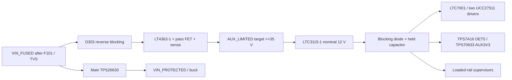

# TASK 2 — independent surge-limited control supply

**VERDICT: retain the architecture; component-level capture BLOCKED. NOT FOR FABRICATION — ENGINEERING REVIEW REQUIRED.** Existing source exposure and proposed supply independence have been analyzed; startup, dynamic limiting, usable-rail thresholds and hold duration remain OPEN.

**OBSERVATION:** pinned PR15 exported netlist has D303 anode on VIN_FUSED, cathode on VIN_AUX; VIN_AUX feeds both U306/U307 IN and EN, C307 and 10 kΩ R323. It is upstream of U101. A SMCJ36CA 58.1 V pulse clamp therefore reaches this branch despite main-eFuse shutdown. The TVS's 36 V standoff is not a 36 V regulated supply. See [pinned identities](INPUT_PROVENANCE.json) and [primary register](SOURCES.md).

**EVIDENCE:** TPS7A16 recommends IN ≤60 V and EN ≤40 V; C307 is specified as 1 µF/50 V. At an ASSUMED 0.5 V D303 drop the old node is CALCULATED 57.6 V, exceeding those recommendations/capacitor rating. Old R323 dissipates CALCULATED 331.8 mW nominal at that voltage, before tolerance, beyond an ordinary 100 mW 0603 construction. An absolute-maximum IN/EN headline is not operating permission. [TI TPS7A16](https://www.ti.com/lit/ds/symlink/tps7a16.pdf).

**DECISION:** keep a separate adjustable surge stopper followed by the 12 V buck-boost, upstream of the main eFuse. Feeding this branch solely from VIN_PROTECTED would remove control power precisely when source isolation acts; hold-up could cover a short interval but not sustained source-off status or deliberate re-arm. No connection from raw/protected 5 V output or host power is credited.

Candidate connection/order details, including exact MPNs, are S03-11…15/17 in [FREEZE_TABLE.md](FREEZE_TABLE.md). D303 is retained; proposed U316 LT4363HMS-1#PBF controls Q316 FDB33N25TM. Use 100 kΩ/4.32 kΩ OUT-to-GND FB divider, 0.33 Ω sense, gate resistor and fault timer following manufacturer pin-specific SNS/OUT placement. Do not swap SNS/OUT or leave SHDN/UV control undefined. [ADI LT4363 Rev C](https://www.analog.com/media/en/technical-documentation/data-sheets/4363fb.pdf) is the reference for the functional block; exact pins/lands and startup are not captured.

**CALCULATED static screen:** `Vlimit = VFB(1+Rt/Rb) ± |IFB|Rt`. With the published 1.25…1.30 V table values/±1 µA and ASSUMED independent ±0.25% hot resistors, the screen is **29.940620…31.643683 V**, nominal **30.788889 V**. These are test-conditioned transfers, not a dynamic/hot limit. A ≤35 V implementation leaves **3.356317 V** above that upper screen for dynamic overshoot and unmodeled errors. Qualification must prove the complete maximum ≤35 V; the 40 V buck-boost operating ceiling leaves another 5 V but is not the permitted branch target. C307 becomes a real 50 V candidate on AUX_LIMITED; R323 becomes a real 1206 candidate there; U306 IN and EN both move to DRV_HOLD, while U307/divider are DNP in the proposed driver path. EN must never exceed IN. The change register's old EN destination must not be read as permission to leave EN on AUX_LIMITED while IN moves lower.

**CALCULATED current/thermal screens:** nominal 50 mV/0.33 Ω ≈151.5 mA. Separate published 12/48 V threshold test points yield a transferred upper sensitivity 58 mV/(0.33 Ω·0.99)=177.533 mA; no guaranteed full 9…58.1 V threshold envelope is inferred. At ASSUMED 40 mA/12 V control, 80% conversion efficiency and 8 V after branch losses, input is 75 mA before stopper/converter consumption and startup. At 58.1 V input/31.644 V limited output/177.533 mA, pass-FET dissipation is about 4.70 W while limiting. `Epass=integral(VDS·ID dt)` and the actual hot SOA/time/repetition must be reviewed; 250 V breakdown alone does not establish linear survival. [onsemi FDB33N25/D Rev 3](https://www.onsemi.com/pdf/datasheet/fdb33n25-d.pdf). Actual D303 peak/reverse current, raw pass-device/control-pin exposure, downstream short and branch backfeed remain OPEN.

**PROPOSED 12 V block:** adapt the LTC3115 Rev E p38 6…40 V/12 V example with 4.7 µH 7447789004, 1 MΩ/90.9 kΩ feedback, 23.7 kΩ frequency setting and the specified compensation/bootstrap/decoupling. Full exact C/pin assignment and biased effective input/output C are required. RUN must permit startup at 9 V after D303/pass/sense losses; copying a 10 V demo UVLO defeats this requirement. With published feedback 0.977…1.017 V, 50 nA bias allowance and ASSUMED ±0.25% hot divider values, CALCULATED static screen is **11.621343…12.311325 V**, before additional regulation/dynamics. This is not a loaded-rail guarantee. [ADI LTC3115-1 Rev E](https://www.analog.com/media/en/technical-documentation/data-sheets/LTC3115-1.pdf).

**OPEN startup flaw in the recovered values:** the proposed two 220 µF hold capacitors store CALCULATED 31.68 mJ at 12 V, before other output capacitance. With ASSUMED 9 ms charging, the capacitor alone averages 488.9 mA input at 12 V output/80% efficiency/9 V input; actual peak can be higher. That exceeds the 151.5 mA nominal stopper limit. A 10 nF TMR is therefore **not frozen**. At the manufacturer's high-stress OC test current 310 µA and gate-off threshold 1.335 V, `C·V/I` is only CALCULATED 43.065 µs; that test point is not a prediction at startup. Select controlled precharge/current limit/timer together with pass-FET SOA and converter input-loop/startup behavior. Increasing TMR blindly can over-stress Q316 in a sustained surge. Startup requires measurement before ARM, not a claimed 9 ms deadline. This is a flaw in tentative values, not in the upstream independent architecture.

**M01 hold-up:** proposed D304 B260-13-F prevents the held rail discharging back into the converter; 2×EEU-FR1E221 nominal 440 µF is not its guaranteed effective C. ASSUMED qualification allocation: effective ≥300 µF, start ≥11.2 V, useful floor ≥10.5 V, total load ≤40 mA including both disposal drivers, logic, references/supervisors/leakage, gate event ≤2.036 µC. `thold=(Ceff·(Vstart−Vfloor)−Qgate)/Icontrol` gives CALCULATED **5.1991 ms**. The gate-charge allocation is a reserve, not a new BSC034 hot maximum. Total actual charge/load/decay duration remain OPEN. The calculated buck-boost minimum minus ASSUMED 0.5 V diode is only 11.121343 V, below the 11.2 V premise: qualify diode/start voltage or recompute; do not claim the 5.1991 ms as guaranteed. With that 11.121343 V and otherwise identical assumptions the sensitivity is 4.609176 ms.

**OPEN supervisor flaw:** proposed TPS3808G01 261 kΩ/10 kΩ and 113 kΩ/10 kΩ give nominal falling thresholds **10.9755 V /4.9815 V**. Including published ±2% threshold accuracy, ±25 nA SENSE bias and ASSUMED ±0.25% divider corners gives CALCULATED **10.697782…11.255596 V /4.856669…5.107361 V**. The high driver corner can reject the low held-rail screen; the detector high corner can reject a healthy DET5 corner. Its typical 20 µs response provides no complete maximum. In addition, DET5 lower screen does not establish the comparator's cited 5 V delay condition. Select/reprogram thresholds with actual valid timing floors and response maxima, or qualify the full comparator/driver timing at a lower rail. Bootstrap drop/loaded VGS≥10 V is a separate proof. Neither proposed divider is frozen.

**Behavior check when main eFuse is off:** topology preserves DC input power to U316/U317/DRV_HOLD/DET5/AUX3V3 because it branches before U101. Its source does not depend on BUCK_PG or VOUT. On main-eFuse off alone it should therefore continue operating (**HYPOTHESIS**, test under maximum control load). On raw-input removal, surge-stopper timer trip, reverse input or brownout, only separately qualified hold energy is available. Maintain default-off gates/SHDN and disarmed startup; never let loss/return of rail permission clear a persistent fault automatically. Hold-up must last through L201/current-tail and both capacitor discharges, not just a digital latch edge. Measure rails, source-referenced VGS and actual load with the source disconnected and the main eFuse off separately.
