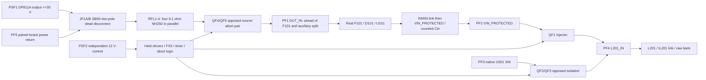

# FIX3-3 — external fault fixture and board interface

**DECISION: external bench equipment, separate from the test-board BOM. Design candidate with explicit rating screens; NOT BUILT / NOT QUALIFIED. NOT FOR FABRICATION — ENGINEERING REVIEW REQUIRED.** This completes the missing fixture wiring description from the partial commits. It does not grant a hot-SOA or abort-timing PASS. External fixture qualification does **not** block schematic capture of the board's isolated hooks; it blocks connecting an energized force path. The board's separate source-coverage/interlock blockers remain in GATE4A_FREEZE.md.

[FIX3_FIXTURE_BOM.csv](FIX3_FIXTURE_BOM.csv) and [FIX3_FIXTURE_NETLIST.csv](FIX3_FIXTURE_NETLIST.csv), generated by `render_fix3_fixture.py`, specify every fixture component and electrical pin. `NC` is explicitly unconnected, not a common net. `FGND` joins board power GND at PF5 only; FAR_GND remains the real harness return. No fixture connection carries FAR_GND back to PF5. The RFD01…12 adapter references are the existing round-2 reservations, not twelve additional loads. Series control accessories S601/J601…604 belong to the interlock contract, not this fixture controller.

## Wiring and source boundaries

The main-source connector is removed only after STOP, supply output OFF, current cessation and verified discharge; it is not the microsecond abort. Both poles physically separate source positive and return. Protective earth is never disconnected. PSF2 negative joins FGND at the same power-return star; its positive powers only UF1…3/UF10 and logic. No other control or instrument supply may feed VIN_PROTECTED/L201_IN. Record all control-to-force charge transfer.

Each NH250 is individually mounted on a **12 × 12 × 0.125 inch aluminum panel** (HF1…4), with manufacturer mounting geometry, thermal interface and airflow maintained; never place four devices on one panel and retain four full ratings. The feeder uses Belden 9906 6 AWG, Anderson 5900 contacts and 1309G4 tool; verify the exact cut length, insulation clearance, strip/crimp construction and polarity in the assembly traveler. House the force network and exposed resistor studs behind an insulating cover. The current envelope is a resistor bound; no instantaneous current limit is inferred from PSF1's 5 A setting.

PF1…5 are separately insulated M4 copper landing pads. BF1 is an authored C110 strap set: 2 mm thick × 15 mm wide, each span ≤30 mm, 4.5 mm holes on 20 mm pitch; M4×12 A2-70 bolts, two 4.3/9/0.8 mm washers and an all-metal M4 nut per joint (MF1). Clamp flat mating copper, with no solder-only structural joint. Four-wire resistance **≤0.2 mΩ per joint** and injection-loop inductance **≤40 nH** are acceptance allocations, not inferred from dimensions or a claimed standardized connector rating. The PCB fixture FETs use their reviewed TDSON-8 pads and thermal copper; a busbar drawing is not that land review. Board-side copper/bolt clearances are reviewed during later layout.

QF4/QF5 source pair: outer drains FX_LIMITED and DUT_IN; common sources FX_SOURCE_MID. QF2/QF3: outer drains native SW and L201_IN; common sources FX_ISO_MID. QF1: drain VIN_PROTECTED, source L201_IN. Thus its body diode permits a return from L201_IN to VIN_PROTECTED after OFF; it is **not bidirectional isolation**. Count this return, local input recharge and negative current. QF2/3 and QF4/5 oppose body diodes. DF1 returns negative L201_IN to FGND; DF2 does the same at DUT_IN; both STPS60H100CT use pins 1/3 as anodes and pin 2/tab as cathode. Insulate live tabs from common heatsinks. DF3 SMCJ30CA is only the external FX_LIMITED transient clamp; it does not replace board D101 SMCJ36CA.

## Autonomous fixture sequence and pin ownership

UF1…3 are LTC7001IMSE#PBF with exact pin maps in the CSV: isolated local 10 µF supply reservoirs, 143 kΩ UVLO set, 1 µF BST–TS, BAS116 bootstrap diode, 1 Ω turn-on resistor, direct TGDN sink, 2 MΩ gate bleed, 1 kΩ command series and 10 kΩ command pulldown. **Corrected RF21…23 to TNPW12062M00BEEA**: a 2 MΩ TNPW0603 code is unsupported. **RF11…13 use TNPW06031R00FEEA (1%, 25 ppm/K)**: the B/0.1% range starts at 3.5 Ω. Pulse energy remains a separate gate-resistor check. All 0603 general-mode DC ceilings are 110 mW, not the earlier blanket 125 mW.

UF10 supplies FX5=5.05832 V nominal, UF11 provides POR, and UF13 compares the loaded FX12 divider against the separate DF40 shunt through UF14 isolation. RF52 is now 100 kΩ, matching the R609 POR-loading correction. FX12 monitoring, held driver rails and logic are independent of board DET5/SAFE5. FX_READY is not credited before reference and timer startup have settled; T12F3 establishes at least 100 ms stable valid supplies before the manual sequence. Loss of FX12 removes FX_READY; driver reservoirs allow turn-off. Intermediate-supply behavior and actual UVLO action require the same plateau/abrupt-loss checks as the board interlock.

UF20 is the fixture ARM latch: /PRE=FX5 permanently, /CLR=RESET_N AND FX_READY AND STOP_OK AND NOT_ABORT. Its D=NOT_SHOT. UF21 is the persistent SHOT latch; its D=SHOT OR START_OK, with CLK=FIRE_EDGE and /CLR=RESET_N AND FX_READY. START_OK requires genuine DUT_PG_OK, DUT_PERMISSION and FX_ARMED. UF24 qualifies SHOT for nominal 2 µs dead time; UF25 qualifies it for nominal 16 µs emergency abort. Both are hardware LTC6994-1 timers. Manual input toggles are Schmitt conditioned; contact bounce can cause extra edges but cannot clear SHOT or restart after ABORT without RESET. T12F3 must verify simultaneous/bouncing controls and asynchronous pulse widths; no software or USB command is safety authority.

**Final-resume correction:** UF33 samples START_OK on DEAD_READY rising. INJECT_CMD=FX_ARMED AND UF33.Q. Thus real PG/permission is checked again after isolation dead time. Once injection starts, later board PG loss does not open the simulated failed high-side and falsely rescue the DUT. Neither a FIRE edge nor an emergency-abort signal enters board FAULT/SRC_TRIP/SHDN. A loss of genuine PG during the handover suppresses injection and marks the attempt invalid.

| Fixture state | Source pair QF4/5 | Native pair QF2/3 | QF1 injection | Required action |
|---|---|---|---|---|
| Unpowered, STOP, RESET, invalid rail | OFF by logic/UVLO/bleeds | OFF | OFF | Physical disconnect before handling; verify all stores |
| Qualified controls, RESET released, fresh ARM | ON | ON | OFF | Board separately completes DIAG/RESET/RUN/ARM; real PG must rise |
| FIRE with START_OK=0 | Previous state | Previous state | OFF | No SHOT; investigate missing genuine permission |
| Accepted FIRE / SHOT=1 | ON | OFF | OFF | Fixed dead interval, already qualified for physical isolation |
| DEAD_READY edge and START_OK still true | ON | OFF | ON | Timestamp t0 from actual QF1 conduction, not FIRE |
| SHOT and subsequent PG loss | ON until abort | OFF | Remains ON until abort | Board must contain fault itself; record genuine fault response |
| ABORT / control loss / STOP | OFF | OFF | OFF | L201 and all downstream stores still require disposal |
| FIRE/ARM repeatedly held or bounced after ABORT | OFF | OFF | OFF | SHOT remains latched; deliberate RESET then new ARM required |

There is no real-time analog isolation detector in this candidate. The fixed dead time is acceptable only after **T12F3 proves native-pair current extinction ≤1.50 µs** for every allowed supply/gate/load condition, below the timer minimum 1.8710755 µs. If isolation is later or uncertain, do not enable QF1; revise the timing/circuit and recalculate abort margin. A digital OFF command alone is insufficient evidence.

## Equations, worst-case screens and rating conditions

All numbers are generated in FIX3_CALCULATIONS.json. Limits below are **development allocations to verify**, not new product requirements. The 30 V fixture ceiling is an abnormal source sizing bound; DUT normal input remains 9–26 V and 27 V keeps its existing OVP policy. No 58.1 V aux surge is allowed on this fixture. T14A needs a separate 60 V source fixture.

| Path / calculation | Worst-case screen | Applicable evidence and unclosed transfer |
|---|---|---|
| Passive limiter | `Rmin=9.1[1−0.01−50ppm×225]/4=2.22665625 Ω`; with PS≤30 V and limited node≥−1 V, `I≤31/Rmin=13.922221 A`, rounded ceiling 14 A | Vishay 30201, 02-Sep-2026, p1 TCR/range, pp2–3 order/mount, p4 mounted derating. Includes winding temperature up to 250°C; final DC resistance/current/temperature verify T12F3. Negative node below −1 V invalidates this current box. |
| Each limiter resistor | `P≤31²/[9.1(1−0.02125)]=107.897211 W`; mounted 70°C derating screen `250(250−70)/(250−25)=200 W` | Below mounted screen; **above** unmounted 100 W at 25°C. Correct panel and measured thermal result are mandatory. NH2509R100FE01 is noninductive, 1%, 9.1 Ω; do not credit a winding as zero inductance. |
| Dead time / abort | 2 µs timer: 1.871076…2.129576 µs; 16 µs timer: 15.255848…16.747848 µs | LTC6994 Rev C p3 ±6.2% / ±4.4%, independent resistor ±0.2625%; code0 / code1. Actual load, startup and transfer must match/qualify. |
| Physical abort | Timer maximum + 2.0 µs logic/gate/current allocation +25 ns uncertainty = **18.772848 µs from SHOT**; require **≤20 µs from physical t0** | Earliest intended abort relative to t0 is 15.255848−(2.129576+0.5)=**12.626273 µs**, preserving the DUT 10 µs window. Require onset within dead-ready+0.5 µs. STOP may abort sooner, but such a run is invalid for DUT PASS. Allocation, not a guaranteed driver/current time. |
| Local energy | `Eadd=½33µF·30² +30·14·20µs +½12µH·8² +½1µF·14² +½40nH·100² +0.1mJ` = **24.032 mJ** | 33 µF includes DUT main Cin≤30 µF plus fixture/stray ≤3 µF; no bypass reservoirs. The 1 µF transfer and 0.1 mJ miscellaneous allowance must bound actual control/feeder coupling; full FX12 reservoirs are not assumed directly coupled. If they are, recalculate. |
| Connected-bank pool | Add `½(5.59656+2.7072+2.64)mF·5.5²` → **189.556370 mJ** | Worst separate destination screen; add any uncounted source/store. Does not mean all maxima occur in one trajectory. |
| First positive L201 interval | `sqrt(2Eadd/5µH)=98.044888 A` | Supports a **conditional 100 A forward screen** only. Raw-bank return can produce a larger negative/coupled interval: `sqrt(2Econnected/5µH)≈275.36 A`. The 5 µH floor is unqualified beyond 100 A, so this is a warning sensitivity, not a valid extended-domain bound. T12F3 must measure/review the full return path before integrated energy. |
| No-dump raw peak | `sqrt(5.5²+2Eadd/2.4064mF)+100·4mΩ+20mV=7.506847 V` | Emergency fixture envelope can exceed the DUT's 6.9 V raw acceptance. A 20 µs rescue cannot give DUT containment PASS. Passive fixture surrogate must be rated for this higher envelope and possible negative excursions. |
| QF1…3 forward conduction | At assumed hot RDS≤6.8 mΩ: `100²·R·20µs=1.36 mJ/device`; 50 V×100 A×1 µs overlap sensitivity =5 mJ | Infineon Rev2.3 pp3–4 and p6 SOA: 60 V, ±20 V gate, 150°C junction, 448 A pulse **at specified conditions**. 6.8 mΩ hot and 1 µs overlap are allocations. They do not qualify hot linear SOA, reverse interval or repetition. |
| QF4/5 and contact loss | `14²·6.8mΩ·20µs=26.656 µJ/device`; `100²·0.2mΩ·20µs=40 µJ/joint` | Same waveform limits; copper joint thermal/mechanical qualification cannot be replaced by this small energy number. |
| DF1/2, DF3 | STPS60H100CT 100 V dual common cathode; SMCJ30CA 30 V standoff, 48.4 V at 31 A stated pulse | ST DS3978 Rev3 pp1–4; Littelfuse SMCJ JC.02/27/25 v2 electrical row. Require measured FET VDS+U≤50 V and |VGS|+U<20 V; actual hot clamp, reverse current, each-die sharing and SOA remain OPEN. No avalanche credit. |

The feeder current rating does not qualify the fixture FET loop's pulse. Anderson DS-SB50 Rev8 pp1–3/7 supports the wire-contact family and tooling; the ≤14 A feeder is deliberately separate from the local ≈100 A forward injection loop. Belden 9906 Rev0.476 (20-Feb-2026) specifies 6 AWG/133×27, 600 V/105°C; keep feeder and disconnect local ambient≤40°C. No manufacturer wire/contact current is transferred to an unreviewed PCB land.

**Source setpoint versus DUT input:** 9 V at PSF1 across this resistance can deliver at most `9²/(4Rmin)=9.094354 W`; it cannot establish 25.5 W output. Establish each matrix voltage at the **DUT connector**, adjusting PSF1 while remaining ≤30 V and keeping all local capacitors counted. At 26 V/25.5 W ideal input, nominal-high R needs about 28.278664 V at PSF1; efficiency, auxiliary power and other losses add to that. Characterize constant-power stability and source droop at 9 V; it is not a stiff-source test. If the required voltage/load cannot be held inside the source ceiling, mark that matrix point NOT EXECUTABLE and revise the external source fixture. Never bypass the limiter while armed or silently call a lower load a 5 A result. Independent normal-operation source tests retain their own approved boundary.

## Disconnect, discharge and capture hooks

RFD01…12 retain the independent round-2 node/return maps. RFD13…18 add SAFE_IN, SAFE5, SER_DRV, safety reference, FX_LOGIC_IN and FX5, each 10 kΩ/1206. RF61…63 bleed each isolated driver supply. RFD19/20 permanently bleed FX_LIMITED and DUT_IN; their 31 V DC screen is ≤96.353 mW each. SFD1…4 connect 100 kΩ discharge resistors across **each local BST–TS**, including the board bootstrap. They remain OPEN during operation and close only after all sources are disconnected; their floating TS returns never join GND. At 14 V and Ceff≤1.2 µF, isolated 100 kΩ discharge to 0.3 V takes <0.463 s. Measure every actual island, including common-source/gate nodes, rather than assuming isolated RC decay proves the connected network.

Board capture needs five keyed/labeled force pads PF1…5, removable native-SW–L201 and main/series links, IMAIN ahead of **all** local input C, IL201 and individual dump/series current links with paired Kelvin sense, and genuine PG_GOOD / MAIN_PERMISSION observation outputs via 1 kΩ fixture input guards. It also needs the interlock's named rail/reference/zero-node/latch/SHDN/RUN/BST–TS pads and the independent local discharge pad pairs. Do not fit the external FETs, limiter or fixture controller on the DUT. Signal Phoenix headers never substitute for force pads. Main, series and injection links are **absent** for logic/rail coupon work.

## T12F3 — exactly what closes the remaining fixture evidence

**NOT RUN.** Start with controller and driver coupons, drains strapped to their local sources, no force supply/output banks. Verify supplies, all manual states, bounce, rail plateaus 0.3…1.8 V, abrupt FX12/FX5/driver-rail loss, and both held buttons. No unintended command or reconnection is allowed. Qualify loaded bootstrap at actual TS (including 30 V source-pair TS), VGS≥10 V during conduction, and every pin limit. Then use a separately rated passive surrogate, progressing only within already reviewed component voltage/current/SOA limits.

Measure resistor minimum including thermal drift, actual negative FX_LIMITED, all downstream C and feeder/loop L; prove ≤14 A positive source current, local and coupled energy boxes, physical native isolation≤1.50 µs, actual injection onset, independent QF1 and QF4/5 abort≤20 µs, and no retrigger. Deliberately disable the DUT autonomous shutdown to test the emergency ceiling **only on the passive surrogate**. Any missing hot SOA, reverse-current rating, excessive ringing, invalid source point or failed rail veto requires fixture revision before DUT connection. At integrated level, log ABORT and reject a containment PASS whenever fixture action was necessary.

T12D then removes JF1 and PSF2/control backfeed, closes floating discharge switches and requires every store |V|+U≤0.3 V within 60 s and for a further 60 s, with DUT dumps both disabled and enabled in separate trials. No timed wait alone authorizes handling. T13 supplies actual sensor/range/deskew uncertainties; target numbers are not calibration results. The 58.1 V auxiliary pulse and the real isolated 48→24 V module remain separate external work.

**Capture disposition:** source limiter, abort, dead disconnect, force assembly and discharge connections are now explicit candidates. Physical parasitics, hot switching/return SOA and control-loss behavior cannot honestly be closed on paper; the measurements and failure actions above close them. Their absence prevents fixture energization, **not capture of isolated board hooks**. The overall board freeze remains BLOCKED solely by its source-coverage and interlock construction/qualification limits. No source, gate, voltage or safety PASS is claimed.

**Provenance:** manufacturer documents and precise sections, use/adaptation, copyright, attribution and available cache hashes are in `third_party/gate4a_fix3/SOURCES.json`. This is an authored fixture using referenced functional blocks; no third-party PCB/CAD was copied and no upstream document was edited.
