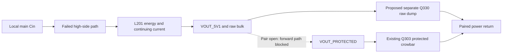
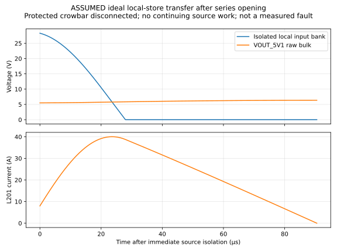

# TASK 5 — where L201 and the raw-bank energy go

**OBSERVATION:** the pinned PR15 exported netlist places C330…C337 (eight470 µF/35 V bulk capacitors), C209…C214 (six22 µF/50 V ceramics), L201 output, Q301 drain and both feedback/OV divider tops on **VOUT_5V1**. Q302 drain, R308/R310 ballast tops, R401 force input, TP302 and local telemetry-supply decoupling are on **VOUT_PROTECTED**. R308/309 and R310/311 connect through their ballast strings to Q303; Q303 source is GND. The protected node does not contain the eight bulk capacitors. Connectivity and exact netlist SHA are reproduced in [CALCULATIONS.json](CALCULATIONS.json), from commit51d1c2ff1f7eca4f20eef137c1595e4b9e052a75. No native CAD was accessed.

**DECISION:** do not credit the protected crowbar with upstream energy after opposed Q301/Q302 stop conducting. Body diodes oppose one another; they do not provide a guaranteed raw→protected disposal path when the pair is off. Coss displacement/stray inductive current can still couple across the pair and needs measurement, but it is not a rated upstream energy sink.

Before series opening, the protected crowbar can receive current from the source/L201 **and directly from the charged raw bank**, bypassing L201. Therefore a positive L201 current bound is not the protected-arrival bound. After opening, L201's positive current charges the raw bank until it decays or a **raw-side** dump diverts it. The local input bank can keep feeding a failed high-side after the main eFuse opens. Depending on the actual reverse/freewheel paths, some energy can return to the input or dissipate in DCR/ESR, body diodes and wiring; none of those unqualified losses is credited in the conservative voltage bound. Q301/Q302 current interruption and harness-current commutation have separate stray-energy destinations and SOA/voltage requirements.

**CALCULATION within the Gate3b source contract:**

`Enew ≤ ½ Cin,max Vin,max² + Vin,max Qsource,+ + ½ Ldiff,max I0²`

At ASSUMED Cin≤30 µF, local/source voltage≤28.289211 V, replenishment≤100 µC and I0≤8 A/Ldiff≤12 µH: **Enew≤15.217113 mJ**. This already includes initial magnetics and all positive new source work. Do **not** add `½ Lmax Ipeak²` to this pool again. Nor may simultaneously charged input C and maximum magnetic energy be treated as independent realized stores when deriving a trajectory. The OVP threshold is not a physical input-voltage clamp, and the fault-onset→source-off≤10 µs bound is still OPEN.

Assume a **differential** raw-bank capacitance floor across the actual voltage excursion of `Craw,min=8×470µF×0.8×0.8=2.4064mF`; ceramic minimum contributes no credited floor. These factors are an application transfer/sensitivity, not guaranteed all-temperature/life/fault C. For positive voltage and no extra source/backfeed:

`½ Craw,min (Vraw,cap²−Vraw,0²) ≤ Enew`

`Vraw,cap ≤ sqrt(Vraw,0,max² + 2Enew/Craw,min)`.

With ASSUMED initial raw≤5.5 V, **CALCULATED capacitive raw peak bound6.549596 V**. Adding ASSUMED 4 mΩ raw ESR at the independently calculated positive L201 bound78.018 A and20 mV extra ringing gives a conservative **terminal sensitivity6.881668 V**. This addition bounds separate maxima conservatively, not a predicted coincident waveform. Further local inductive/ESL spike, negative excursion, actual C/ESR and source voltage/work are OPEN; consequently **the actual VOUT_5V1 peak is OPEN**. Without the source/trigger/C/commutation conditions, there is no justified finite raw peak from this analysis.

There is no need to move the existing bank downstream merely to obtain this bound. Its low differential voltage headroom is ample **inside the stated source assumptions**: capacity from5.5 to35 V at that assumed minimum is CALCULATED1.437523 J. That is not component derating or proof that the unbounded real fault fits those assumptions. A sustained58.1 V pass-through, for example, exceeds35 V bulk and50 V ceramics; the main buck has a42 V VIN absolute limit. The AUX fix does not qualify the main-eFuse let-through at58.1 V. Test that coordination separately using reviewed voltage/time/energy limits; no such direct test is authorized by this report.

The raw bank's **existing** initial energy must still be counted when installing a raw dump: ASSUMED upper capacitance5.59656 mF at5.5 V stores CALCULATED84.647970 mJ. Maximum initial raw energy plus the conditional Enew pool is **99.865083 mJ**. This Cmax is for dump capacity; Cmin is for voltage rise. Do not put Cmax initial energy into the Cmin peak formula as though both were one realized bank. Separate protected/dummy/cable energy remains outside this raw subtotal unless the real waveform transfers it upstream.

The ideal isolated-input example below shows a specific current tail. It assumes the main source is **already isolated immediately at t=0**, pair open, constant10 µH/30 µF/2.4064 mF, initial8 A/28.289211 V/5.5 V, ideal input-ground freewheel diode and no losses. It does not include the100 µC continuing-source allowance, either crowbar, fixture inductance or reverse-current cycles. Analytic coupled-capacitor transfer until VIN reaches0 V, then ideal freewheel into raw C, gives:

- Input-ground diode begins at CALCULATED27.954677 µs.
- Positive inductor current first reaches zero at CALCULATED90.528973 µs; raw cap reaches **6.363399 V**.
- Initial input/L energy is transferred into the raw bank; analytic total-energy residual is below4×10⁻¹⁷ J in the sampled trace. Energy conservation is numerical/model evidence, not a measured hardware result.

[Standalone curve](RAW_IDEAL_TRANSFER.svg) and [sampled data](RAW_IDEAL_TRANSFER.csv) are reproducible. The protected node has no curve here because this isolated raw-node model cannot determine its peak. Its independent harness/initial-state counterexample5.542140 V remains unresolved.

| Raw-node connected element | At the conditional6.881668 V terminal screen | Actual exposure/acceptance |
|---|---|---|
| C330…337 PCH1V471MCL1GS,35 V | Voltage alone below nameplate; about19.7% utilization | C floor, derating, ESR/ESL, charge-current/ripple/temperature and fault repetition OPEN |
| C209…214 C5750X7R1H226M250KB,50 V | Voltage alone below nameplate; about13.8% utilization | Biased C, impulse current and real local spike OPEN |
| C20722 pF/50 V across feedback network | Differential voltage is below the raw-to-GND screen when FB stays positive | Fault slew/negative FB/feedforward current and resistor/node ratings OPEN |
| Q301/BSC034 pair,60 V VDS/20 V VGS | Raw voltage alone does not approach60 V | Actual common-source/gate/drain ringing and loaded turn-off SOA are independent OPEN limits |
| LM61460 FB via100k/24.4k | Nominal divider gives≈1.34914 V, below16 V FB absolute limit | Absolute limit is not operation; pin dynamics/negative excursions and VIN/SW/backfeed remain OPEN. BIAS stays grounded |
| R202/R203 feedback resistors | Low steady divider power at this screen | Negative/fast capacitively coupled waveform and actual resistor voltage/pulse limits require review |
| R301/R302→DIV→original D301/REF/TLV network | Unclamped nominal divider≈3.23083 V | Can over-stress/backpower an unpowered comparator/reference despite bulk voltage being low. Original reference-sink path is unacceptable as a proved clamp |
| Proposed isolated DIV/shunt clamp | Has a ground-return proposal, independent of REF5025 | Shunt minimum current, diode/switch leakage/charge, negative faults and comparator powered-off pin limits remain OPEN; new1M loading shifts nominal trip28.25mV |

**PROPOSED FIX:** retain the existing raw bank and protected crowbar; add the independent **raw crowbar/dump** S03-09: CSD18540Q5B/UCC27511DBVR and two parallel strings of two WFMB2512R0330FEA, commanded by the genuine fault latch using held power. Its return must be a short power loop separate from detector/reference Kelvin return. Add a reviewed negative/freewheel/stray-energy clamp as required by the measured topology; it remains an explicit unfrozen connection. Include raw dump in hold-up load, default gates off and persistent-fault truth table. It must stay commanded through safe energy decay; neither PGOOD loss nor series opening is its completion criterion.

ASSUMED hot capacity target≥0.2 J is a proposal with about2× this raw source/bank energy screen, **not** a rating of the selected parts. Raw-bank discharge alone starts approximately5.5V/33mΩ≈166.7 A before MOSFET/ESR/parasitics. L201 incoming current and resistor sharing can change that. Maximum-bank33mΩ RC is CALCULATED184.686 µs; its energy tail is longer than a100 µs headline pulse rectangle. Obtain actual hot MOSFET SOA and each ballast terminal/pulse/repetition limit (pre-pulse≤85°C, total below95°C); integrate measured current/voltage and unequal branches. The existing protected dump's evidence cannot be reused automatically for this new bank discharge.

**Receiving-bank flaw:** proposed four additional PCH capacitors are1.88 mF nominal; the manufacturer's14 mΩ20°C/100kHz row gives3.5 mΩ in parallel, and28 mΩ after-endurance/−40°C row gives7 mΩ. This is materially above the inherited0.5 mΩ protected ESR allocation. Nominal C also exceeds the inherited1.5 mF upper allocation. In the inherited conditional80 A/0.5 µs/5.38 V/20 mV screen, the candidate minimum1.2032 mF and3.5 mΩ give **5.713245 V**, exceeding5.5 V. The legacy5.38 V static clamp is itself an unqualified allocation for this crowbar. This is a calculation explaining why the old20 mV margin cannot be carried over, not a prediction that the actual four-cap board peaks there. Select/recompute receiving C/ESR, actual arriving-bank current and the complete harness trajectory before freezing. [Nichicon PCH primary catalog](https://www.nichicon.co.jp/english/_assets/images/products/catalog/corporate/digital/PCH_e.pdf).

**Conclusion/OPEN RISK:** the upstream bank can absorb the calculated magnetic/input energy without35 V voltage overstress under the stated source/C/spike assumptions. That does not close detector partial-power stress, autonomous source triggering, raw discharge/negative returns, protected arrival, hot SOA or far-end5.5 V. Add the proposed independent raw disposal path and complete those proofs/tests; **capture freeze remains BLOCKED**.

## Current R4A-09 correction

Theoriginal33mΩrawdump proposalissuperseded by66mΩ: eightWFMB2512R0330FEA, twofour-resistorstringsparallel, Q330CSD18540Q5B/U330UCC27511. D330B260localnegative/strayreturnisdefinedanodeGND/cathoderaw. Protected33mΩdumpdoesnotchange. Atconditional6.881668V, rawinitialcurrent screen105.321A instead of210.642A; maxRC373.067µs and0.5Vdecay978.184µs, so100µspulseheadline cannotqualifylongtail. Equalsharing12.483mJperresistor isnotahotrating. T09mustclosehotpulse/SOA/negativepaths andeveryrawconnectedpin, preservingtheoriginalenergyfailureevidence. Missingapplicableratingsblocksfullenergytest; measuredsurvivalaloneisnotvalidation.
