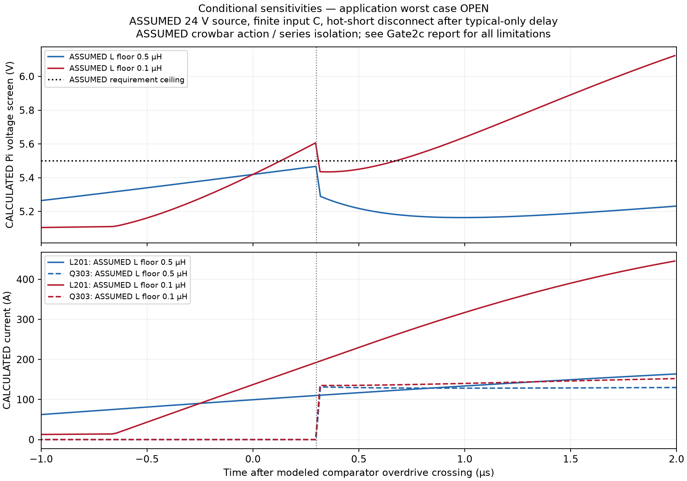

# Gate 2c — independent review closure and honest bounds

**STATUS: BLOCKED. PRELIMINARY — R2/R3 BLOCKED — NOT FOR FABRICATION.**

Gate2c owns analysis and documentation on `feat/sheet03-gate2c`, based on
`c47409fb2637c94ccaa685c3ac4cbbd10681d5a2`. No native KiCad schematic, board or
symbol file was opened or saved. Circuit observations use the existing exported
[XML](V1A_gate2.net.xml) and input/buck/output component contracts. The independent
[input review](gate2c/INDEPENDENT_REVIEW_INPUT.md) is preserved verbatim; its SHA256
is `2de2180bb3db2b4b3651078cdae9d9e1eb6ab1c34e15d6571b913bfc19fb401f`.
The exported XML hash is recorded in `gate_2c` of [CALCULATIONS.json](CALCULATIONS.json).
This is analysis closure: an OPEN physical premise has not become validated behavior.

## Quantity labels and authority

**DATASHEET** identifies a manufacturer specification; its test condition and
typical/minimum/maximum status are essential. **CALCULATED (worst-case)** below
means an extremum within the expressly listed input box, which includes
**ASSUMED** allocations. Such a calculation does not establish the application
worst case. **CALCULATED (typical only)** uses characterization/typical quantities.
**OPEN** means no applicable bound; JSON stores it as `null`, never as zero.
**ASSUMED** identifies an unqualified model input or design target.

The frozen GPIO power requirements are **ASSUMED, user-supplied requirements**:
normal input **9–24 V**, Pi peak **strictly below 5.5 V**, Pi at least **4.75 V at
5 A**, and both normal/trip and trip/let-through inequalities. These are binding
requirements, not manufacturer claims. References, physical pin identifiers,
dates, page numbers and document revisions are identifiers rather than measured
quantities. Historical numbers in preserved documents keep their original
classification and are superseded by this analysis.

Primary sources, exact revisions, downloaded hashes, license/provenance and
retrieval limitations are in the [Gate2c source register](../../../../third_party/sheet03_gate2c_source_register.json).
Manufacturer PDFs were referenced, never altered or committed. Failed/empty
downloads are not evidence. No third-party complete circuit was copied.

## Finding disposition

| Review ID | Disposition | Evidence / remaining limit | PROPOSED CHANGE — not applied |
|---|---|---|---|
| B01 saturated inductance / current | **BLOCKING** | Sections “Fault classes” and “Current versus time”: no guaranteed differential inductance above the typical saturation point. A normal-input sensitivity fails even with finite input capacitance and early eFuse opening. Series interruption still has no bounded inductive-energy destination. | Establish a rated fault-energy path and source contract; obtain a supplier-qualified saturation model over current/temperature or prevent current entering that region. Consider bounded current limiting ahead of the buck fault path, including its local capacitors. Recalculate every affected pulse. |
| B02 complete delay | **BLOCKING** | Stage table includes both intervening gates and parallel paths. Rail-qualified gate-charge screen exceeds the historical action allocation at the permitted PG floor; actual overdrive-to-commutation maximum remains OPEN. | Qualify actual driver rail, analog settling and nonlinear gate/commutation trajectory; specify maximum isolation/action time and validate later using dummy loads. |
| B03 all margins | **BLOCKING** | Three application worst-case margins are OPEN. Retained harness and longer-response screens are negative. Typical hysteresis/IFB and unqualified C/resistance remain in the positive arithmetic. | Specify all missing worst-case inputs. Reduce and qualify the actual harness drop; establish the achievable normal/fault voltage window before changing thresholds or bulk population. |
| M01 supply qualification | **BLOCKING** | PG driver floor screen is below the voltage used for timing; grounded LTC VCCUV does not enforce the assumed rail minimum. Falling input UVLO is below the cited rising threshold. | Add direct rail qualification with threshold, delay and hold-up adequate for the required gate action. Choose the threshold from an applicable timing bound, not the net name. |
| M02 brownout state | **OPEN** | Actual equations show loss of CTRL_ENABLE clears both latches, disables crowbar and releases SHDN. Fault history survives only while supplies remain qualified. | Define reset/brownout policy and a maintained shutdown/energy-disposal path. Preserve fault state independently if the intended policy requires it. Re-arming still normally needs a new ARM edge. |
| M03 powered-off clamp | **OPEN** | D301 clamps OV_DIV to reference, not comparator supply. Injection-current and pin-voltage maxima are different constraints. Powered-off reference sink/back-power has no demonstrated limit. | Qualify a powered-off clamp and reset recovery strategy; verify both reference and comparator pin conditions throughout rail decay. |
| M04 series VGS, inrush, SOA | **OPEN** | Common-source wiring is correct, but loaded bootstrap voltage, effective capacitor, leakage and hot RDS are unqualified. Interrupting the modeled high current has no bounded SOA/avalanche trajectory. | Specify effective bootstrap C and loaded steady/transient VGS. Analyze ARM inrush and turn-off VDS/ID/SOA with layout and the inductive return path. |
| M05 pulse tail / terminal rating | **BLOCKING** thermal premise; tail **BOUNDED** conditionally | Analytical downstream tail and each resistor's energy are included. New check: inherited resistor-terminal temperature exceeds Vishay's maximum. Actual SOA/pulse pass remains OPEN. No invented MOSFET I²t rating is used. | Qualify terminals within their rating or propose a different rated part with supplier-approved hot pulse data. Bound voltage, repetition, capacitance and isolation; do not substitute overload timeout for isolation. |
| M06 bulk / false firing | **OPEN** | Ordinary BUCK_PGOOD loss after ARM triggers crowbar. Bulk startup, control loop, inrush and load release are not qualified by the datasheet reference-board curves. | Establish startup/load-step/ARM-inrush performance and a deliberate policy for PGOOD loss. Qualification needs the captured bulk network and actual load. |
| m01 contradictory text | **CLOSED** | Architecture text now says common source, sources/TS at PROT_MID, drains at outer rails; historical parameter paragraphs are marked superseded inline. Off pair blocks through-conduction in both directions; on pair is bidirectional. | None for this text correction. |
| m02 PDF readability | **OPEN**, external owner | Baseline independent review found marked pages and matching values but poor full-page readability/body-diode depiction. codex-a owns graphical edits; this branch does not recapture or change PDFs. | codex-a should export and visually inspect the revised complete PDF; repeat value/connectivity reconciliation against its new capture. |
| m03 PG pull-up | **OPEN** | DET regulated upper screen exceeds PG recommended voltage. Staying below absolute maximum does not satisfy recommended operation. | Pull up to a qualified voltage within TPS7A16 PG's recommended range, with logic-level and reset-load checks. |

New findings: **BLOCKING** application timing at brownout; **BOUNDED** correction
of rising versus falling UVLO; **OPEN** exact upstream converter; **OPEN**
eFuse hot-short maximum and fault-source impedance; **BLOCKING** inherited
resistor-terminal thermal premise. Nominal rail compatibility
does not close Sheet03's protection findings.

## Datasheet inputs and tolerance stack

| Input | Classification, value, source and condition |
|---|---|
| Detector reference | **DATASHEET:** REF5025 high grade, SBOS410O electrical tables: nominal **2.5 V**, initial error maximum **±0.05%**, drift maximum **3 ppm/K**, line/load limits **5 ppm/V**, **50 ppm/mA** over specified temperature. **ASSUMED:** full temperature span **165 K**, supply change **2.5 V**, reference-load change **0.1 mA**, extra aging/noise **200 ppm**. These produce **CALCULATED** fraction **0.0012125**; the extra errors are not guaranteed by the datasheet. |
| Comparator errors | **DATASHEET:** TLV3201 SBOS561C §6.5, supply **5 V**, common mode at half supply: offset max **±4 mV** over **−40…125°C**, bias maximum **5 nA**; hysteresis **1.2 mV typical**, no maximum. PSRR minimum **65 dB**, CMRR minimum **60 dB** under that table's conditions. **ASSUMED:** extra signed hysteresis allowance **±2 mV**, not a confirmed maximum. |
| Clamp leakage | **DATASHEET:** BAS116, Nexperia August2020 electrical table, reverse current maximum **80 nA** at **150°C**, reverse voltage **75 V**. Transfer of that bound to the actual temperature/reverse-voltage range must be accepted as a conservative screen; powered-off operation is separate. |
| Threshold passives | **ASSUMED procurement specification:** captured **11.3 kΩ/10.0 kΩ**, initial **±0.1%** plus **10 ppm/K × 100 K**, total **±0.2%**, independent signed corners. Exact passive MPN qualification remains OPEN. |
| Buck static | **DATASHEET:** LM61460 SNVSBD5D §7.4: reference **0.99…1.01 V** over specified conditions; feedback current **10 nA typical**, no maximum. **ASSUMED:** divider initial **±0.1%**; signed feedback allowance equal to that typical value. Captured **100 kΩ/24.4 kΩ**. This is a typical-only screen for the complete regulator. |
| Output C | **DATASHEET:** Nichicon PCH catalog pp1–2: captured **8 × 470 µF**, initial **±20%** at **120 Hz/20°C**, endurance capacitance change **±20% of initial** after restoration to room temperature. **CALCULATED:** initial/endurance product minimum **2.4064 mF**, upper screen **5.4144 mF**. Neither is an all-temperature effective-C guarantee. **ASSUMED:** bank ESR **3.5 mΩ** and ceramic ESR **2 mΩ** for transient model. |
| Ceramic effective C | **DATASHEET:** TDK C5750X7R1H226M250KB initial tolerance **±20%**, X7R temperature class **±15%** over **−55…125°C**. DC-bias graphs are reference data. **ASSUMED:** bias and aging factors each **0.9**. **CALCULATED:** captured **6 × 22 µF × 0.8 × 0.85 × 0.9 × 0.9 = 72.7056 µF**. Actual minimum OPEN. |
| Fault input store | **ASSUMED upper-C screen:** captured **2 × 22 µF plus 2 × 100 nF**, factor **1.2 × 1.15**, with zero ESR/ESL in the finite-input model; **CALCULATED** upper screen **60.996 µF**, energy **17.567 mJ at 24 V**. Bias generally reduces C, but this simple upper box still needs part/life/frequency qualification. Upstream cable/source impedance is OPEN. |
| Inductor | **DATASHEET:** Coilcraft XAL8080-682 Document839 p1: **6.8 µH ±20%** at low current, DCR typical/max **13.2/14.5 mΩ**, typical saturation **14 A** at **30% L reduction/25°C**. RMS current typical **8 A at 20 K rise**, **11.3 A at 40 K rise**. Typical L/I plot is not a guaranteed minimum beyond saturation. |
| Ballast | **DATASHEET:** WFMB2512R0330FEA, Vishay30387 p1: **33 mΩ**, initial **±1%**, TCR **±50 ppm/K** for this resistance range. **ASSUMED:** **100 K** excursion and additive errors; **CALCULATED** individual/equivalent extrema **32.505…33.495 mΩ**. Each series pair has equal nominal resistance; branches are parallel. |

The reference/divider equation in the independent script is

`Vtrip = (Vref ± Voffset ± Vhysteresis) × (1 + Rt/Rb) ± Ib × Rt`.

**CALCULATED (worst-case within the above ASSUMED box):** nominal **5.325 V**,
minimum **5.293568 V**, maximum **5.356563 V**. The script also reports the
omitted R303 bias contribution: **CALCULATED** approximately **10.65 µV**
referred to the raw rail, using **DATASHEET** comparator maximum bias and
**ASSUMED** captured resistance. CMRR/PSRR changes from the datasheet calibration
condition, hysteresis maximum, reference startup/load/noise and exact passives
are not fully bounded. Consequently the complete trip limits remain **OPEN**.
Adding drift again to the full-temperature offset would double count it; no
such additional offset-drift term is used.

## The three margins

All historical claims are **CALCULATED conditional screens**; all application
worst-case results are **OPEN**. A finite positive number is not defensible with
the currently missing inputs. The independently generated results are in
[GATE2_CALCULATIONS.md](GATE2_CALCULATIONS.md); historical JSON members remain intact.

| Margin | Historical claim | Independent arithmetic | Worst-case disposition |
|---|---|---|---|
| Fault | **CALCULATED** **+18.388 mV** | **CALCULATED conditional sensitivity in historical ASSUMED box** **+18.645 mV**, Pi **5.481355 V**. Sub-millivolt event/knee integration differences do not establish margin. | **OPEN / BLOCKING**: complete delays, rail validity, saturated L, source, effective C and commutation. |
| Harness | **CALCULATED** **+11.431 mV** | **CALCULATED (worst-case within reduced ASSUMED path)** **+11.433 mV**, Pi **4.761433 V**. Independent bias/resistor correlation accounts for the microvolt difference. | **OPEN / BLOCKING**: reduced physical path and hot VGS/RDS not qualified. |
| False trip | **CALCULATED** **+21.954 mV** | **CALCULATED (worst-case within ASSUMED release box)** **+21.954 mV** after the **ASSUMED 10 mV** allocation. | **OPEN / BLOCKING**: full trip/normal voltage tolerance and transient-response limits. |

### Normal-release calculation

**ASSUMED:** initial current **6 A**, buck's excess-current interval **20 µs**,
positive ripple **20 mV**, ESR **3.5 mΩ**; no remaining load. **CALCULATED:**
low-current maximum L **8.16 µH** from nominal and tolerance. The conservative
charge model is `Q = I × tloop + (I/2) × (Lmax × I / Vbuck,min)`.
The triangular tail is an assumption about healthy low-side decay; it is not a
datasheet bound on control response for this bulk bank.

**CALCULATED:** excess charge approximately **149.153 µC**, normal maximum
**5.261614 V**, and `Vtrip,min − Vnormal,max − 10 mV = +21.954 mV`.
The maximum compatible response window in this same box is **CALCULATED
28.805 µs**. Changing only the unqualified response to **ASSUMED 30 µs** gives
**CALCULATED −2.979 mV**, a **BLOCKING conditional counterexample**.
No manufacturer specification closes that response window or capacitance box.

### Harness calculation

`VPi,min = Vbuck,min − Iload × Rloop,max`. **ASSUMED** reduced path totals
approximately **55.367741 mΩ**, including hot series-pair allocation **13.6 mΩ**;
the earlier path totals approximately **75.554538 mΩ**. Copper/contacts/joints
are allocations, not as-built maxima. Wire screen uses **ASSUMED** reference
resistances **6.5/16.2 Ω per 304.8 m**, lengths **0.15/0.05 m**, temperature
**60°C** referenced to **20°C**, temperature coefficient **0.00393/K**, and
extra resistance factor **1.1**. Contact/copper allocations and parallel
branch factors are explicit in the script; their qualifications remain OPEN.

At **ASSUMED requirement 5 A**, the original path gives **CALCULATED** Pi
approximately **4.660499 V**, margin **−89.501 mV**: **BLOCKING if that retained
path is the implementation**. The reduced path's additional **ASSUMED 100 mV**
dynamic reserve would give **CALCULATED approximately −88.567 mV**; this is an
unmet design target, not a newly imposed frozen requirement. The proposal is to
qualify/reduce the path, not silently raise the raw rail into the OV window.

## Fault classes and what the upstream parts can actually do

### Healthy regulator, commanded overload or crowbar

**DATASHEET:** LM61460 §7.4 high-side current-limit detector is
**8.9/10.3/11.5 A min/typ/max**, duty approaching zero; low-side detector is
**6.1/7.1/8.1 A min/typ/max**, over the electrical table's operating conditions.
Section §8.3.12 describes hysteretic operation between these levels. These are
thresholds, not a guarantee that switching peak never exceeds the maximum
threshold: blanking, comparator turn-off, slope and duty conditions matter.
The actual peak bound is **OPEN** until those are addressed.

Hiccup requires **DATASHEET** output below approximately **40%** of setpoint
for **128 consecutive switching cycles**, completion of the specified startup
qualification, and operation outside dropout. At **ASSUMED nominal 400 kHz**,
the count alone corresponds to **CALCULATED 320 µs**; current-limited switching
need not keep that frequency. Hiccup is followed by attempted restart, not
permanent isolation. Local output C discharges through the crowbar before the
regulator or eFuse can remove that energy. A false firing can therefore have a
large crowbar current even when the healthy buck limits its own switch current.

**CALCULATED linear energy screens:** `E = ½LI²` gives **122.4 µJ** at
**ASSUMED 6 A / nominal 6.8 µH**, and **539.58 µJ** at **DATASHEET threshold
maximum 11.5 A / CALCULATED zero-bias Lmax 8.16 µH**. These are useful initial
energy screens, not proof of saturation at the actual switching peak.
The typical saturation point exceeds that threshold, but has no worst-case
temperature/tolerance guarantee; L201 saturation is **OPEN**, not PASS.

### Shorted buck high-side switch

The current-limit controller cannot open a physically shorted high-side device.
Its **DATASHEET 11.5 A** threshold must not be used to cap this fault current.
The path includes converter/source → eFuse → local input C → failed switch →
L201 → raw output C → series pair → ballast/crowbar. Series opening relocates
inductor energy upstream; it does not make the inductor current disappear.
No qualified recirculation/clamp/avalanche path for that transition is shown.

For nonlinear saturation use differential inductance:
`dI/dt = (Vin − Vnode − I×Rpath)/Ldiff(I,T)` and
`W(I) = integral[0..I] i × Ldiff(i,T) di`.
Using nominal L in `½LI²` at the modeled very high current is invalid. The
script's abrupt L floor is explicitly a sensitivity, not a manufacturer model;
high-current energy and series-MOSFET SOA remain **OPEN**.

### TPS26630 sequence

**CALCULATED:** nominal programmed limit `18 / RILIM(kΩ)` with captured
**ASSUMED 4.02 kΩ** gives **4.477612 A**. **DATASHEET:** TPS2663 SLVSE94G
§6.5 specifies **4.185/4.5/4.815 A min/typ/max** at that resistance.
With **ASSUMED ±0.1%** resistor initial tolerance, limits become
**CALCULATED 4.180819…4.819820 A**. Full resistor drift/procurement is OPEN.

**DATASHEET:** TPS26630 fast-trip threshold is **2×IOL typical**, with no
minimum/maximum; short-circuit current threshold is **45 A typical**.
The hot-short response is **1 µs typical**, no maximum. Soft-short response
is **2.2/3.2/4.5 µs min/typ/max** under §6.6's test setup: **RILIM 30 kΩ**,
**COUT 1 µF**, dVdT open, stated voltage and temperature range. The application
has different current programming and capacitors; that maximum is not an
automatic application guarantee.

Section §8.3.7.2 says fast trip holds the pass FET off briefly, then restarts it
slowly into active current regulation. It is not immediate permanent latch-off.
TPS26630 has no pulse current-boost mode. Normal current-limit timeout is
**DATASHEET 129/162/202 ms min/typ/max**; thermal regulation/shutdown can occur
earlier. MODE open selects internal latch behavior for qualifying overload or
thermal events, which is different from external SHDN being held low.

In a healthy current-limited buck short, input power/current can remain below
the eFuse limit. An eFuse fast trip or internal overload latch is therefore
not inevitable; the intended external Q304 shutdown still matters.

Q304 provides a parallel external shutdown path. **DATASHEET:** SHDN crossing
its falling threshold to FET off is **0.8/1/1.5 µs min/typ/max**; actual Q304
drive and SHDN crossing are **OPEN**. SHDN threshold **0.8 V** is typical.
After the eFuse opens, downstream input capacitors and L201 continue supplying
energy. A brownout that releases Q304 is not proof that internal latch-off has
already occurred. Datasheet pass-FET resistance at normal current also cannot
be extrapolated into a guaranteed high-current source impedance.

## Current versus time and peak Pi voltage



The plotted stages align to comparator-overdrive crossing. The curves are
model sensitivities; they are not predicted or measured protection waveforms.

The new stdlib script uses RK4; it neither imports nor executes the historical
calculator. States are inductor current and internal ceramic/bulk/input
capacitor voltages; ESR/KCL gives the common terminal. Initial-interval crowbar
I²t and ballast energy are integrated independently. Finite-input cases stop
the stiff source at a specified eFuse event but keep its downstream input C.
No input-current limit is credited for local capacitor discharge.

**ASSUMED baseline box:** initial current **6 A**, raw voltage the static buck
minimum screen, low-current inductance **5.44 µH**, floor **0.5 µH** above
**14 A**, source **24 V** (or historical abnormal **30 V**), crowbar effective
action **0.30 µs** after input obtains **20 mV** overdrive, series isolation
**2 µs** after overdrive, conducting crowbar resistance **40.095 mΩ** including
**6.6 mΩ** hot FET allocation, and local/post-isolation allowance **20 mV**.
All those timing/saturation/FET/ringing inputs remain unqualified. Comparator
overdrive test input is **DATASHEET 20 mV**, giving a **CALCULATED approximately
42.69 mV** raw-rail increment at maximum divider gain before its delay is credited.

The model contains no layout inductance, nonlinear gate/Miller behavior,
body-diode recovery, failed-switch resistance, cable impedance, ground bounce
or series turn-off energy path. Fault-current maxima after series isolation
are therefore **OPEN**. Both the current and voltage results are conditional
screens, not acceptance predictions. Initial state/load corners have not all
been optimized; zero-load and raw-precharged cases also need qualification.

| ASSUMED sensitivity inputs | CALCULATED Pi peak | CALCULATED L peak before assumed isolation | Margin / conclusion |
|---|---:|---:|---|
| Historical source **30 V**, action **0.30 µs**, floor **0.5 µH** | **5.481355 V** | **204.409 A** | **+18.645 mV**, conditional only |
| Historical source **30 V**, action **0.40 µs**, floor **0.5 µH** | **5.502486 V** | **204.311 A** | **−2.486 mV**, BLOCKING sensitivity |
| Normal source **24 V**, action **0.30 µs**, floor **0.5 µH** | **5.468711 V** | **174.731 A** | **+31.289 mV**, conditional only |
| Normal source **24 V**, action **0.30 µs**, floor **0.1 µH** | **6.268052 V** | **502.943 A** | **−768.052 mV**, BLOCKING sensitivity |
| Normal source **24 V**, floor **0.1 µH**, finite input C, assumed source opens **1 µs** after overdrive | **6.198299 V** | **472.155 A** | **−698.299 mV**, BLOCKING sensitivity |
| Normal source **24 V**, floor **0.1 µH**, finite input C, assumed source opens **1 µs** after modeled **45 A** crossing | **6.126415 V** | **446.256 A** | **−626.415 mV**, typical-response sensitivity |

The last row deliberately grants a **DATASHEET typical-only** hot-short timing
as an **ASSUMED** early source interruption. It still has a negative margin
within that box. It does not assert actual eFuse response or actual saturation.
An additional continued-input **ASSUMED 4.819820 A** current-regulation case is
in JSON; even ideal upstream limiting leaves the charged local capacitors.
The historical abnormal source is not part of the normal-input requirement.
eFuse OVP is a trip threshold, not a bounded source clamp; its FLT timing alone
does not bound abnormal voltage/slew/energy at the buck.

## Complete protection timeline

Missing minima/typicals/maxima are **OPEN**, not inferred from adjacent table
columns. Min/typ/max cannot be summed into a guaranteed end-to-end figure when
stage conditions are different or the analog/commutation stage is unbounded.

| Stage / path | DATASHEET min / typ / max | Actual applicability |
|---|---|---|
| OV onset → divider/sense/reference; input reaches overdrive | **OPEN / OPEN / OPEN** | R303 and input/parasitic capacitance, slew, noise and dynamic reference must be modeled. No explicit sense capacitor exists in the export; parasitic C remains relevant. |
| TLV3201 falling output | **OPEN / 45 ns / 55 ns** | SBOS561C §6.6: **5 V**, **20 mV** overdrive, **15 pF** load; max over **−40…125°C**. Actual supply/load/slow crossing transfer OPEN. |
| U310 QUALIFIED gate | **1 ns / OPEN / 4.6 ns** | SN74LVC1G11 §5.8, **5 V ±0.5 V**, **30/50 pF**, **−40…125°C**. |
| U304 asynchronous /CLR → /Q | **1.6 ns / OPEN / 6.1 ns** | SN74LVC1G74 §6.7 at stated **5 V** table condition, full temperature, specified load. |
| U311 CROWBAR_ON gate | **1 ns / OPEN / 4.6 ns** | Same logic condition; actual loading/rail must fit. |
| UCC27511 IN+ → output | **4/15/26 ns** at **4.5 V**; **4/13/23 ns** at **12 V** | SLUSAW9F §8.6: **5 V** input pulse, outputs tied, **1.8 nF** load. Actual **7.623 V** rail, split outputs and nonlinear MOSFET are not those tests. |
| Q303 gate reaches threshold | Charge max **OPEN** | CSD18540Q5B §electrical table: VGSth **1.5/1.9/2.3 V** at **250 µA/25°C**, Qg(th) **6.3 nC typical** at specified switching test. Threshold is not an effective high-current clamp. |
| Q303 reaches useful conductance and commutates | **OPEN / OPEN / OPEN** | Gate charge maximum to **4.5 V** is **26 nC** at **30 V / 28 A / 25°C**; driver and charge test-condition transfer, source inductance, voltage sag, hot RDS and commutation remain OPEN. |
| Parallel U305 RUN_GATE low | **1 ns / OPEN / 4.6 ns** after QUALIFIED low | Direct QUALIFIED input shuts RUN off; this fast path need not await U304 latch clearing. |
| LTC7001 INP → gate sink | **OPEN / 35 ns / 70 ns** | RevG p3: **VCC=BST=10 V**, TS ground, **1 nF**. Actual rail/bootstrap/load transfer OPEN. |
| BSC034N06 pair gate removal → current isolated | **OPEN / OPEN / OPEN** | Total **DATASHEET max Qg 2×41 nC** at specified **10 V/30 V/50 A** test; effective sink-current/plateau/turn-off SOA not bounded. |
| Parallel Q304 → SHDN crossing | **OPEN / OPEN / OPEN** | Current, capacitance and SHDN falling threshold/load required. |
| TPS26630 SHDN crossing → input off | **0.8/1/1.5 µs** | TPS2663 §6.6, general test setup as above. |
| eFuse hot-short alternative | **OPEN / 1 µs / OPEN** | Threshold and delay typical-only; origin is input-current crossing, not comparator OV onset. |
| eFuse soft-short alternative | **2.2/3.2/4.5 µs** | Test setup differs from captured circuit; application maximum OPEN. |
| eFuse active limit → internal latch | **129/162/202 ms** | Thermal protection can intervene. This must not be substituted for fast series isolation. |

Parallel path equations:

`tcrowbar = toverdrive + tTLV + tU310 + tCLR + tU311 + tUCC + tgate + tcommutation`

`tseries = toverdrive + tTLV + tU310 + tU305 + tLTC + tgate-off + tinterruption`

`tSHDN = toverdrive + tTLV + tU310 + tCLR + tU311 + tQ304/SHDN + tTPS-SHDN`

**CALCULATED (conditional charge screen):** use the **DATASHEET** maximum
pull-up resistance **11 Ω at 4.5 V / −10 mA**, Q303 internal Rg maximum
**1.6 Ω**, and **ASSUMED** external **1 Ω**. Assume those resistances/charge
transfer to the actual higher-current hot trajectory. Gate-current floor
`(7.440269 − 4.5)/(11 + 1 + 1.6)` gives **CALCULATED 0.2162 A**;
`26 nC / Ig` gives **CALCULATED 120.261 ns**. Adding the table-based stages
gives **CALCULATED 216.561 ns**. This omits analog settling and commutation and
is not a manufacturer maximum for the captured circuit. The driver datasheet
rise-time test must not be double counted with this charge estimate.

At the **CALCULATED PG floor screen 6.175423 V**, the same transferred model
gives charge time **CALCULATED 211.051 ns** and partial total **307.351 ns**,
already greater than the historical **ASSUMED 300 ns** action allocation.
Therefore that allocation cannot be guaranteed while SUPPLY_OK is merely high.
No end-to-end min/typ/max or guaranteed peak Pi voltage can be supplied from
the present manufacturer data. This is **BLOCKING**, not a timing PASS.

## Supply validity, startup, brownout and fault

Captured supply path: `VIN_FUSED → BAT46W D303 → VIN_AUX → U306 DET_5V / U307 DRV_7V5`.
It is upstream of the input eFuse shutdown, so Q304 shutdown alone need not
remove auxiliary power. A source/converter brownout or input fault can remove
both auxiliary supplies; their independence from the buck does not guarantee
hold-up or validity during that event.

**DATASHEET:** TPS7A16 overall output accuracy **±2%** with the specified
input headroom, current and temperature; FB current maximum **±0.1 µA**.
**ASSUMED:** divider total error **±0.2%**, nominal reference **1.193 V**.
With captured detector divider **31.9 kΩ/10 kΩ** and driver divider
**53.9 kΩ/10 kΩ**, the script calculates regulated ranges:
**CALCULATED DET 4.880625…5.117398 V**, driver **7.440269…7.807424 V**, nominal
driver **7.623270 V**. Headroom condition is **DATASHEET Vin ≥ Vout,nom + 0.5 V**;
dropout maximum **500 mV** is tested at **100 mA / 5 V output / 4.5 V input**,
not a universal maximum at this driver voltage.

**DATASHEET:** BAT46W VF maxima at **25°C** are **0.25 V at 0.1 mA**,
**0.45 V at 10 mA**, **1 V at 250 mA** (stated pulse conditions). The existing
**ASSUMED auxiliary load ≤20 mA** is not qualified. The **10 mA** VF maximum
cannot silently be used as a **20 mA**, all-temperature maximum.

The cited **CALCULATED nominal 8.456831 V** is eFuse **rising** UVLO, not
falling UVLO. **DATASHEET:** TPS2663 §6.5 rising threshold
**1.176/1.2/1.224 V**, falling **1.09/1.122/1.15 V**, pin leakage
**±150 nA**. With captured **332 kΩ/54.9 kΩ** and **ASSUMED ±0.1%** resistors:
**CALCULATED rising 8.223735…8.690636 V**, falling
**7.618701…8.168235 V**, nominal falling **7.907137 V**. Drift remains OPEN.
The regulator/driver can lose accuracy well before falling input UVLO trips.
Even at **ASSUMED input 8.46 V** and the **DATASHEET 10 mA/25°C VF maximum**,
**CALCULATED VIN_AUX 8.01 V** is below required regulated headroom
**CALCULATED 8.123270 V** for the driver. This does not predict actual dropout;
it disproves treating that point as guaranteed regulated operation.

| Part / source | DATASHEET valid range / condition | Startup, brownout, fault result |
|---|---|---|
| REF5025 / DET_5V | Recommended supply **2.7…18 V** for this reference; startup **200 µs typical** to stated settling condition with **1 µF**, no maximum | Regulated DET is adequate. Reference supervisor only detects gross undervoltage; precision settling, back-power and decay remain OPEN. |
| TLV3201 / DET_5V | Recommended **2.7…5.5 V**; switching bound cited only at **5 V** | Regulated DET fits; PG may stay high into an unqualified timing range. Raw charge while DET off can violate input sequencing. |
| SN74LVC1G74 and logic / DET_5V | Recommended **1.65…5.5 V**; switching limits depend on supply/load | No guaranteed latch power-up value without asynchronous clear. Correct reset gives safe logical state; below recommended supply, state/delay is not guaranteed. |
| UCC27511 / DRV_7V5 | Recommended **4.5…18 V**; UVLO rising **3.70/4.20/4.65 V**, falling **3.45/3.9/4.35 V**, stated temperature table | Output forced low during UVLO. PG can remain high while its supply is below the timing screen rail; UVLO does not enforce that rail. |
| LTC7001 / DRV_7V5 | Supply **3.5…15 V**; grounded VCCUV rising **3.1/3.5/3.7 V**, falling **2.8/3.2/3.4 V** | Grounded UVLO permits operation far below timing assumptions. Loaded bootstrap and interruption behavior during rail loss OPEN. |
| TPS3808 / DET_5V; SENSE=REF | Recommended VDD **1.7…6.5 V**; G25 threshold **2.33 V**, max accuracy **±1.5%** over **−40…125°C** | **CALCULATED reset window 2.29505…2.36495 V** establishes gross reference existence, not precision. Power-up-low guarantee has specified reset current and ramp limits. |
| TPS7A16 PGs / common SUPPLY_OK | Falling ratio **83…93%**, rising **85…95%**, recommended PG voltage **0…5 V** | **CALCULATED conservative driver PG-floor screen 6.175423 V**, detector **4.050918 V**. They do not enforce regulated minimum. Pull-up DET maximum **5.117398 V** exceeds recommended PG voltage. |

Across the sheets, the export connects U101 PGOOD to U201 EN/SYNC through
BUCK_INPUT_PGOOD, with the existing input-derived enable divider. U101 PGTH
senses VIN_PROTECTED through captured **ASSUMED 56.2 kΩ/10 kΩ**. Using the
**DATASHEET TPS2663 §6.5 PGTH limits and ±150 nA leakage**, with **ASSUMED
±0.1%** divider tolerance, gives **CALCULATED rising input-PG window
7.763493…8.125090 V** and falling **7.195139…7.634377 V**. Input ramp completion,
PG assertion and the U201 enable threshold all participate; this is not a
replacement for U101 UVLO. The buck's own PGOOD is separately pulled to DET_5V
and exported to U310 QUALIFIED. Q304 is the only Sheet03 input shutdown request
in the export; VIN_FUSED also supplies the independent auxiliary branch. On
SHDN, the buck input and EN/PGOOD normally decline while auxiliary power can
remain present, producing the intended latched crowbar state. On input brownout,
auxiliary validity can decline too and erase that state, as described above.
A failed buck's PGOOD cannot be credited as an independent safety detector of
its own shorted switch. The independent REF/comparator path must carry that
fault argument.

**DATASHEET:** TPS3808 power-up RESET-low characterization down to supply
**0.8 V maximum** requires **15 µA** reset load and specified ramp
**at least 15 µs/V**. Actual pull-up/loading and all startup slopes must be
checked; that small-current guarantee cannot simply cover every power ramp.
Its sense-to-reset assertion is **20 µs typical**, no maximum at the stated
step. **DATASHEET equation:** `td(s) = CT(nF)/175 + 0.0005`.
Captured CT is **ASSUMED nominal 220 nF**, so nominal release is
**CALCULATED 1.257643 s typical**, not the older approximate delay description.
The **DATASHEET 180 nF** table gives **0.62/1.03/1.44 s min/typ/max**; linear
scaling to the actual capacitor plus **ASSUMED ±20%** is only a delay screen,
not a guaranteed maximum for an unselected effective CT.

Actual logic:

```
CTRL_ENABLE = SUPPLY_OK & RESET_N
QUALIFIED   = CTRL_ENABLE & OV_OK & BUCK_PGOOD
ARM_LATCH   = D-high latch, asynchronously cleared by QUALIFIED-low
ARM_HISTORY = delayed-ARM-clock latch, asynchronously cleared by CTRL_ENABLE-low
RUN_GATE    = ARM_LATCH & ARM_HISTORY & QUALIFIED
CROWBAR_ON  = ARM_HISTORY & !ARM_LATCH & CTRL_ENABLE
```

* Cold start, if reset is valid: both latches clear; series pair and crowbar
  remain off. Detector must qualify before manual ARM. A pre-existing raw OV
  inhibits ARM under valid comparator/logic conditions. This is a logical
  argument; it does not guarantee all partial-power/ramp cases.
* Once armed: OV_OK or BUCK_PGOOD loss clears the run latch and commands crowbar
  while CTRL_ENABLE remains true. Input SHDN follows CROWBAR_ON through Q304.
* Manual RESET or SUPPLY_OK loss: both latches clear; crowbar and SHDN release.
  No unconditional “fault retained until manual reset” claim is valid.
* Brownout: BUCK_PGOOD can fall first and briefly fire crowbar; later SUPPLY_OK
  disables it. Healthy undervoltage/inrush can therefore cause a crowbar event.
  Actual propagation/rail overlap is OPEN.
* Load release: exceeding the unqualified normal bound produces a latched
  event. ARM inrush can drop PGOOD and produce the same event.

D301's reference clamp does not solve powered-off sequencing. As an example,
at **ASSUMED raw 24 V** the unclamped divider produces **CALCULATED 11.267606 V**
with Thevenin resistance **5.305164 kΩ**. Assuming a clamp level
**ASSUMED 3.4 V** gives **CALCULATED injection approximately 1.483 mA** into
the reference path. If reference/supply collapse, the clamp level and sink
behavior change. This is not a qualified powered-off current/voltage bound.
TLV3201 absolute input voltage and current limits must both be observed;
meeting one does not waive the other. A missed or mis-timed OV detection during
invalid power remains **OPEN / BLOCKING** until the fail-off sequence is bounded.

## Crowbar pulse, I²t, ballast energy and SOA

**ASSUMED pulse envelope:** protected node at most the requirement ceiling
**5.5 V**, series isolation as modeled, downstream C at most **220 µF**, no
independent downstream power source, initial part temperature **125°C**, and
single infrequent pulse. The voltage ceiling is itself unresolved; this is a
conditional part-selection exercise, not proof of the ceiling.

**CALCULATED (worst-case within envelope):** ignoring positive MOSFET/source
resistance, `I ≤ V/Rballast,min` gives **169.205 A**. That is an upper screen
for Q303 at the assumed voltage, not for L201. The output capacitors can supply
this pulse independently of either upstream current limiter.
For any MOSFET resistance on that load line,
`Pmos = VDS × (Vrail − VDS)/Rballast ≤ Vrail²/(4Rballast)` gives
**CALCULATED 232.657 W**. Resistor independent-corner enumeration gives each
element maximum **CALCULATED 232.657 W**; four equal worst elements total
**CALCULATED 930.626 W**, shared as the two series/two parallel network dictates.

For isolated downstream discharge,
`I(t) = V0/(Rballast+RDS) × exp[−t/((Rballast+RDS)C)]`,
`Ecap = ½CV0²`, `integral I²dt = CV0²/[2(Rballast+RDS)]`.
**CALCULATED:** at the above capacitor/voltage ceiling, total store
**3.3275 mJ**, total I²t upper **0.102369 A²s** at zero RDS, and characteristic
time up to approximately **8.82 µs** in the assumed resistance box.
The modeled initial interval and the tail must both be counted. In the
historical zero-RDS sensitivity the initial interval is approximately
**CALCULATED 0.043 A²s**; adding the conservative tail yields approximately
**CALCULATED 0.145 A²s**. Extrema may not coincide. The new JSON gives its own
integrated interval for each listed conducting resistance/source case.

Each resistor dissipates approximately one quarter of ballast energy with
equal parts, but independent corners are enumerated for its maximum rather
than assuming perfect sharing. A rectangular extension of its maximum power
for **ASSUMED 100 µs** gives **CALCULATED 23.265651 mJ per resistor**.
**DATASHEET graphical reference:** Vishay30387 p3 single-pulse plot;
**ASSUMED lowered reading 1000 W at 100 µs**, and applying the continuous
temperature derating fraction **0.45 at 125°C** to that pulse is an additional
assumption. This yields **CALCULATED 45 mJ**, ratio **1.934**, not a supplier-
guaranteed hot pulse limit. More fundamentally, **DATASHEET Vishay30387 p2
specifies maximum terminal temperature 95°C for the 2512 package**. The
historical Gate1d evidence explicitly assumes **ASSUMED resistor terminals
125°C**, exceeding that rating by **CALCULATED 30 K before the pulse starts**.
The operating element-temperature range and derating curve do not waive the
separate terminal rating. This makes the inherited hot-terminal acceptance
envelope **BLOCKING** regardless of its positive energy ratio. A proposal must
qualify cooler terminals or use an applicable rated part/supplier allowance;
no substitution is applied here. Pulse repetition, board thermal realization
and supplier acceptance remain OPEN. The continuous **DATASHEET 4 W at 70°C**
rating is not the allowable instantaneous fault power.

**DATASHEET:** CSD18540Q5B SLPS488B p1 pulse headline **400 A at 25°C**, subject
to **100 µs / 1% duty** pulse/SOA footnote limits; junction-to-case maximum
**0.8 K/W**. Fig10's hot-SOA transfer is not a guaranteed curve for this board.
An **ASSUMED normalized transient thermal reading 0.05** gives
**CALCULATED temperature rise 232.657 × 0.8 × 0.05 = 9.306 K**. This is an arithmetic thermal screen; the resistor-terminal premise still
fails, and the MOSFET screen does not establish hot SOA.
An additional **ASSUMED graphical reading** of Fig10's single-pulse
**100 µs / 25°C** curve gives about **400 A** in its **2…5.5 V** region.
An **ASSUMED thermal-headroom transfer** `(175−125)/(175−25)` is
**CALCULATED one third**, yielding **CALCULATED 133.3 A** for comparison;
the ballast load line at **ASSUMED VDS ≥2 V** is at most **CALCULATED
107.68 A**. This is conditional graphical screening, not a guaranteed hot
SOA rating. At lower VDS the ohmic boundary, hot resistance and transient
thermal limit must be checked separately; scaling the cold RDS boundary as
though it were a constant-power SOA limit would be wrong. None of these
screens closes the fault waveform, layout or terminal-temperature issues.
No MOSFET I²t maximum is specified, so no fuse-style I²t PASS is claimed.

If isolation is late, raw bulk contributes **CALCULATED upper store screen
81.893 mJ** at the assumed ceiling. Bulk-only discharge gives **CALCULATED
I²t upper 2.519391 A²s**, before source/inductor/ceramic/downstream energy.
Its ballast time scale is **CALCULATED approximately 176 µs** for the bulk-only
minimum-resistance case. The restricted pulse rectangle cannot bound this
extended fault simply by waiting for eFuse overload timeout.

## Can V1A use the robot's proposed 24 V rail?

**Answer:** nominal operation is technically plausible; exact converter
compatibility and containment remain **OPEN**. The user clarified that the
senior has not selected the upstream module yet. A missing MPN does not prevent
this analysis; the following is the interface contract for selection.
No fallback module shortlist is justified because nominal operation from that
rail has not been shown to fail. This statement does not release Sheet03 or
approve connecting an SBC.

### Output tolerance, trim, startup and OVP contract

**DATASHEET:** TPS26630 OVP comparator thresholds **1.176…1.224 V** and leakage
**±150 nA**, under §6.5 conditions. With captured **348 kΩ/15.8 kΩ** and
**ASSUMED initial ±0.1%** divider tolerance:
**CALCULATED nominal trip 27.630380 V; minimum 26.973873 V; maximum 28.289211 V**.
Full resistor drift and selected MPN remain OPEN. These are trip thresholds,
not a rail clamp. **DATASHEET OVP-to-FLT delay 8.5/11/14 µs** at its specified
overdrive does not by itself establish the maximum downstream voltage.

The senior should supply the following for the chosen module:

| Selection item | Required assessment |
|---|---|
| Output setting | Calculate total high/low output including initial accuracy, trim accuracy, line/load, temperature, ripple, startup and load-release excursions. Keep **ASSUMED frozen normal limit 24 V** or obtain an explicit requirement revision. |
| Trim | For aggregate high error `ε` and additive peak `ΔV`, require `Vset ≤ (24 V − ΔV)/(1+ε)`. **ASSUMED examples only:** aggregate **2%** with no additive peak gives **CALCULATED Vset ≤23.529 V**; aggregate **5%** gives **CALCULATED ≤22.857 V**. Do not apply an actual trim until the converter is selected. |
| Avoid nuisance input OVP | Require maximum normal excursion plus an explicit design margin below the qualified minimum eFuse threshold. Relative to a perfect **ASSUMED 24 V** source, initial-only headroom is **CALCULATED 2.973873 V / 12.391%**. That spare OVP space does not increase the frozen normal-input limit. |
| Converter OVP and fault ceiling | Obtain min/max trigger, delay, clamp/shutdown/hiccup/latch behavior and restart. A typical “OVP” headline alone does not bound let-through. If its trigger exceeds V1A OVP, V1A may trip first; this can be acceptable only with a bounded pulse at the buck and a reviewed reset policy. |
| Primary fault | Obtain actual maximum primary bus (battery charging/regen/transients included), isolation architecture, credible fault modes, output current/time/energy and downstream stored C. A nominal **ASSUMED 48 V** label is not a maximum input voltage or fault containment specification. |
| Current/power/startup | Verify total output power, thermal derating and startup into V1A input C and raw bulk. Current limit must coexist with V1A's eFuse/inrush so that startup does not latch repeatedly. |
| Ground and other ports | Determine output-negative/chassis bonding, communications grounds, shields and alternate SBC supplies before crediting galvanic isolation. |

### LM61460 at 24 V versus 12 V, required output load

**DATASHEET:** LM61460 recommended input **3…36 V**, output-current headline
**6 A**; neither implies thermal qualification of this layout. Captured
R201 **ASSUMED 33.2 kΩ** selects **DATASHEET 360/400/440 kHz min/typ/max**
under the RT test. Buck nominal output is **CALCULATED 5.098361 V**, so at the
**ASSUMED required 5 A** buck output power is **CALCULATED 25.492 W**.
The downstream series/shunt/harness drop is a separate loss.

**DATASHEET typical curves:** SNVSBD5D Fig9-12, **5 V output / 400 kHz / FPWM**.
Curves at this frequency are **8 V, 13.5 V and 24 V**, not an exact **12 V**
curve. **ASSUMED graphical reading interval**, deliberately coarse:
efficiency near the specified load **93.5…94.5% at 24 V**, versus
**94…95% at 13.5 V**. No guaranteed efficiency minimum is specified.
Those nearby typical curves cannot be relabeled as measured V1A efficiency
or exact operation at **12 V**. The plotted circuit differs in L/C/layout/bias.
The exact **12 V** efficiency in this capture remains **OPEN**.
The export also confirms LM61460 BIAS is grounded. **DATASHEET §9.2.2.9**
connects BIAS to the output in its reference application to reduce internal
LDO loss; its stated saving is `ILDO × (Vin − Vout)`. Therefore the efficiency
curves cannot be transferred to captured V1A without addressing that bias
change, particularly at the higher input. Actual ILDO switching-load demand
is OPEN. **PROPOSED CHANGE, not applied:** investigate an appropriately
fault-qualified output/external bias implementation and rerun its loss and
fault analysis; a raw-output connection cannot be copied without checking
BIAS's **DATASHEET 16 V absolute maximum** during the buck fault.

Applying the graph reading to the captured nominal output gives
**CALCULATED (typical only)** buck total loss screen
`Ploss = Pout × (1/η − 1)` = **1.484…1.772 W at 24 V**.
For the nearby lower-input curve the corresponding screen is approximately
**CALCULATED 1.342…1.627 W**. These are whole-buck losses, not IC junction
power, and do not include the output protection/harness or auxiliary LDOs.

Auxiliary heating also increases with input. **ASSUMED illustrative load
10 mA per auxiliary rail** and diode drop **0.5 V**, not a qualified load/VF
limit: `PLDO = (Vin − VF − Vrail) × Irail`. **CALCULATED typical-only screen**
at nominal higher/lower input gives detector-LDO loss **0.185/0.065 W**,
driver-LDO **0.159/0.039 W**, and auxiliary bleed **0.055/0.013 W**. The
combined increase is **CALCULATED approximately 0.282 W**, before quiescent
and dynamic gate-drive consumption. Actual split/load and board thermal
path remain OPEN; the hotter auxiliary supplies affect the protection contract.

An independent conduction/switching decomposition compares exact nominal
inputs without inventing an efficiency guarantee:

`D ≈ Vout/Vin`

`ΔIL ≈ (Vin−Vout) × D/(L × fsw)`

`Pcond ≈ (Iout²+ΔIL²/12) × [D×RHS+(1−D)×RLS]`

`Ptransition ≈ ½Vin×Iout×(tr+tf)×fsw`

**DATASHEET** LM61460 §7.4 HS/LS RDS typical **41/21 mΩ**, maximum
**82/45 mΩ**, within table conditions; **ASSUMED** ideal duty, nominal
**400 kHz/6.8 µH**, and aggregate edge time **10 ns** for sensitivity only.
Missing switching-energy, diode/recovery, control/LDO, gate-drive, magnetic,
capacitor and PCB losses keep total worst-case loss **OPEN**.

| Input, ASSUMED nominal | CALCULATED duty | CALCULATED ripple | CALCULATED typical switch conduction | CALCULATED assumed switching loss | CALCULATED partial IC loss |
|---|---:|---:|---:|---:|---:|
| **12 V** | **0.42486** | **1.078 A p-p** | **0.740 W** | **0.120 W** | **0.860 W**, incomplete |
| **24 V** | **0.21243** | **1.476 A p-p** | **0.636 W** | **0.240 W** | **0.876 W**, incomplete |

Longer low-side conduction at the higher input reduces conduction loss because
RLS is lower; switching loss increases with input voltage. Doubling input
does not imply doubling total buck dissipation. With the max-RDS inputs the
same conditional conduction screens become **CALCULATED 1.524 W / 1.331 W**
at nominal lower/higher input respectively, before all other losses.
Using **DATASHEET DCR max at 25°C 14.5 mΩ**, inductor copper loss is
**CALCULATED approximately 0.364/0.365 W**; hot copper and core loss remain OPEN.

**DATASHEET** §7.3 quotes EVM thermal resistance **25 K/W** and JEDEC
**58.7 K/W**, explicitly unsuitable as a universal layout design value.
`Tj = Ta + PIC × θeffective` requires actual IC loss and this board's thermal
path. The partial IC losses above would give **CALCULATED conditional rises
21.5/21.9 K** using **ASSUMED transfer of EVM 25 K/W**; these are incomplete
screens, not temperature bounds. Multiplying whole-buck loss by IC thermal
resistance would incorrectly put external inductor loss into the junction.
Ambient, copper/airflow, enclosure and additional LDO heating remain OPEN.
The chosen higher rail is therefore not rejected on nominal buck capability;
thermal acceptance needs the final board/load/ambient.

At **ASSUMED output 25.492 W / efficiency 93.5%**, ideal input current is
**CALCULATED 1.136 A at 24 V**, comfortably below the conditional eFuse minimum
limit. At **ASSUMED 12 V / 94%**, it is **CALCULATED 2.260 A**. These are
typical operating screens, excluding auxiliary/inrush and source droop.

### Isolation and containment

**OPEN:** the future converter may be isolated or nonisolated; an MPN is needed.
Transformer galvanic isolation can eliminate a direct DC primary-to-secondary
path in an intact converter and helps define its fault boundary. It does not
guarantee a bounded secondary output voltage after a feedback/control fault,
prevent insulation failure, eliminate capacitively coupled transients, or
remove secondary stored energy. An isolation-voltage test is not a guaranteed
output-overvoltage clamp or a blanket containment certification.

A nonisolated buck can plausibly expose its output to the primary bus after a
shorted switching device. V1A's buck recommended input maximum is **DATASHEET
36 V**; normal eFuse OVP alone cannot justify containing an unspecified
**ASSUMED nominal 48 V** converter pass-through. Independently verify all
input-connected components and transient voltage/energy, including the
auxiliary supplies. Even an isolated module requires bounded secondary fault
behavior and cross-port/backfeed analysis. The senior's interface contract
must state what failures it contains and the residual output pulse; source
fault allocation upstream is not the same as proven containment.

## EXPLANATION FOR THE DESIGNER

Think of this as overlapping events, not one switch followed by another.
First the fault starts putting energy into the output. The capacitor voltage
cannot jump, but the voltage across ESR can. Once the sensed voltage crosses
the detector threshold and supplies enough overdrive, the comparator changes
state. Logic simultaneously removes the series-switch enable and begins the
crowbar/shutdown sequence. The gate then has to receive charge, pass through
its switching trajectory, and make the MOSFET conduct strongly enough to
redirect current. Merely reaching VGS threshold is not that point.

The ballast prevents the output capacitor from looking like a perfect short.
Its simplest first-current estimate is `I ≈ V/R`. The charged local capacitor
then decays approximately exponentially with time constant `RC`. That is why
its pulse has both an initial interval and a tail. Energy is `½CV²`; resistor
heating is `integral I²R dt`. Increasing ballast reduces the current spike but
also raises the residual rail voltage while incoming current continues. A
resistor that survives the pulse can still permit the Pi voltage to exceed
its limit.

Meanwhile L201 current cannot disappear when a switch opens. Before saturation,
its stored energy is `½LI²`. In saturation, the useful equation for current
rise is `dI/dt = V/Ldiff`; decreasing inductance allows much faster rise.
The ordinary regulator current limit can help only while its switches still
respond. If the high-side silicon has failed short, software/control cannot
turn that short off. The eFuse may remove the upstream source, but it cannot
uncharge the capacitors already sitting beyond it. The series switch must
interrupt that remaining current into a known return/clamp path. Otherwise
its VDS/SOA/avalanche is an unresolved part of the protection event.

The arithmetic for a fast action time is a sum of comparator, gate, latch,
driver and gate-charge stages, plus analog settling and commutation. Some
datasheet numbers are typical and some are maxima only for a particular test
supply or capacitor. Adding them produces a guaranteed delay only when every
condition applies to the real circuit. The auxiliary PG presently says the
rail exists, not that it is still high enough to support the optimistic gate
charging calculation. A supply supervisor and hold-up strategy can make that
contract explicit, but their thresholds have to follow the actual timing
requirement.

The narrow voltage window has competing requirements. Lowering the trip
threshold helps the fault peak but increases nuisance trips during normal
load release. Adding bulk C slows the fault voltage rise and helps load
release, but adds startup current, stored fault energy and control-loop work.
Reducing harness resistance helps the Pi at load without raising the no-load
rail. Increasing gate drive can shorten the crowbar delay, but requires valid
power during faults and a qualified bootstrap/driver trajectory. Each proposed
improvement needs the complete event recalculated; changing one component does
not automatically close the other limits.

The upstream nominal rail is a separate selection decision. The higher rail
is within the buck's operating range and normally draws less input current;
its switching/auxiliary losses and converter fault containment still need
review. A correctly selected converter can bound the energy entering V1A,
but it cannot erase a charged local input/output capacitor. That is why both
the converter contract and Sheet03 fault envelope must be completed.

## Reproduction, validation and remaining work

* Run `python3 -B scripts/calculate_sheet03_gate2c.py --write` to append/update
  only the Gate2c JSON member and generated current calculation section.
* Run `python3 -B -m unittest discover -s tests -p test_sheet03_gate2c_calculations.py`.
  The numerical checks cover analytic RC energy/I²t, time-step convergence,
  independent resistor corners, negative counterexamples, and unknown-bound
  preservation. A passing numerical test is not an electrical qualification.
* Verification details are in [VALIDATION.json](gate2c/VALIDATION.json);
  **CALCULATED test count: 6 passing numerical tests**, with history preservation,
  deterministic regeneration and hardware metadata/diff checks.
* The historical calculations and review input remain intact. Native KiCad
  files, PDF exports, netlist, component contracts and footprints are unchanged.
  No ERC re-export was run because no electrical edit was applied and native
  schematic access is prohibited for this owner.
* Remaining OPEN list: qualified converter/source voltage/current/time/energy,
  saturation/current envelope, healthy-buck overshoot/current peak, effective
  capacitance/ESR and loop/startup behavior, actual analog/digital/commutation
  timing, rail qualification/hold-up/reset/back-power, series inrush/VGS/SOA,
  hot resistor/MOSFET pulse/repetition/layout, actual harness/contacts, PG pull-up,
  exact passives, and codex-a's revised PDF/readability reconciliation.

VERDICT: BLOCKED (unbounded fault-current/inductive-energy and complete protection-timing/supply envelope; inherited resistor-terminal temperature exceeds its rating; all three application worst-case margins OPEN, with negative conditional counterexamples).
