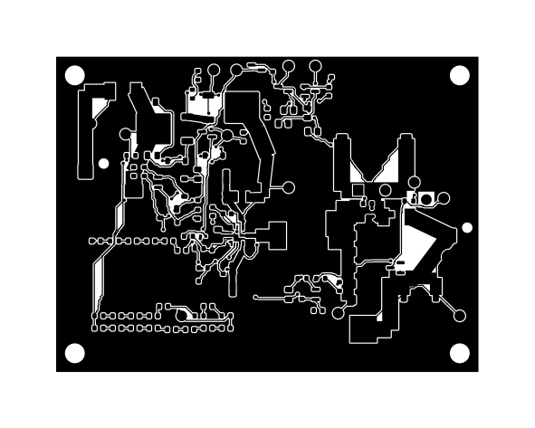
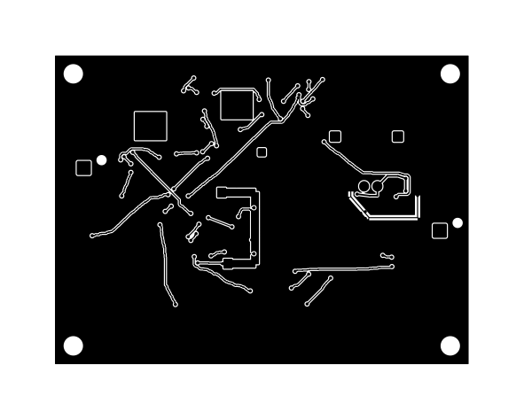
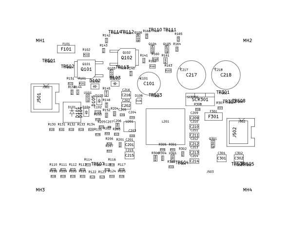
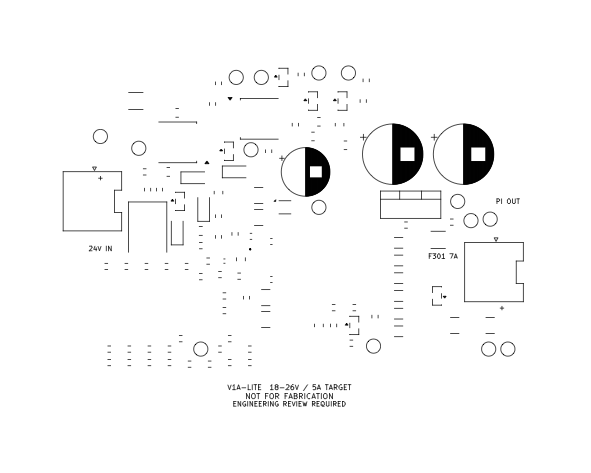

# V1A-Lite PCB: what goes where, and why

2026-10-05. **NOT FOR FABRICATION — ENGINEERING REVIEW REQUIRED**

**STATUS: layout and export review candidate. Electrical qualification and fabrication release are BLOCKED.** The owner authorized this layout study despite unresolved electrical review findings. No hardware test, purchase, upload, merge or push has occurred.

## Reading the board

The board is **80 × 60 mm**, with **two 35 µm / 1 oz copper layers**, a nominal **1.6 mm** finished thickness and four **3.2 mm M3 mounting holes**. There are 116 schematic footprints plus four board-only mounting holes. The purchased population is 100 parts; the other 16 schematic footprints are test pads and the dummy-load connection. Component reference labels are mainly on the assembly drawing, so use that drawing when probing. Board silk carries the fabrication warning. The 5 A marking is a target, not a validated rating.

These pictures use the board's native coordinates, looking down from the top. **Bottom plots are not mirrored.** Copper drawings show conductive shapes, including clearances around different nets; they do not show measured current or temperature. Individual high-resolution PDFs are in [fab/pdf](fab/pdf/).

**3D limitation:** component bodies are absent. KiCad exported the board but could not create its macOS 3D-model cache outside the writable workspace, even after a temporary-config/model-path retry. See [retry record](layout/MODEL_RENDER_RETRY.md). This image is not a populated mechanical model.

## Follow the power from left to right

1. **J501 is the left-edge input.** Normal input is 18–26 V, nominally 24 V. Power goes through F101, reaches the upstream D101 TVS and Q101, crosses the common-source connection, and passes Q102 to the protected input capacitors. This keeps the input protection near the incoming wiring. The required 54.6–64 V upstream fault is not an allowed buck operating voltage. D101's return enters the ground copper near the input rather than being deliberately routed through the buck's quiet feedback area.
2. **Q101 and Q102 are at the upper left.** They have opposite body-diode directions: Q101 provides reverse-input blocking and Q102 is the forward cutoff device. Their large drain tabs and nine vias per drain spread heat to separate bottom copper islands on the correct electrical nets. Those islands are live drains, not GND. Detector and latch transistors are grouped nearby; resistor chains extend down the left side because the circuit has many ballast components. The thermal and pulse capability of those chains is still untested.
3. **U201 and L201 make the 5 V-class rail near the center.** C203 and C204 sit beside the two VIN/PGND pin pairs. Short top traces connect these bypasses; input bulk ceramics feed them and a lower-layer VIN strap joins the two input sides. L201 sits directly to the right of U201. The SW copper is restricted to the IC-to-inductor connection and bootstrap route. C205/C206 provide bootstrap/VCC bypassing. The feedback divider sits to the left, away from the main SW island. This follows the functional placement guidance of [TI LM61460 §11, SNVSBD5D](https://www.ti.com/lit/ds/symlink/lm61460.pdf), with the deviations below still needing review.
4. **The raw output bank and SCR are on the right.** C209–C214 form the ceramic bank, and C217/C218 are the two larger bulk capacitors above it. SCR301 connects directly between raw VOUT_5V1 and GND. No fuse sits between that bank and the SCR. Wide raw-output copper links the inductor, bank and SCR; their return uses the connected ground pours and plated pins/vias. This shortens the discharge loop, but only transient measurements can establish its overshoot and SCR stress.
5. **F301 leads to J502 at the right edge.** F301 is only in the Pi branch, downstream of the raw crowbar. It protects wiring conditionally; it does not interrupt the capacitor-to-SCR discharge. C301/C302 sit on the Pi side. J503 is the solder-pad dummy-load connection near the lower right. Use a dummy/electronic load before any Pi.

The bottom is predominantly connected GND, with stitching vias tying it to the top. It also carries some signals, the VIN strap and the two isolated FET drain spreaders. Therefore it is **not an uninterrupted ground sheet**. Ground stays beneath the switching area except for local routing/clearances, including the authored RBOOT route. A return-current and EMI review is still required around those interruptions.

## Heat, sensing and layout limits

**OBSERVATION:** U201 has 14 real pins and no separate exposed-ground pad. Thermal vias were placed on actual ground/VIN connections beside/under the package rather than inventing an extra pad. Output ceramic grounds use nearby vias. FET drain vias must stay on their own drain nets. Four M3 holes provide mounting; screw-head/washer insulation and enclosure clearances are not qualified.

**DECISION:** retain two layers and 1 oz as a cost-first review candidate. TI recommends four layers with 2/1/1/2 oz copper for thermal/shielding performance; this board does not implement that reference stack. The prior buck-loss screen of 2.417 W would require an effective thermal resistance no greater than 24.8 K/W at the illustrative 50°C ambient / 110°C junction screen. Neither ambient nor actual board thermal resistance is validated. If temperature/EMI qualification fails, revise the stack/copper or placement; the budget must be recalculated. Moving to 2 oz also requires revisiting its larger manufacturing clearances.

**OPEN RISK:** the two-layer RBOOT trace, its two vias, the bootstrap loop width/length, and the ground-plane slots differ from the ideal reference layout. Thermal vias in FET/capacitor solder lands need a reviewed solder-wicking/tenting/fill process. No filled/capped-via service or premium process is assumed to fit the budget.

**OBSERVATION:** TP301 and TP302 provide SCR gate and cathode-sense access. TP302 uses a separate bottom sense trace with pour keepouts; it must not carry discharge current. In the saved placement the test pad is about 12.9 mm straight-line from the cathode; its routed sense stub is longer, and the pair spacing is about 4 mm. This is not ideal for a fast differential measurement. TP113 and TP114 expose Q102 source/gate, but are about 12.5 mm apart and the source net also feeds the control network. **OPEN:** verify these measurement loops and shared-control drops; use differential component-pin probing if needed. Netlist connectivity alone does not establish Kelvin accuracy. No placement rerun was performed during resume.

**OBSERVATION:** telemetry and current shunt were removed in Lite. Shunt resistance, dissipation and measurement accuracy are therefore N/A, not validated.

## The 5 A voltage budget

**CALCULATION / ASSUMPTION:** the committed resistor mesh uses the actual filled copper, pads, tracks and plated connections; 35 µm copper, 18 µm assumed barrel plating, copper temperature coefficient 0.00393/K, 1.6 mm barrels, and equipotential terminal pads. The 18 µm figure is a published average, not a guaranteed minimum. Solder/contact resistance and current crowding through real joints are not qualified. The mesh is a DC calculation, not thermal or fault simulation.

| Sample from raw capacitor to J502, including positive copper and GND return | 20°C | Illustrative 85°C | Drop at 5 A, 85°C |
| --- | ---: | ---: | ---: |
| C209 | 3.232 mΩ | 4.058 mΩ | 20.3 mV |
| C214, farther along the capacitor bank | 5.843 mΩ | 7.335 mΩ | 36.7 mV |

The series positive sections are C209→F301.1 **1.548 mΩ** or C214→F301.1 **4.289 mΩ**, then F301.2→J502.1 **0.921 mΩ**, at 20°C. The associated return estimates are **0.763 / 0.633 mΩ**. F301's body resistance is excluded from these copper values. L201.2→F301.1 is separately **1.834 mΩ**, so the inductor-to-J502 positive path is **2.755 mΩ** cold. The actual DC source is the inductor; individual-capacitor injections additionally show spreading along the output bank. These sampled paths are not a proven bound on all tolerances or capacitor current distributions.

The 0.1 mm and 0.2 mm raster meshes differ by about **4.2%** for the farther path (5.843 versus 5.595 mΩ). Numerical solver residuals are below 1e-10, but that does not remove raster/model uncertainty. Wider copper is clipped around component pads and signal clearances, so nominal pour-outline width is not used as a guaranteed effective width. See [0.1 mm calculation](layout/COPPER_RESISTANCE_0.1.json), [0.2 mm comparison](layout/COPPER_RESISTANCE_0.2.json), and [geometry](layout/COPPER_GEOMETRY.json). All match the delivered PCB hash.

The nominal raw setpoint is **5.06504 V**. [PI_HARNESS.md](PI_HARNESS.md) allows **40 mΩ hot harness**, with a **9 mΩ cold fuse** screen. The nominal full round-trip ceiling to remain above 4.75 V is **63.01 mΩ**. Subtracting the larger hot copper estimate gives:

`5.06504 − 5 A × (40 + 9 + 7.335) mΩ = 4.7834 V`

That leaves just **33.4 mV** before regulator tolerance, ripple, transient droop, increased hot-fuse resistance and measurement uncertainty. At the same assumptions J502 is about **4.9834 V**, versus the harness allocation's required **4.95 V** minimum. Copper loss is about **0.183 W** for that modeled loop. **This is not evidence that the Pi stays above 4.75 V.** It explains why nominal copper resistance alone does not force a thicker stack and why full-load hot measurements remain essential. At 18 V input, 5.065 V×5 A with assumed 90% efficiency requires about 1.56 A input; no efficiency measurement is claimed.

## Rules and checks

JLC limits were checked against its [published capabilities](https://jlcpcb.com/capabilities/pcb-capabilities), accessed 2026-10-05; exact source record is [here](../../../third_party/v1a_lite_layout/SOURCES.md). This is a process-rule screen, not an order quote or electrical rating.

| Implemented setting | Value |
| --- | ---: |
| Track minimum / default clearance | 0.15 / 0.15 mm |
| Power-net clearance | 0.20 mm |
| Via diameter / drill / minimum annulus | 0.60 / 0.30 / 0.15 mm |
| Via/general hole-to-hole | 0.25 mm |
| Drilled component-pad hole-to-hole | 0.45 mm |
| General via/NPTH hole-to-copper | 0.25 mm |
| Plated component hole-to-copper | 0.28 mm |
| Plated component pad annulus | 0.20 mm |
| Copper to board edge | 0.50 mm |
| Mask expansion / minimum web | 0 / 0.10 mm |

Use a mask color/process supporting the selected 0.10 mm web; green is the review default. Board-level rules are in V1A.kicad_pro; additional PTH rules are in V1A.kicad_dru. Neither exclusions nor severity downgrades were added.

**EVIDENCE:** native KiCad 9.0.6 DRC, all-track-errors/all-severities and schematic parity: **0 errors, 0 warnings, 0 unconnected, 0 parity issues**. Fresh ERC: **0 errors, 0 warnings**. [Final layout DRC](layout/JLC_FINAL_DRC.json), [package DRC](fab/review/DRC.json), [ERC](layout/RESUME_ERC.rpt). The [historical schematic-only checker log](layout/RESUME_STATIC_CAPTURE.log) records 565 passing checks and fails its explicit pre-layout “PCB byte-identical to 9c37897” condition; that obsolete preservation contract is not claimed as a passing test. Current board/schematic parity is established by the fresh native check.

## Package and assembly review

- [Gerber/drill review ZIP](fab/V1A_GERBERS_DRILL_REVIEW_ONLY.zip): two copper layers, mask, silk, paste, outline, Gerber job and separate PTH/NPTH drills, with a NOT_FOR_FABRICATION notice. Uses Protel/JLC-recognized extensions. Drill maps stay outside the ZIP.
- [JLC-format BOM](fab/assembly/BOM_JLC.csv) and [CPL](fab/assembly/CPL_JLC.csv): exactly 100 purchased references each, excluding 16 PCB features and four mounting holes. Includes through-hole parts for review, not a claim of JLC assembly-service availability.
- D101 remains **Bourns SMCJ64CA / Mouser 652-SMCJ64CA**. Its LCSC field is blank; the other 99 purchased references retain their exact inherited LCSC numbers. No substitute or number was invented. D101 requires the documented external sourcing/assembly route.
- [Native positions](fab/assembly/POSITIONS_KICAD.csv) and [rotation review](fab/assembly/ROTATION_REVIEW.csv) retain native KiCad angles. All JLC zero-angle, centroid, pin-1 and polarity matches remain OPEN. Coordinates are absolute, in mm, native Y-up export convention; negative Y is intentional and Gerber/drill origins are consistent. Do not silently apply a second origin or mirror transform.
- [Per-layer PDFs](fab/pdf/) / [PNGs](fab/png/), [3D view](fab/render/PCB_3D.png), [manifest](fab/MANIFEST.json), [command record](fab/review/COMMANDS.json), and [package README](fab/README.md). Missing 3D models or unrealistic body shapes do not validate assembly dimensions.

The inherited installed-parts planning estimate is **387,816.90 VND**, excluding MOQ/spares, board, assembly, harness/carrier, freight/tax and qualification. The owner's **<1,000,000 VND first-build** ceiling has **not** been demonstrated. Two layers/1 oz and standard drills avoid intentionally selecting a premium stack, but no live landed-cost quote or order was requested.

## OPEN list and next action

1. All four blocking electrical findings: output normal/trip/delay window and remote overshoot; input fault/cold-start cutoff and hot FET SOA; latch capture/hold/reset; SCR gate/discharge di/dt, I²t and recovery. See [SCH_REVIEW_R1.md](SCH_REVIEW_R1.md) and [BENCH_TESTS.md](BENCH_TESTS.md).
2. Thermal, efficiency, ripple, startup/inrush, load transient and EMI measurements; approved ambient/airflow/derating and bounded upstream source. Two-layer/1 oz remains conditional.
3. Sense/return geometry, bootstrap/RBOOT routing, via solder process, screw insulation, solder joints, exact package orientation and connector polarity. A clean DRC cannot close these.
4. Hot/aged harness and connector/contact resistance/current sharing, fuse clearing coordination, Pi-header rating, mechanical key and source/harness capacitance/inductance. No Pi first load.
5. All JLC rotations/centroids and through-hole/manual assembly decisions; D101 external sourcing; complete landed budget and current stock.
6. Local Git writes are blocked by worktree index.lock permission. Authorized per-step commits were attempted; no push, lock deletion or permission change was made.

R4 may review this package, but **fabrication release remains BLOCKED**. Follow visual inspection → continuity/short checks → current-limited no-load startup → rail verification → low dummy load → load steps → thermal → ripple → transients → protection/fault testing → telemetry N/A → Pi only after all earlier gates pass. Physical tests have not been run.
