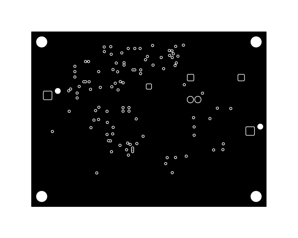
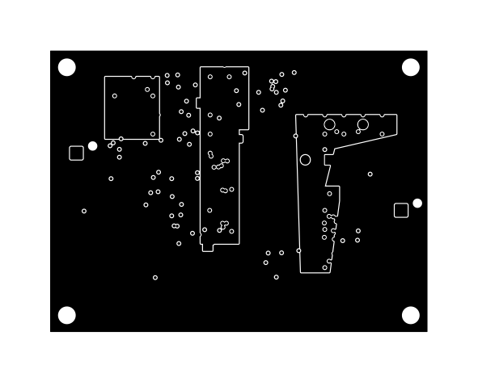
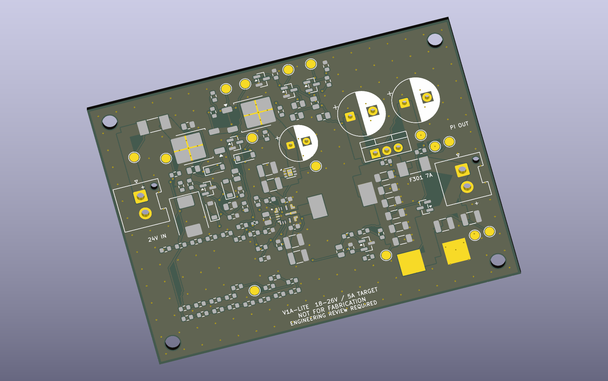

# V1A-Lite FIX1 PCB: placement and limits

2026-10-05 — **NOT FOR FABRICATION — ENGINEERING REVIEW REQUIRED**

This is an **80×60 mm, four-layer, nominal 1.6 mm** review candidate. It uses 35 µm outer and 15.2 µm inner copper (nominal 1 oz / 0.5 oz). The previous two-layer explanation is preserved in [the baseline copy](fix1/BASELINE_LAYOUT_EXPLAINED.md) and Git history. The [FIX1 report](PCB_FIX1_REPORT.md) is the current engineering disposition.

## Reading the board

These are native top-view coordinates; bottom plots are **not mirrored**. There are 116 schematic footprints plus four mounting holes, including 100 purchased parts. The silk warning and “5A TARGET” do not establish a validated rating. Some connector/custom component models are absent from the KiCad 3D render; use the assembly drawing and actual package dimensions for review.

## Follow the power

1. **J501 → F101 → D101/Q101 → Q102.** Input is the inherited 18–26 V operating range; the 54.6–64 V source fault is not a permitted buck operating voltage. D101 is after F101 and before both FETs. The exact IRFR6215 parts have opposite body-diode orientations. Q101's drain copper is VIN_FUSED; Q102's is VIN_PROTECTED. Enlarged F/B/L3 spreaders remain on those separate live nets. L2 stays GND; the layer change does not prove cutoff/SOA performance.
2. **U201 → L201.** The input bypasses remain beside the real VIN/PGND pin pairs. LM61460 RJR has 14 pins and no separate exposed ground pad. R204/C205 were moved above pins 13/14: BOOT now uses short F.Cu routing and no vias/bottom detour. The prescribed under-package SW approach is retained. C206/R203 moved closer on the quiet side. Startup, switching ringing and local return coupling still need review/measurement.
3. **Raw bank → SCR301.** The bulk capacitors are oriented with their grounds toward the SCR return. SCR K/A/G now run right to left. Top raw copper and L3 spreading pair with the nearby ground layers; the old long TP302 ground-plane slot is gone. R308 sits to the right of the SCR body with a separate short authored K branch. The shared plane is not an isolated Kelvin net. No fuse lies between the raw bank and SCR.
4. **F301 → J502 / J503.** F301 moved down to open the inductor-to-fuse corridor; R308's old via obstruction was removed. F301 remains only in the Pi branch. J502 pin 1 is VOUT_PI, pin 2 GND; silk now states their numbers/polarity. J503's positive/GND pads are labeled for dummy-load use. Match the [harness mating-face diagram](PI_HARNESS.md) and verify continuity before power.

L2 is GND-only with normal antipads, not a magically unbroken conductor. L3 includes separate power regions and GND. Bottom copper contains GND, routing and live drain spreaders. Return-current review must consider these actual shapes, package lands and transitions.

## Probes, assembly and soldering

Q102 source/gate test pads TP113/TP114 are on the **bottom**, 3.2 mm apart, using nearby component escape vias. SCR TP301/TP302 are 3.1 mm apart. Raw output TP504/TP506 are 3.25 mm apart near C214. Use rated differential probes on the high side; use a short spring/terminal pickup for fast ripple. Shared traces/planes and exposed pad diameter do not prove populated probe-body clearance or Kelvin accuracy.

Via holes were moved out of wettable lands on both faces. The final polygon/drill audit finds zero overlaps and a **0.142 mm minimum hole-to-open-land gap**. Standard off-land tented vias are selected; tenting is not filled/capped via-in-pad. Inspect the manufactured mask webs and solder/void quality. FET thermal paths changed when vias were moved, and the final thermal model uses the resulting locations.

Silk critical text meets the configured 1.0 mm height / 0.15 mm stroke limits. Numbered connectors, revision and fabrication warning remain. Some dense locations still lack a local silk reference; [the explicit list](fix1/SILK_IDENTIFICATION.json) prevents claiming full coverage. Removed duplicate Fab reference text to improve assembly reading; high-resolution PDFs and native position tables remain essential.

The complete review BOM/CPL contains 100 references. Separate SMT candidate files contain 93; C101, D101, SCR301, C217/C218 and J501/J502 are the seven manual parts. This corrects the earlier prose count; the files already excluded the THT C101. D101 retains **Bourns SMCJ64CA**, external Mouser sourcing, blank LCSC, excluded from SMT placement. The THT anchors are not assumed to be body centroids. All supplier rotation/centroid offsets remain OPEN; zero applied is not zero accepted. See [assembly disposition](fix1/SPACING_AND_ASSEMBLY.md).

## What the calculations show

**CALCULATED, not measured:** the 0.1 mm four-layer mesh gives L201→F301 **1.074 mΩ cold / 1.348 mΩ at assumed 85°C**, a **6.740 mV drop at 5 A**. The larger sampled capacitor-to-J502 copper round trip is **4.258 mΩ cold / 5.346 mΩ hot**, excluding fuse, joints and harness. These sampled injections are not a guaranteed DC/tolerance bound; the inductor source was analyzed separately.

With the unchanged **5.06504 V** nominal setpoint, −1% reference and opposing 0.1% divider tolerances give **5.00635 V raw minimum** for that tolerance screen. Subtracting 25 mΩ harness, 9 mΩ **cold** fuse and sampled hot copper gives **4.80962 V at 5 A**, **59.62 mV margin** to 4.75 V. That conditional calculation passes. Hot fuse/joints, minimum copper/plating, ripple, transients and uncertainty remain unbounded. An explicitly assumed sensitivity case gives 4.74544 V and fails. Thus full operating compliance remains OPEN.

**CALCULATED / ASSUMED thermal screen FAIL:** with illustrative 50°C ambient and 10 W/m²K combined cooling, the coarse coupled model gives approximately **181.0°C Q101, 181.6°C Q102 and 206.8°C U201**. These exceed both the historical 110°C screen and the model's valid fixed-hot-resistance envelope; they are failed screening outputs, not valid operating-temperature predictions. Four layers and enlarged copper do not establish safe continuous 5 A. Ambient/airflow/derating and a credible revised thermal case need engineering review.

Crowbar pulse behavior also remains unqualified. An assumed 10–100 nH loop sweep produces 465–46.5 A/µs under the selected illustrative voltage/drop, not a demonstrated bound. Package/capacitor parasitics, gate rise/current, source current and Q102 cutoff must be bounded. See [pulse review](fix1/CROWBAR_REVIEW.md), [calculation details](PCB_FIX1_REPORT.md) and [proposed bench plan](fix1/QUALIFICATION_PLAN.md).

## Manufacturing checks, cost and handoff

KiCad 9.0.6 DRC with all severities, all track errors and schematic parity: **0 violations / 0 unconnected / 0 parity**. Fresh ERC: **0 errors / 0 warnings**. Minimum track/default clearance 0.15 mm, power clearance 0.20 mm, vias 0.60/0.30 mm, PTH rules and 0.50 mm copper-edge clearance retained; silk process sizes enforced. No DRC exclusion or severity downgrade added. These are JLC manufacturing checks, not electrical-spacing or safety approval. Environmental/coating/altitude basis and 64/103 V spacing remain OPEN.

The [review package](fab/) includes four-layer Gerbers, drills/maps, ZIP, BOM/CPL/manual lists, PDF/PNG views, incomplete assembly render and integrity manifest. Nothing was uploaded or ordered. JLC's public entry tier is **from US$2/five** for both two-layer and four-layer boards within this size category: **advertised delta US$0**. A configured 80×60 mm quote, freight/tax and the full <1M VND build budget remain OPEN; [dated source detail](fix1/COST_AND_STACK.md).

Electrical findings, thermal qualification, detector Kelvin return, environmental spacing, mechanical access and supplier rotations still block fabrication. Next is independent engineering review. After approval, bring-up must progress through inspection, continuity, current-limited no-load startup, rail verification, dummy-load steps, thermal/ripple/transient/protection tests, and only then Pi integration. Telemetry/shunt are N/A in Lite. Earlier Git writes failed; the final resume Git outcome is recorded in LAYOUT_PROGRESS.md. No push or permission/lock changes.

**Thermal bench proposal:** [THERMAL_MITIGATION.md](fix1/THERMAL_MITIGATION.md) gives per-device rise and a conditional initial 2 A ceiling, requiring U201 loss ≤0.75 W and reviewed temperature/uncertainty limits. At 50°C ambient and assumed 5 W/m²K cooling it gives Q101/Q102/U201 85.3/85.5/105.4°C. It is a measurement plan, not an approved continuous-current rating.
