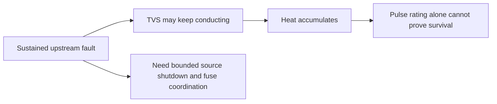

# 01 — Input protection

> [!abstract] In one sentence
> Four different input guards manage sustained overcurrent, brief surges, reversed connections and unsuitable supply conditions; none alone guarantees a safe 5 V output.

## 1. An everyday picture: guards at an entrance

![[f1-01-input-guards-analogy.png|850]]
*BATCH_F F1.1. Four responsibilities, not four identical switches. “Backwards power” groups two different cases: reversed input polarity and output backfeed; each needs its own path analysis.*

A building entrance has a guard who checks visitors, a barrier that closes, an emergency overflow channel and a last-resort breakaway link. Giving every guard the same job would leave gaps. V1A similarly combines a fuse, a transient voltage suppressor (**TVS**), a reverse-protection arrangement and an electronic fuse (**eFuse**).

**Learning goals:** trace the real input path; distinguish standoff, breakdown and clamp; read the voltage window; explain why 5 A out can need much less than 5 A in.

> [!warning] Status
> Normal input is **9–26 V**. **Gate 4a-FIX freeze BLOCKED. PRELIMINARY TEST BOARD — NOT FOR FABRICATION — ENGINEERING REVIEW REQUIRED.** Component selections below are not installed protection ratings.

## 2. Picture walkthrough: where current actually travels

![[b2-conceptual-input-protection-placement.png|850]]
*Existing B2 image: conceptual placement only. Current owner selections are D101 **SMCJ36CA** and F101 **Schurter 3403.0285.23**, regardless of older labels. No PCB is routed.*

Read the paths in this order:

1. Incoming positive power passes through **F101** to the fused node.
2. **D101** branches from that fused node to ground. Surge current through it passes through F101, but **does not pass through the downstream eFuse**.
3. **Q101** carries normal input current. **Q102** helps discharge Q101's gate relative to its source in the captured external reverse-protection arrangement.
4. **U101 TPS26630** checks the admitted supply, limits input current and controls startup. Its output feeds the local input bank and buck.
5. Ground is the physical return conductor. A protection symbol cannot make its inductance or resistance disappear.

| Guard | Selected device / arrangement | What must be established |
|---|---|---|
| Fuse | F101 Schurter 3403.0285.23 | Hot hold current, total clearing, DC interruption and source/wire coordination |
| TVS | D101 Littelfuse SMCJ36CA | Pulse clamp at actual current, temperature and repetition |
| Reverse path | Q101 CSD19537Q3 with Q102 BSS138 control | Gate voltage, body-diode paths, reversed input and backfeed cases |
| Electronic admission | TPS26630 | Threshold corners, current limit, startup and physical cutoff |

The fuse is a **12.5 A time-lag** part, with **125 VDC / 1000 A DC interruption** at its specified conditions. Its number is not V1A's output-current rating. Installed clearing, hot surge behavior and coordination remain **(still open)**.

## 3. TVS: three voltage labels, three meanings

![[v2-01-tvs-iv.png|850]]

Follow the positive-polarity curve from left to right. The bidirectional CA part also has an avalanche behavior under reversed polarity; this plot only shows the positive magnitude.

1. At **36 V standoff**, the device is specified to have only small leakage under its stated test conditions. “36 V TVS” does not mean a surge stays at 36 V.
2. **40.0–44.2 V breakdown** is specified at **1 mA**. It describes the beginning of appreciable avalanche conduction.
3. At the specified **25.9 A pulse**, the maximum clamp is **58.1 V**, for the datasheet's **25°C, 10/1000 µs** test conditions.

The drawn curve between the anchors is **ASSUMED**, not a measured characteristic or a hot guarantee. Read the anchors as different tests, not as an accurate interpolated component model. These values come from the [Littelfuse SMCJ datasheet, 2025-02-27 v.2](https://www.littelfuse.com/assetdocs/littelfuse_tvs_diode_smcj_datasheet?assetguid=37388813-0d6d-4329-969b-1aa8b7614ac1).

The higher standoff avoids the old 26 V device conducting during some studied upstream faults. The cost is a higher clamp: the **58.1 V figure cannot be allowed directly onto the LM61460 input**. The main eFuse's dynamic let-through and the separately supplied auxiliary branch need their own review.

## 4. eFuse: read the window, then read its uncertainty

![[f1-03-efuse-three-jobs.png|800]]
*BATCH_F F1.3. Admission, cutoff and current limiting are different actions. A commanded cutoff has a response delay.*

![[v2-01-efuse-window.png|900]]

Read the top ruler first. **Undervoltage lockout (UVLO)** holds the path off below its threshold; **overvoltage protection (OVP)** commands cutoff above its threshold. Baseline nominal rising thresholds are **8.46 V** and **27.63 V**. The normal-input requirement remains **9–26 V**, inside that wider nominal window.

Now read the enlarged lower ruler:

- The inherited rising OVP screen spans **26.97–28.29 V**. A 27 V test can trip one corner and leave another on. **27 V is a fault-test point, not guaranteed normal operation or a guaranteed trip.**
- The falling/reset screen spans **25.00–26.58 V**. After a trip, returning to 26 V does not guarantee recovery.
- The initial minimum rising screen is only **0.97 V above 26 V**. Hot drift, restart and nuisance-trip behavior are **(still open)**; the plotted bands are not complete hot limits.

Startup control reduces the rate at which the downstream voltage rises. It is not a promise of a particular inrush current: capacitor current also depends on effective capacitance through $I=C\,dV/dt$.

## 5. Worked example: why the input limit can be below 5 A

![[v2-01-input-current.png|800]]

**ASSUMED:** local output 5.1 V at 5 A, buck efficiency 90%, and **9 V at the buck input**. Ignore input-path and auxiliary losses for this example.

$$
P_{out}=5.1\times5=25.5\ \mathrm{W}
$$

$$
I_{in}=\frac{P_{out}}{\eta V_{in}}
=\frac{25.5}{0.90\times9}=3.15\ \mathrm{A}
$$

At 24 V the same estimate is **1.18 A**. The eFuse's roughly **4.48 A nominal input limit** therefore does not contradict a 5 A output target. At low input voltage, current and losses increase; the graph does not prove startup or hot full-load capability.

## 6. What goes wrong: assigning each guard a fixed timescale

![[f1-02-tvs-vs-fuse-timescale.png|850]]
*F1.2 requires regeneration with the corrected BATCH_F prompt. The existing “eFuse acts in between” / millisecond placement is **not a valid timing bound**. eFuse response depends on the fault and action; fuse clearing depends on current. Use this picture only to distinguish mechanisms.*

A TVS diverts current when voltage rises. A fuse must heat enough to open. An eFuse detects a condition and changes semiconductor conduction. These responses overlap in time; they are not exclusive microsecond/millisecond/second lanes.

A particularly important failure is a **sustained excessive voltage**. The TVS could keep dissipating heat while the current is too small to clear F101. The downstream 4.48 A limit cannot guarantee blowing a 12.5 A fuse, and it does not limit the upstream TVS branch at all.

A different failure starts **inside the buck** at an otherwise normal input. Source isolation is necessary but leaves charged capacitors downstream. The development route calls for **10–30 µF effective local input capacitance** and a **physical cutoff within 10 µs** of fault onset. The independent fault trigger and full isolation time are **(still open)**; see [[03 Output protection]].

## 7. Why this design and not another

The owner chose 9–26 V to give the nominal 24 V source normal tolerance room; it is a requirement to prove, not permission for sustained 33.6 V operation. The required isolated upstream module is **(still open)** in model and qualification. The UENPO non-isolated module was rejected because its failed high-side switch can create a direct battery pass-through path.

The larger SMCJ36CA improves the studied pulse-power/standoff screen but raises clamp exposure. A bidirectional TVS ahead of Q101 avoids the straightforward forward-conduction path a unidirectional diode would create under reversed input. The selected larger time-lag fuse improves an assumed hot hold-current screen but clears moderate faults more slowly. Each choice trades one margin for another; source shutdown and component coordination remain necessary.

> [!warning] Common misconceptions
> A fuse is not a universal fast-spike stopper. Standoff is not clamp voltage. An OVP threshold is not a maximum transient peak. TPS26630 does not replace the captured external reverse-input arrangement. Input protection cannot by itself contain a shorted buck switch.

## 8. Check yourself

1. Why does TVS current bypass the eFuse's current limit?
2. What does the 58.1 V label actually mean?
3. Why might a 27 V OVP test leave the input on?
4. Why does 5 A at the output need only about 1.18 A at 24 V in the example?

> [!question]- Answers
> 1. D101 branches from the fused node before the eFuse; topology determines the current path.
> 2. A specified clamp maximum at a particular pulse current and test condition, not a continuous rail or hot installed limit.
> 3. The inherited rising threshold screen extends above 27 V, to about 28.29 V.
> 4. The converter lowers voltage while approximately conserving power; 90% efficiency supplies the assumed loss.

## 9. One-page visual summary

![[v2-01-efuse-window.png|700]]

| Remember | Current fact | Still owed |
|---|---|---|
| Normal input | **9–26 V** | Complete source waveform within range |
| D101 | **SMCJ36CA**, 36 V standoff | Hot/repeated pulse and downstream clamp exposure |
| F101 | **3403.0285.23**, 12.5 A time-lag | Installed hold/clearing and DC source coordination |
| eFuse | **8.46 / 27.63 V** nominal admission thresholds | Tolerance, hot behavior and restart |
| Source isolation | **≤10 µs**, **≤100 µC** proposed contract | Autonomous trigger and whole-event measurements |
| Release | **BLOCKED** | No Pi before required qualification gates |

> [!info]- Sources and reproducibility
> [Fact-check register](FACTCHECK_LOG.md#sources): IN, TVS, SRC, BASIS, G4, OWNER. Threshold corners also read from `0677fea:GATE2C_REVIEW_CLOSURE.md` under `docs/evidence/r2/sheet03/`; Gate 4a-FIX `2b99ac7` retains source/auxiliary gaps. [BATCH_F](../illustrations/BATCH_F.md) records the F1.2 correction. Charts: `python3 -B docs/lessons/figures/src/lesson_charts.py 01`.

Previous: [[00 System overview]] · Next: [[02 Buck converter LM61460]] · Terms: [[99-Glossary]]
