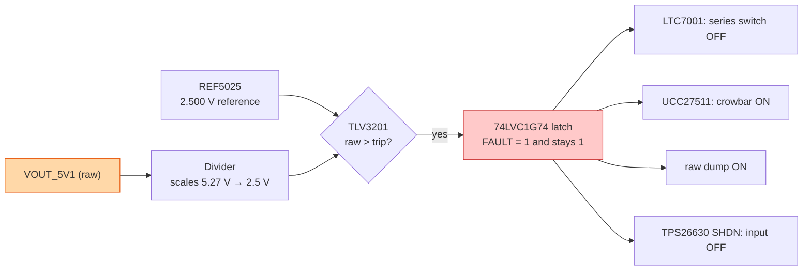
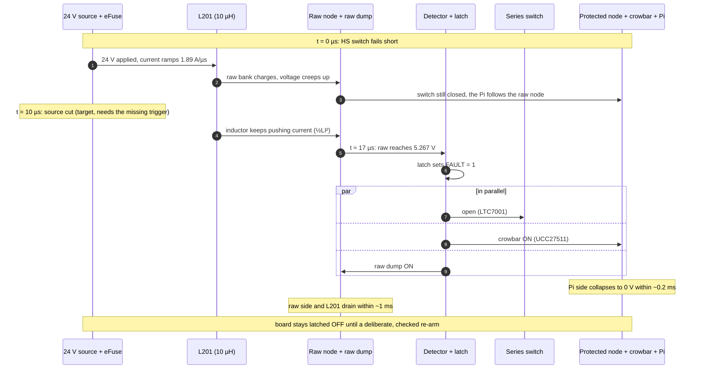
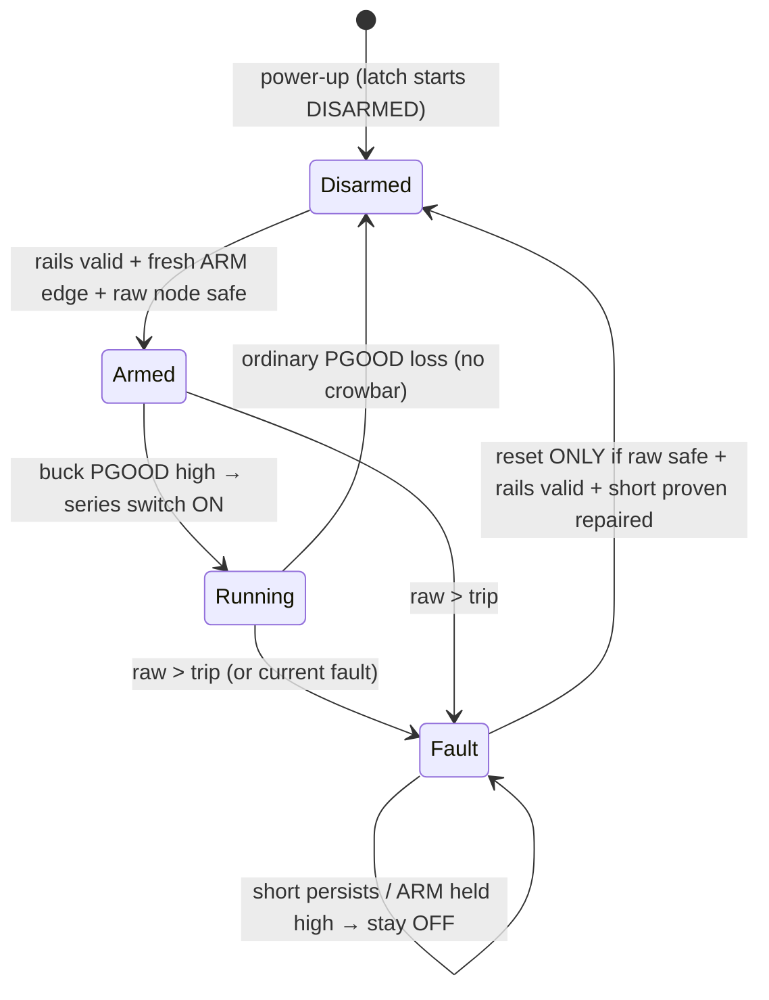
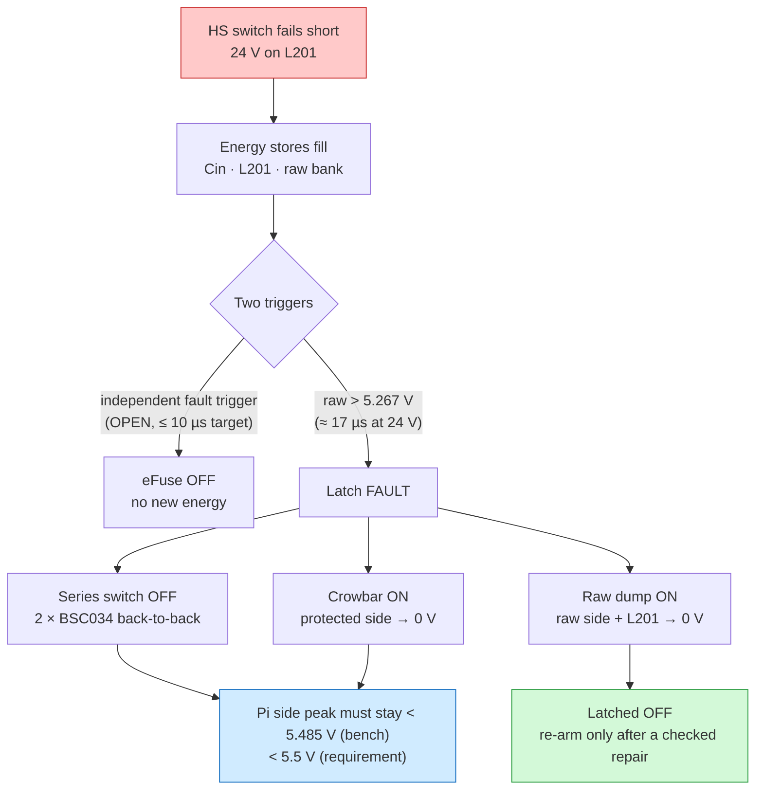

# 03 — Output protection (visual pilot)

> [!abstract] In one sentence
> If the buck converter's top switch fails short, 24 V heads straight for a 5 V computer. Sheet 03 is the circuit that notices, **cuts the wire**, and **drains the leftover energy** before the Pi sees more than 5.5 V.

> [!warning] Status (read once, then enjoy the lesson)
> **PRELIMINARY V1A SHEET-03 ARCHITECTURE (TEST BOARD) · NOT FOR FABRICATION — ENGINEERING REVIEW REQUIRED.**
> Gate 4a-FIX is still open (verdict BLOCKED; work in progress on `feat/r2-testboard-freeze`). Every number here is labelled **CALCULATED** (arithmetic under stated assumptions), **ASSUMED** (an allocation we chose) or **OPEN** (unknown). Waveforms come from an *ideal* model ([fault_model.py](fault_model.py)) that reproduces the Gate 4a numbers. They teach the mechanism. They are not measurements. On R2 a dummy load stands in for the Pi. **The Pi is never connected until the bench fault tests pass.**

**What you will be able to do after this lesson**

1. Explain why a buck converter cannot protect itself from its own switch failing short.
2. Name the four energy stores in a fault and say where each one's energy must go.
3. Walk through the fault microsecond by microsecond: detect, remember, cut, drain.
4. Read the "voltage ladder" and the drop budget, and say why the margins are so thin.
5. Explain why the owner chose architecture D for the test board and what D still owes.

---

## 1. Where Sheet 03 sits

![[p03-01-where-sheet03-sits.png|900]]

Follow the colours. They are the same in every figure of this lesson.

- **Purple** is the input side (9–26 V). The buck's input capacitors sit here.
- **Orange** is `VOUT_5V1`, the *raw* 5 V node, straight out of the buck and L201. Call it **raw** from now on.
- **Blue** is `VOUT_PROTECTED`, which becomes `LOAD_5V1` and then feeds the Pi. Call it **protected**.

Sheet 03 is the wall between orange and blue. The buck regulates on the orange side (its feedback senses `VOUT_5V1`). The Pi lives on the blue side.

---

## 2. An everyday picture first: a tap stuck open

![[f3-01-analogy-stuck-tap.png|800]]

Think of the buck as a **tap** (vòi) that opens and closes 400 000 times a second to keep a bucket (cái thùng) (aka the capacitors) filled to exactly the 5.1 V line. The Pi drinks from the bucket.

Now the tap handle (tay vòi) snaps off (bị gãy) with the tap **fully open**. The tap's own "controller" (feedback) keeps turning a handle that is no longer connected to anything. Water keeps pouring.

To save the house you need four separate moves. The analogy is only a hook: the real explanation is the schematic walk in **section 2b** just below, where each move is a part you can point at.

1. **Stop new water arriving** → turn the input eFuse **U101** off.
2. **Close a gate between the bucket and the house** → open the series switch **Q301 + Q302**.
3. **Empty the water already in the house** → turn on the crowbar **Q303**.
4. **Empty the bucket** → the "raw dump" (frozen on paper only, see 2b).

The "water still rushing through the pipe" is the important subtle bit. Moving water has momentum (động lượng). Closing the main valve does not stop it at once. In the circuit, that momentum is the **current in inductor L201**, and its energy is ½LI².

---

## 2b. Read it on the schematic (open the PDF next to this lesson)

Open `~/Desktop/Research/V1A_review_2026-09-29/V1A_REVIEW_READABLE.pdf`. It has 6 pages: page 1 is the top-level sheet, then one page per sub-sheet in order. Each page's title block names the sheet, so check the title if the page numbers ever shift.

> [!tip] How to read a KiCad schematic page
> - A **refdes** (reference designator) like `U101` names one part: U = IC, Q = transistor, L = inductor, R = resistor, C = capacitor, D = diode.
> - Each pin has a **number** (on the package) and a **name** (its job), e.g. U101 pin 12 is named `SHDN`.
> - Wires with the **same net label** are connected, even on different pages. So `VOUT_5V1` on page 3 and `VOUT_5V1` on page 4 are one piece of copper.
> - Follow a net by searching its name in the PDF (Cmd+F). That is the fastest way to trace a signal.

**Step 1: where the dangerous current comes from. Page 3, sheet `02_BUCK_5V`.**
- Find **U201** (LM61460, the buck). Its **pin 10 `SW`** is the switch node, net `BUCK_SW`.
- Follow `BUCK_SW` to **L201** (the inductor): L201 pin 1 is on `BUCK_SW`, and L201 pin 2 is on **`VOUT_5V1`**, the raw 5 V output.
- The fault in this lesson is U201's internal high-side switch failing short. Then `VIN_PROTECTED` (U201 pins 8 and 12, `VIN1`/`VIN2`) connects straight through the switch to `BUCK_SW`, and L201 feeds whatever current it has into `VOUT_5V1`. That current is the "water still moving".

**Step 2: stop new energy. Page 2, sheet `01_INPUT_PROTECTION`.**
- Find **U101** (TPS26630, the input eFuse). Its **pin 12 `SHDN`** sits on net `INPUT_SHDN`. Pulling this net low turns the eFuse off, which stops new energy from the 24 V side.
- Pins 17–18 `OUT` feed `VIN_PROTECTED`, the net you met on U201 in step 1. So "turn off U101" really means "starve U201's input".
- Also here: **D101**, the input TVS on `VIN_FUSED`. The schematic still shows **SMBJ26CA**. Your decision is **SMCJ36CA**, which is frozen on paper and not yet drawn (it will change in the Gate 4b capture).

**Step 3: detect the overvoltage. Page 4, sheet `03_OUTPUT_PROTECTION`.**
- **R301 (11.3 kΩ) and R302 (10.0 kΩ)** divide `VOUT_5V1` down to net `OV_DIV`, then R303 (1 kΩ) feeds `OV_SENSE`.
- **U303** (TLV3201 comparator) compares **pin 4 `IN−` = `OV_SENSE`** with **pin 3 `IN+` = `REF_2V5`**. `REF_2V5` comes from **U302** (REF5025) **pin 6 `VOUT`**.
- The trip point on this drawing is $2.5\ \text{V}\times\frac{11.3+10.0}{10.0}=5.325\ \text{V}$ (CALCULATED from the drawn values). Gate 4a-FIX proposes about **5.267 V**. That is frozen on paper only, so the drawn resistor values will change in Gate 4b.
- U303 **pin 1 `OUT`** (net `OV_OK`) feeds the latch logic around **U304** (74LVC1G74 flip-flop). Once the latch sets, the fault stays remembered until a person resets it.

**Step 4: cut the path to the Pi. Same page 4.**
- Find **Q301** and **Q302** (BSC034N06). Both have their **sources (pins 1–3)** on net `PROT_MID` and their **gates (pin 4)** on `PROT_GATE`.
- Q301's **drain (pins 5–8)** is on `VOUT_5V1` (raw side), and Q302's drain is on `VOUT_PROTECTED` (the Pi side). This is the back-to-back pair: the two body diodes face each other, so "off" blocks both directions.
- **U301** (LTC7001 driver) drives them: **pin 6 `TGDN`** pulls `PROT_GATE` down to turn the pair off. **Pin 8 `TS`** watches `PROT_MID`. **Pin 1 `VCC`** is on `DRV_7V5`, a separate driver supply, so the driver keeps working while the 5 V rail collapses.

**Step 5: drain the Pi side. Same page 4.**
- Find **Q303** (CSD18540Q5B, the crowbar MOSFET): **source pins 1–3 on `GND`**, **gate pin 4 on `CB_GATE`**, **drain pins 5–8 on `CB_DRAIN`**. `CB_DRAIN` reaches the protected rail through the 33 mΩ ballast resistors.
- **U315** (UCC27511 gate driver) turns it on: **pin 6 `IN+` = `CROWBAR_ON`**, **pin 3 `OUTL`** drives `CB_GATE` directly, and **pin 2 `OUTH`** drives it through R306 (1 Ω).

**Step 6: drain the raw side. Frozen on paper only.**
- Gate 4a found that once Q301/Q302 open, energy on `VOUT_5V1` and in L201 cannot reach the crowbar. It proposes a **raw dump** (a second switched ballast, about 100 mΩ, on `VOUT_5V1`) and an **independent auxiliary supply** for the detector and drivers.
- **Neither is drawn yet.** You will not find them in this PDF. They arrive in the Gate 4b KiCad capture.

| What | Where in the PDF | Drawn today? |
| --- | --- | --- |
| Buck U201, L201, `VOUT_5V1` | page 3, `02_BUCK_5V` | Yes |
| eFuse U101 `SHDN`, TVS D101 | page 2, `01_INPUT_PROTECTION` | Yes (D101 still the old SMBJ26CA) |
| Detector U302/U303, latch U304 | page 4, `03_OUTPUT_PROTECTION` | Yes (trip values change in 4b) |
| Series pair Q301/Q302 + U301 | page 4 | Yes |
| Crowbar Q303 + U315 | page 4 | Yes |
| Raw dump, auxiliary supply | nowhere yet | **No, frozen on paper only** |

![[f3-05-schematic-walk-circuit.png|900]]
*(Circuit picture to generate: BATCH_F prompt F3.5. A code-drawn version is in `code/draw_sheet03_simplified.py` in this vault. Run `python3 -m pip install schemdraw` once, then `python3 code/draw_sheet03_simplified.py` to make `p03-12-simplified-circuit.png`.)*

![[p03-12-simplified-circuit.png|900]]

---

## 3. The fault: the high-side switch becomes a wire

![[p03-02-buck-normal-vs-shorted.png|900]]

In a healthy buck the high-side (HS) switch connects the switch node (SW) to 24 V for only about 21 % of each cycle (duty ≈ 5.1/24). The inductor averages those pulses to 5.1 V.

When the HS metal-oxide-semiconductor field-effect transistor (**MOSFET**) fails short, SW sits at 24 V **all the time**. The inductor now sees about 24 − 5.1 = 18.9 V across it. By $V = L\,\frac{di}{dt}$ its current ramps up steadily:

$$
\frac{di}{dt} = \frac{V_L}{L} = \frac{18.9\ \text{V}}{10\ \mu\text{H}} = 1.89\ \text{A per microsecond}
$$

**CALCULATED, ideal 10 µH.** After just 10 µs the inductor carries 18.9 A *more* than before. The buck controller can pull its gate drive low as hard as it likes. A piece of shorted silicon does not listen.

> [!tip] Why input protection does not catch this
> The input is a perfectly normal 24 V. The eFuse's overvoltage protection (OVP) watches the *input*, so it sees nothing wrong. The danger is only visible at the *output*. That is why V1A needs a separate output-protection sheet.

---

## 4. Where the fault energy hides

Every capacitor stores $E=\tfrac12CV^2$. Every inductor stores $E=\tfrac12LI^2$. In a fault, all of these stores want to empty into the Pi.

![[f3-02-energy-springs.png|700]]
*(BATCH_F prompt F3.2.)*

![[p03-03-energy-stores.png|850]]

Two lessons hide in this bar chart:

1. **The biggest stores are the 5 V banks, not the 24 V source.** The raw bank (8 × 470 µF) holds up to about 85 mJ just by sitting at 5.5 V. Big capacitors are good for normal ripple and load steps. In a fault they are a loaded spring.
2. **Each side needs its own drain.** Once the series switch opens, energy on the orange side *cannot* reach the crowbar on the blue side. So the raw side needs its own raw dump. Gate 4a found this gap and proposed the 100 mΩ raw dump. Its hot pulse rating is still **OPEN**.

---

## 5. The cast: what each Sheet 03 part does

### 5a. Detect and remember

![[p03-05-detector-chain.png|900]]

- The **divider** scales the raw 5 V node down to the comparator's range. The comparator compares it with a precise, independent 2.5 V reference. "Independent" means the buck cannot drag the reference along with it.
- The **comparator** gives a fast yes/no answer.
- The **latch** (a D flip-flop) turns a short "yes" into a permanent "FAULT". This matters because the crowbar pulls the voltage *down*. Without a latch, the comparator would un-trip, the switch would close again, the fault would push the voltage back up… and the board would chatter on and off. The latch says: *once is enough; a human decides when to try again.*

**CALCULATED (Gate 4a-FIX, work in progress):** nominal trip **5.267 V**. The tolerance window is **5.220–5.315 V** after resistor, reference, comparator-offset and leakage corners. Adding the 20 mV comparator overdrive at the top corner gives **5.357 V**.

### 5b. Cut: why the switch is two MOSFETs back-to-back

![[p03-04-back-to-back-mosfets.png|900]]

Every power MOSFET has a built-in **body diode**. A single MOSFET that is "off" still conducts one way through that diode. With two MOSFETs joined source-to-source, the two diodes face away from each other, so "off" blocks both directions. That keeps each side's energy on its own side, where its own drain can handle it.

The chosen parts are **2 × BSC034N06NSATMA1**: 3.4 mΩ maximum each at 25 °C with a 10 V gate drive. Gate 4a assumes twice that when hot, so 13.6 mΩ for the pair. That number comes back in the drop budget.

### 5c. Drain: crowbar and raw dump

![[f3-03-two-sides-two-drains.png|750]]
*(BATCH_F prompt F3.3.)*

A **crowbar** is a deliberate short to ground, like throwing a steel bar across two terminals. Here it is a *controlled* short: a CSD18540Q5B MOSFET plus a 33 mΩ ballast resistor limits the current. The UCC27511 gate driver turns it on hard and fast. The raw dump is the same idea on the orange side, with a 100 mΩ ballast.

> [!info] Who powers the protection during the fault?
> The detector and drivers must keep working while the main 5 V collapses. Gate 4a therefore proposes an **independent auxiliary supply** upstream of the main eFuse: a surge limiter, a 12 V buck-boost and a hold-up capacitor. Its conditional hold-up screen is about **4.6 ms** (CALCULATED). Startup and rail-loss behaviour are still **OPEN**.

---

## 6. The fault, microsecond by microsecond

This is the heart of the lesson. Read the figure top to bottom, then the table.

![[p03-06-fault-timeline.png|950]]

| Step | Time (ideal model, 24 V) | What happens | Where the energy goes |
|---|---|---|---|
| ① Short | 0 µs | SW node stuck at 24 V. L201 current starts at 8 A (**ASSUMED** worst healthy value) and ramps up. | Source → L201 → raw bank |
| ② Source cut | 10 µs (**target**) | The eFuse is shut off. L201 is at about 27 A. | The input bank (30 µF) still empties through the short |
| ③ Detector trips | 17.1 µs | Raw reaches 5.267 V. The latch sets. | — |
| ④ Actions | ≈ 18 µs (**ASSUMED** 1 µs; real value **OPEN**) | The switch opens. Crowbar and raw dump fire together. | Protected bank → crowbar. Raw bank + L201 → raw dump |
| ⑤ Drained | 0.2 ms (Pi side), ≈ 0.75 ms (raw < 0.3 V) | Both sides reach ≈ 0 V and stay latched off. | All energy turned into heat in the ballast resistors |

**What the Pi experiences:** a peak of about **5.28 V** in this ideal model, then an abrupt power loss. That is the accepted price. A Pi that lost power abruptly can be rebooted. A Pi that saw 9 V cannot.

### Now compare: the same fault without Sheet 03

![[p03-07-with-vs-without.png|900]]

- **Red:** nothing cuts the source. The Pi passes 5.5 V at about 28 µs and reaches 9.2 V by 100 µs (the ideal model ignores the eFuse current limit here).
- **Orange:** a perfect source cut at 10 µs, but no Sheet 03. The **stored energy alone** pushes the Pi to about **6.08 V**. This is the key insight of the whole lesson: **stopping the source is necessary but not sufficient.**
- **Blue:** with Sheet 03 the Pi side is split off at 5.28 V and then drained.

---

## 7. Worked example: check the orange curve by hand

Can we trust the 6.08 V? Let us rebuild it with nothing but ½CV² and ½LI².

**ASSUMED (Gate 4a conventions):** 24 V source cut at exactly 10 µs; input bank 30 µF; L201 = 10 µH; raw bank minimum 2.4064 mF; 8 A at the start; no load, no losses (so this is the pessimistic case).

**Step 1: inductor current at 10 µs.**
$$
I_L = 8\ \text{A} + 1.89\ \tfrac{\text{A}}{\mu\text{s}} \times 10\ \mu\text{s} \approx 26.9\ \text{A}
$$

**Step 2: energy still "in flight" when the source is cut.**
$$
E_{C_{in}} = \tfrac12 (30\ \mu\text{F})(24\ \text{V})^2 = 8.64\ \text{mJ}
\qquad
E_L = \tfrac12 (10\ \mu\text{H})(26.9\ \text{A})^2 = 3.62\ \text{mJ}
$$
$$
E_{\text{in flight}} \approx 12.3\ \text{mJ}
$$

**Step 3: pour it all into the raw bank**, which is at 5.17 V at 10 µs.
$$
V_{peak} = \sqrt{V_0^2 + \frac{2E}{C}} = \sqrt{5.17^2 + \frac{2(0.0123)}{0.0024064}} = \sqrt{26.7 + 10.2} \approx 6.07\ \text{V}
$$

**CALCULATED:** 6.07 V by hand against 6.08 V from the simulation. Two independent methods agree, so the model is doing what we think. With Pi limit 5.5 V, the stored energy alone breaks the requirement by more than half a volt. That is why Sheet 03 exists even with a perfect source cut.

> [!example] Try it yourself
> Repeat the example at 9 V input. The ramp is slower ((9 − 5.1)/10 µH = 0.39 A/µs), so I_L ≈ 11.9 A at 10 µs, and ½CV² of the input bank is only 1.2 mJ. Is the peak above or below 5.5 V? *(Answer in the self-check.)*

---

## 8. The voltage ladder: why the margins are thin

Put every important voltage on one ruler and the design problem becomes visible.

![[p03-09-voltage-ladder.png|850]]

Read it from the bottom:

- **Between 5.171 V (the highest healthy regulation) and 5.220 V (the lowest trip)** there are only about **49 mV**. If the detector tripped inside the healthy band, a normal load release would turn the robot's computer off. That is a *nuisance trip*. The 49 mV is a static screen; real load-release overshoot is measured in bench test T06.
- **Between 5.315 V (highest trip) and 5.5 V (Pi limit)** there are about **185 mV** for everything that happens *after* the trip decision: comparator overdrive, logic and gate delays, and cable ringing.
- The bench pass line is **5.485 V**, not 5.5 V. The oscilloscope has about 15 mV of uncertainty, so a reading of 5.49 V could really be 5.505 V.

### The other end of the ruler: the 5 A drop budget

The protection parts sit *in series* with the Pi's power, so they also cost voltage in normal operation.

![[p03-10-drop-budget.png|950]]

**CALCULATED (Gate 4a allocations):**

$$
V_{Pi} = V_{buck,min} - I\,(R_{send}+R_{return}) - V_{trough}
= 5.026 - 5\times0.042673 - 0.020 = 4.793\ \text{V}
$$

That leaves **43 mV** above the 4.75 V minimum. The two red giants are the **series switch (13.6 mΩ hot)** and the **Pi contacts (13.3 mΩ, ASSUMED)**. If a real load step dipped 100 mV instead of the assumed 20 mV, the result would be **4.713 V: FAIL**. So you cannot "just raise the setpoint" to buy low-side margin. Every 10 mV you add at the bottom is taken from the 49 mV nuisance margin at the top.

> [!important] The squeeze in one line
> Too little series resistance is impossible (the switch must exist). Too much, and the Pi browns out at 5 A. A higher setpoint causes nuisance trips. The design lives in a window about 0.2 V wide.

---

## 9. What goes wrong: three traps the gates found

### Trap 1: the detector is too slow to be the source trigger

![[p03-08-detector-latency.png|850]]

The large raw bank makes the voltage rise *slowly*. That is good for the Pi. But it means a voltage detector cannot see the fault for **16–30 µs** (CALCULATED, Gate 4a-FIX), while the source-energy contract needs the source **off within 10 µs** of the short. So Sheet 03 needs a *second, independent* trigger that sees the fault itself, for example from current. In Gate 4a-FIX that circuit is **not yet designed**. This is the top blocker (R4A-01).

### Trap 2: the cable can ring above the module

![[p03-11-d-vs-e.png|900]]

The harness is not a perfect wire. It has inductance, and both ends have capacitance. When the module side is suddenly clamped, the cable's current keeps flowing into the Pi's capacitance and can overshoot. Gate 3b's conditional model found **5.542 V at the Pi** while the module node stayed below 5.5 V. That is a paper counterexample, but it is **BLOCKING** until real far-end measurements with the real harness disprove it.

![[f3-04-fault-bench-no-pi.png|800]]
*(BATCH_F prompt F3.4.) The bench that settles Trap 2: a dummy load at the far end of the real harness, with the Pi locked away.*

### Trap 3: "latched" must survive power loss and repair

A volatile latch forgets everything when power drops. Gate 4a's policy says:

The subtle part is the last arrow. With power off and the capacitors empty, a healthy buck and a buck with a *still-shorted* switch look identical to the detector. So "the voltage is low now" is **not** proof that it is safe to re-arm. Gate 4a requires a diagnostic check or a documented repair lockout. That circuit is also **OPEN**.

---

## 10. Why D, and not the alternatives

| Option (Gate 3) | Idea | Why not (or why) for R2 |
|---|---|---|
| A: crowbar + bounded source | Short the output, limit the source | Useful *ingredient* (the source bound), heavy qualification on its own |
| B: fuse-blowing crowbar | Short the output hard enough to blow a fuse | The 4.5 A eFuse limit cannot guarantee blowing a normally rated fuse. Rejected |
| C: two-stage conversion | Lower intermediate voltage | A shorted stage still gives about 6 V. Still needs D or E. Extra heat |
| **D: module disconnect + absorber** | Series switch + crowbar on V1A | **Chosen by the owner for the fault-test board**: fits on the module, no extra series stage at the Pi |
| E: Pi-end protection | Final switch/absorber at the GPIO header | Gate 3's recommendation. Watches the exact Pi voltage, but adds FETs, wiring, auxiliary power and drop (49.6 mΩ loop) |

The honest summary: **D was chosen for practicality, not because it proved a better fault margin.** D keeps everything on one board, which is ideal for a board whose job is to be *tested to destruction on a dummy load*. The price is Trap 2. D must prove with the real harness that the far end stays below 5.485 V.

---

## 11. One-page visual summary

| Remember | Number | Label |
|---|---|---|
| Inductor ramp during the short at 24 V | 1.89 A/µs | CALCULATED |
| Source must be off within | 10 µs of the short | ASSUMED contract |
| Detector trip (window) | 5.267 V (5.220–5.315 V) | CALCULATED, WIP |
| Voltage-detector latency at 9–27 V | 29.6–15.9 µs | CALCULATED |
| Stored energy alone (no Sheet 03) | ≈ 6.08 V at the Pi | CALCULATED, ideal |
| Pi limit / bench pass line | 5.5 V / 5.485 V | REQUIREMENT / TEST |
| Normal 5 A at the Pi | 4.793 V (43 mV margin) | CALCULATED |
| Top blockers | independent source trigger, aux startup, reset/re-arm, rated fault fixture | OPEN |

---

## 12. Check yourself

1. The eFuse's OVP is set around 27.6 V. Why does it do nothing during a high-side short at 24 V?
2. Using ½CV², why is the raw bank a bigger fault problem than the 30 µF input bank, even though it sits at only 5 V?
3. Why do we need a latch after the comparator? Describe what happens without one.
4. Why does the series switch use two MOSFETs instead of one?
5. The source is cut perfectly at 10 µs. Why can the Pi still see more than 5.5 V without Sheet 03?
6. Why can the 5 V detector not be the trigger that meets the 10 µs source-off target?
7. Somebody suggests raising the buck setpoint by 50 mV to fix the thin 4.75 V margin. What breaks?
8. *(Worked-example follow-up)* At 9 V input, is the "stored energy only" peak above or below 5.5 V?

> [!question]- Answers
> 1. OVP watches the **input**, which is a normal 24 V. The danger is at the output, which only a separate output-side detector can see.
> 2. Energy grows with C. The raw bank is about 2.4–5.6 mF, roughly 100× the input bank. Up to about 85 mJ at 5.5 V, against 8.6 mJ for 30 µF at 24 V.
> 3. The crowbar pulls the voltage down, so the comparator would un-trip, the switch would re-close, the fault would push the voltage up again, and the board would oscillate. The latch holds the fault until a deliberate, checked re-arm.
> 4. Each MOSFET's body diode conducts one way even when the MOSFET is off. Back-to-back, the diodes face away from each other, so the pair blocks both directions and each side keeps its own energy.
> 5. The energy already stored in the input bank and in L201 (≈ 12.3 mJ at 24 V) still flows into the 5 V bank: √(5.17² + 2·0.0123/0.0024064) ≈ 6.07 V.
> 6. The big raw bank makes the voltage rise slowly. The detector crosses 5.267 V only after 16–30 µs, which is later than 10 µs. An independent trigger that sees the fault directly is needed, and it is still OPEN.
> 7. The top of healthy regulation moves up by the same 50 mV, which uses up almost all of the 49 mV nuisance margin below the lowest trip point. Normal load releases could then turn the Pi off.
> 8. Below. At 10 µs I_L ≈ 8 + 0.39 × 10 ≈ 11.9 A, so ½LI² ≈ 0.71 mJ. The input bank holds ½(30 µF)(9 V)² ≈ 1.22 mJ. The raw node is ≈ 5.14 V at 10 µs. √(5.14² + 2(0.00193)/0.0024064) ≈ 5.29 V. So at low input voltage the danger is smaller, but the detector is slowest (29.6 µs).

---

> [!info]- Sources and reproducibility
> - Gate 4a / Gate 4a-FIX (WIP): `feat/r2-testboard-freeze` at `2b99ac7`, `docs/evidence/r2/gate4a/` (GATE4A_FREEZE.md, TIMING_AND_LOGIC.md, CALCULATIONS.md, calculate_gate4a.py).
> - Gate 3b source bound: `0a853c7`, `docs/evidence/r2/sheet03/gate3b/GATE3B_SOURCE_BOUND.md` (5.542 V counterexample, 15.217 mJ packet).
> - Gate 3 options A–E: `65a8698`, `docs/evidence/r2/sheet03/GATE3_ARCHITECTURE_OPTIONS.md`.
> - Path budget: `ebe51b9`, `docs/evidence/r2/path_budget/PATH_CALCULATIONS.json`.
> - Figures: `python3 make_figures.py` (needs matplotlib and numpy). The ideal model in `fault_model.py` reproduces the Gate 4a-FIX OV-only latencies (29.56 / 16.91 / 16.24 / 15.94 µs) exactly.
> - Content baseline: fact-checked lesson 03 on `docs/illustration-audit` (commit 4b33d83, see [FACTCHECK_LOG](../FACTCHECK_LOG.md)).

Previous: [[02 Buck converter LM61460]] · Next: [[04 Monitoring]] · Terms: [[99-Glossary]]
