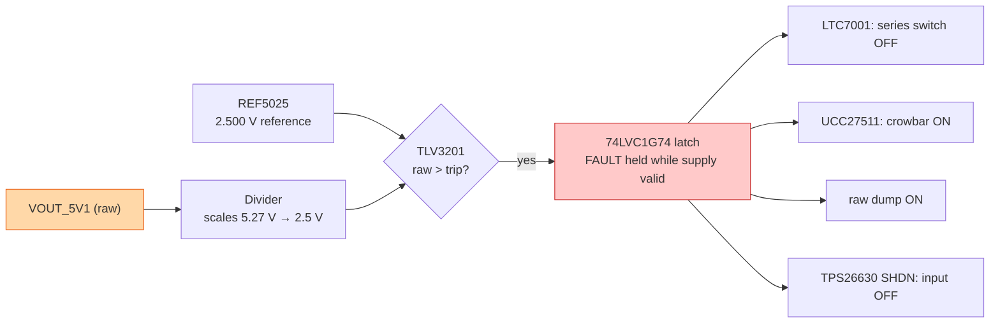
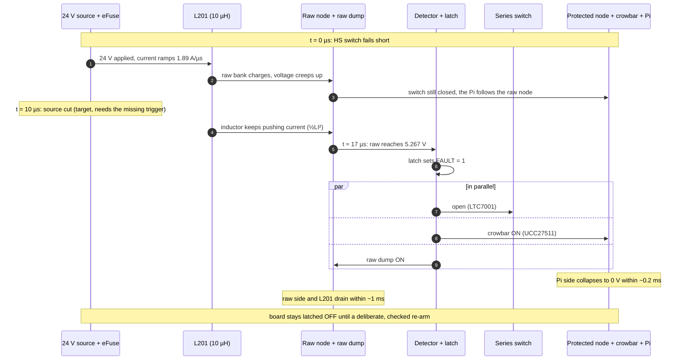

# 03a — Output protection: fault and energy

> [!abstract] In one sentence
> If the buck converter's top switch fails short, 24 V heads straight for a 5 V computer. Sheet 03 is intended to notice, **cut the power path**, and **drain stored energy** so the Pi stays strictly below the project’s 5.5 V peak limit. That result is still unproved.

> [!warning] Status (read once, then enjoy the lesson)
> **PRELIMINARY V1A SHEET-03 ARCHITECTURE (TEST BOARD) · NOT FOR FABRICATION — ENGINEERING REVIEW REQUIRED.**
> Gate 4a-FIX is still open (verdict BLOCKED; work in progress on `feat/r2-testboard-freeze`). Every number here is labelled **CALCULATED** (arithmetic under stated assumptions), **ASSUMED** (an allocation we chose) or **OPEN** (unknown). Waveforms come from an *ideal* model ([fault_model.py](figures/src/fault_model.py)) that reproduces the Gate 4a numbers. They teach the mechanism. They are not measurements. On R2 a dummy load stands in for the Pi. **The Pi is never connected until the bench fault tests pass.**

**What you will be able to do after this lesson**

1. Explain why a buck converter cannot protect itself from its own switch failing short.
2. Name the four energy stores in a fault and say where each one's energy must go.
3. Walk through the fault microsecond by microsecond: detect, remember, cut, drain.
4. Check the stored-energy example by hand and identify its assumptions.
5. Explain why source cutoff and separate drains must work together.

This is the first half of the pilot lesson. [[03b Output protection margins and proof|Part B]] follows with voltage margins, alternative architectures and the remaining proof obligations.

---

## 1. An everyday picture first: a tap stuck open

![[f3-01-analogy-stuck-tap.png|800]]
*BATCH_F F3.1: follow the two separate drains. The drawing is an analogy, not a circuit.*

Think of the buck as a **tap** that opens and closes 400 000 times a second to keep a bucket (the capacitors) filled to exactly the 5.1 V line. The Pi drinks from the bucket.

Now the tap handle snaps off with the tap **fully open**. The tap's own "controller" (feedback) keeps turning a handle that is no longer connected to anything. Water keeps pouring.

To save the house you need four separate moves:

| Plumbing move | V1A part | Why it is needed |
|---|---|---|
| Close the **main valve** upstream | TPS26630 eFuse (U101) turned off through its SHDN pin | Stops *new* water arriving from the 24 V source |
| Close a **gate valve** between the bucket and the house | 2 × BSC034N06NSATMA1 series switch, driven by LTC7001 | Keeps the flood out of the Pi's side |
| Open a **drain** in the house side | Crowbar CSD18540Q5B + UCC27511 + 33 mΩ ballast | Empties the water already on the Pi's side |
| Open a **drain** on the bucket side | Raw dump, 100 mΩ ballast (proposed in Gate 4a) | Empties the bucket *and* the water still rushing through the pipe |

The "water still rushing through the pipe" is the important subtle bit. Moving water has momentum. Closing the main valve does not stop it at once. In the circuit, that momentum is the **current in inductor L201**, and its energy is ½LI².

---

## 2. Where Sheet 03 sits

![[p03-01-where-sheet03-sits.png|900]]
*Functional map only. The shunt separates VOUT_PROTECTED from LOAD_5V1, and the harness adds further drop; these names do not denote identical physical voltages.*

Follow the colours. They are the same in every figure of this lesson.

- **Purple** is the input side (9–26 V). The buck's input capacitors sit here.
- **Orange** is `VOUT_5V1`, the *raw* 5 V node, straight out of the buck and L201. Call it **raw** from now on.
- **Blue** is `VOUT_PROTECTED`, which becomes `LOAD_5V1` and then feeds the Pi. Call the module-side node **protected**; the Pi endpoint is a different measurement plane.

Sheet 03 is the wall between orange and blue. The buck regulates on the orange side (its feedback senses `VOUT_5V1`). The Pi lives on the blue side.

---

## 3. The fault: the high-side switch becomes a wire

![[p03-02-buck-normal-vs-shorted.png|900]]

In a healthy buck the high-side (HS) switch connects the switch node (SW) to 24 V for only about 21 % of each cycle (duty ≈ 5.1/24). The inductor averages those pulses to 5.1 V.

When the HS metal-oxide-semiconductor field-effect transistor (**MOSFET**) fails short, SW sits at 24 V **all the time**. The inductor now sees about 24 − 5.1 = 18.9 V across it. By $V = L\,\frac{di}{dt}$ its current ramps up steadily:

$$
\frac{di}{dt} = \frac{V_L}{L} = \frac{18.9\ \text{V}}{10\ \mu\text{H}} = 1.89\ \text{A per microsecond}
$$

**CALCULATED, ideal 10 µH.** After just 10 µs the inductor carries 18.9 A *more* than before. The buck controller can pull its gate drive low as hard as it likes. A piece of shorted silicon does not listen.

> [!tip] Why input protection does not catch this
> The input is a perfectly normal 24 V. The eFuse's overvoltage protection (OVP) watches the *input*, so it sees nothing wrong. The danger is only visible at the *output*. That is why V1A needs a separate output-protection sheet.

---

## 4. Where the fault energy hides

Every capacitor stores $E=\tfrac12CV^2$. Every inductor stores $E=\tfrac12LI^2$. During a fault these stores can feed unwanted current. The path and switch state decide which store can reach the protected side.

![[f3-02-energy-springs.png|700]]
*(BATCH_F prompt F3.2.)*

![[v2-p03-03-energy-stores.png|850]]

Two lessons hide in this bar chart:

1. **In this bounded example, the 5 V banks exceed the listed input-capacitor store.** A source left connected can supply much more energy; this chart does not bound it. The raw bank (8 × 470 µF) holds up to about 85 mJ at the assumed upper capacitance and 5.5 V. Big capacitors are good for normal ripple and load steps. In a fault they are a loaded spring.
2. **Each side needs its own drain.** Once the series switch opens, energy on the orange side *cannot* reach the crowbar on the blue side. So the raw side needs its own raw dump. Gate 4a found this gap and proposed the 100 mΩ raw dump. Its hot pulse rating is still **OPEN**.

---

## 5. The cast: what each Sheet 03 part does

### 5a. Detect and remember

![[p03-05-detector-chain.png|900]]
*Picture correction: the divider and REF5025 feed separate comparator inputs; they are not a serial signal path. The label rounds the upper trip corner: use 5.315 V below. An eFuse-off command from this slow OV path cannot meet the independent 10 µs source contract.*

- The **divider** scales the raw 5 V node down to the comparator's range. The comparator compares it with a precise, independent 2.5 V reference. "Independent" means the buck cannot drag the reference along with it.
- The **comparator** gives a fast yes/no answer.
- The **latch** (a D flip-flop) turns a short "yes" into a permanent "FAULT". This matters because the crowbar pulls the voltage *down*. Without a latch, the comparator would un-trip, the switch would close again, the fault would push the voltage back up… and the board would chatter on and off. The latch says: *once is enough; a human decides when to try again.*

**CALCULATED (Gate 4a-FIX, work in progress):** nominal trip **5.267 V**. The tolerance window is **5.220–5.315 V** after resistor, reference, comparator-offset and leakage corners. Adding the 20 mV comparator overdrive at the top corner gives **5.357 V**.

### 5b. Cut: why the switch is two MOSFETs back-to-back

![[p03-04-back-to-back-mosfets.png|900]]

Every power MOSFET has a built-in **body diode**. A single MOSFET that is "off" can still conduct one way when its body diode is forward-biased. With two MOSFETs joined source-to-source, the two diodes face away from each other, so the off pair can block both directions within its voltage, leakage and drive limits. That keeps each side's energy on its own side, where its own drain can handle it.

The retained test-board candidates are **2 × BSC034N06NSATMA1**: 3.4 mΩ maximum each at 25 °C with a 10 V gate drive. Gate 4a assumes twice that when hot, so 13.6 mΩ for the pair. That number comes back in the drop budget.

### 5c. Drain: crowbar and raw dump

![[f3-03-two-sides-two-drains.png|750]]
*(BATCH_F prompt F3.3.)*

A **crowbar** is a deliberate short to ground, like throwing a steel bar across two terminals. Here it is a *controlled* short: a CSD18540Q5B MOSFET plus a 33 mΩ ballast resistor limits the current. The UCC27511 gate driver turns it on hard and fast. The raw dump is the same idea on the orange side, with a 100 mΩ ballast.

> [!info] Who powers the protection during the fault?
> The detector and drivers must keep working while the main 5 V collapses. Gate 4a therefore proposes an **independent auxiliary supply** upstream of the main eFuse: a surge limiter, a 12 V buck-boost and a hold-up capacitor. Its conditional hold-up screen is about **4.6 ms** (CALCULATED). Startup and rail-loss behaviour are still **OPEN**.

---

## 6. The fault, microsecond by microsecond

This is the heart of the lesson. Read the figure top to bottom, then the table.

> [!info] What this model leaves out
> The pilot model is reused unchanged. Before the disconnect opens it charges **only the raw capacitance**, ignores load current, and makes the protected voltage equal the raw voltage. After opening it uses the protected capacitance and a resistive load. This is a teaching convention, not a fully energy-conserving model of two connected capacitor banks. It omits ESR, wiring inductance, MOSFET transitions, saturation and control-rail failure. Here “Pi side” means an **ideal endpoint with no harness**, not a prediction at the physical Pi header.
> The 10 µs source cut is externally imposed. The autonomous trigger is **(still open)**. The separate source contract also limits whole-event positive replenishment charge to **100 µC**; the pilot simulation does not establish that limit. Stored-capacitor discharge is separate from replenishment charge.

![[v2-p03-06-fault-timeline.png|950]]

| Step | Time (ideal model, 24 V) | What happens | Where the energy goes |
|---|---|---|---|
| ① Short | 0 µs | SW node stuck at 24 V. L201 current starts at 8 A (**ASSUMED** worst healthy value) and ramps up. | Source → L201 → raw bank |
| ② Source cut | 10 µs (**target**) | The eFuse is shut off. L201 is at about 27 A. | The input bank (30 µF) still empties through the short |
| ③ Detector trips | 17.1 µs | Raw reaches 5.267 V. The latch sets. | — |
| ④ Actions | ≈ 18 µs (**ASSUMED** 1 µs; real value **OPEN**) | The switch opens. Crowbar and raw dump fire together. | Protected bank → crowbar. Raw bank + L201 → raw dump |
| ⑤ Drained | 0.2 ms (Pi side), ≈ 0.75 ms (raw < 0.3 V) | Both sides reach ≈ 0 V and stay latched off. | Energy dissipates in modeled resistive paths; real sharing/stress OPEN |

**What the Pi experiences:** a peak of about **5.28 V** in this ideal model, then an abrupt power loss. That is the accepted price. Abrupt power loss can corrupt storage or interrupt the robot. Avoiding an excessive voltage does not make shutdown harmless; no damage-versus-time allowance is credited.

### What goes wrong: source cutoff alone leaves stored energy

![[v2-p03-07-with-vs-without.png|900]]

- **Red:** nothing cuts the source. The Pi passes 5.5 V at about 28 µs and reaches 9.2 V by 100 µs (the ideal model ignores the eFuse current limit here).
- **Orange:** a perfect source cut at 10 µs, but no Sheet 03. The **stored energy alone** pushes the Pi to about **6.08 V**. This is the key insight of the whole lesson: **stopping the source is necessary but not sufficient.**
- **Blue:** with Sheet 03 the Pi side is split off at 5.28 V and then drained.

---

## 7. Worked example: check the orange curve by hand

Can we trust the 6.08 V? Let us rebuild it with nothing but ½CV² and ½LI².

**ASSUMED (Gate 4a conventions):** 24 V source cut at exactly 10 µs; input bank 30 µF; L201 = 10 µH; raw bank minimum 2.4064 mF; 8 A at the start; no load, no losses (so this is the pessimistic case).

**Step 1: inductor current at 10 µs.**
$$
I_L = 8\ \text{A} + 1.89\ \tfrac{\text{A}}{\mu\text{s}} \times 10\ \mu\text{s} \approx 26.9\ \text{A}
$$

**Step 2: energy still "in flight" when the source is cut.**
$$
E_{C_{in}} = \tfrac12 (30\ \mu\text{F})(24\ \text{V})^2 = 8.64\ \text{mJ}
\qquad
E_L = \tfrac12 (10\ \mu\text{H})(26.9\ \text{A})^2 = 3.62\ \text{mJ}
$$
$$
E_{\text{in flight}} \approx 12.3\ \text{mJ}
$$

**Step 3: pour it all into the raw bank**, which is at 5.17 V at 10 µs.
$$
V_{peak} = \sqrt{V_0^2 + \frac{2E}{C}} = \sqrt{5.17^2 + \frac{2(0.0123)}{0.0024064}} = \sqrt{26.7 + 10.2} \approx 6.07\ \text{V}
$$

**CALCULATED:** 6.07 V by hand against 6.08 V from the simulation. Both methods use the same assumptions. Their agreement checks arithmetic consistency; it does not validate the hardware or the model’s missing physics. With the project peak limit of 5.5 V, the stored energy alone breaks the requirement by more than half a volt. That is why Sheet 03 exists even with a perfect source cut.

> [!example] Try it yourself
> Repeat the example at 9 V input. The ramp is slower ((9 − 5.1)/10 µH = 0.39 A/µs), so I_L ≈ 11.9 A at 10 µs, and ½CV² of the input bank is only 1.2 mJ. Is the peak above or below 5.5 V? *(Answer in the self-check below.)*

---

## 8. Why this design and not another

The owner chose **D for a fault-test board**: place the series disconnect and protected absorber on V1A, with a separate raw-side energy destination. This keeps the protection together on the module. An input cutoff alone leaves stored energy, while one protected crowbar cannot drain the raw side after the pair opens. The choice does not establish timing or the real far-end voltage. [[03b Output protection margins and proof|Part B]] compares D with E and reviews the adverse screens.

> [!warning] Common misconceptions
> A source cutoff does not empty local capacitors. A protected crowbar cannot drain energy isolated on the raw side. The pilot's ideal far-end waveform omits harness ringing. The actual control timing and hot limits are **(still open)**; the source/C/L allocations remain **(still open)**. No Pi before all required gates pass.

## 9. Check yourself

1. Why does a normal 24 V input not trigger input OVP during a failed buck switch?
2. Why do the two separated sides need their own drains?
3. Why does agreement between the energy calculation and simulation not validate hardware?
4. At 9 V input, is the stored-energy-only example above or below 5.5 V?

> [!question]- Answers
> 1. Input OVP observes the input; this fault produces excessive voltage at the output.
> 2. Opening the series pair separates their energy stores. The raw bank and inductor cannot rely on a drain across the open pair.
> 3. Both use the same ideal assumptions; agreement checks consistency, not the omitted physical effects.
> 4. Below in this model: the assumed 10 µs current is about 11.9 A, input-capacitor energy 1.22 mJ and inductor energy 0.71 mJ. With raw voltage about 5.14 V, the energy estimate gives about 5.29 V. Low input still has the longest voltage-detector latency; it does not prove the full design.

## 10. One-page visual summary

![[v2-p03-07-with-vs-without.png|750]]

| Follow the fault | What must happen / what remains open |
|---|---|
| High-side short | Input feeds L201 continuously; feedback cannot remove a physical short |
| New energy | **Independent source trigger OPEN**; source cutoff ≤10 µs / positive charge ≤100 µC are targets |
| Raw energy | Raw bank + L201 need a qualified **raw dump** |
| Protected energy | **Series pair OFF**, protected **crowbar ON**, usable control power maintained |
| Teaching model | **6.08 V** with source cutoff alone; **5.28 V** with ideal protection; neither predicts real harness peak |
| Next review | [[03b Output protection margins and proof|Part B: margins, failed screens and re-arm proof]] |

> [!info]- Sources and reproducibility
> - Gate 4a / Gate 4a-FIX (WIP): `feat/r2-testboard-freeze` at `2b99ac7`, `docs/evidence/r2/gate4a/` (GATE4A_FREEZE.md, TIMING_AND_LOGIC.md, CALCULATIONS.md, calculate_gate4a.py).
> - Gate 3b source bound: `0a853c7`, `docs/evidence/r2/sheet03/gate3b/GATE3B_SOURCE_BOUND.md` (5.542 V counterexample, 15.217 mJ packet).
> - Gate 3 options A–E: `65a8698`, `docs/evidence/r2/sheet03/GATE3_ARCHITECTURE_OPTIONS.md`.
> - Path budget: `ebe51b9`, `docs/evidence/r2/path_budget/PATH_CALCULATIONS.json`.
> - Figures: `python3 -B docs/lessons/figures/src/make_figures.py` (needs matplotlib and numpy). The ideal model in [fault_model.py](figures/src/fault_model.py) reproduces the Gate 4a-FIX OV-only latencies (29.56 / 16.91 / 16.24 / 15.94 µs) exactly.
> - Content baseline: fact-checked lesson 03 on `docs/illustration-audit` (commit 4b33d83, see [FACTCHECK_LOG](FACTCHECK_LOG.md)).

Previous: [[02 Buck converter LM61460]] · Next: [[03b Output protection margins and proof]] · Terms: [[99-Glossary]]
