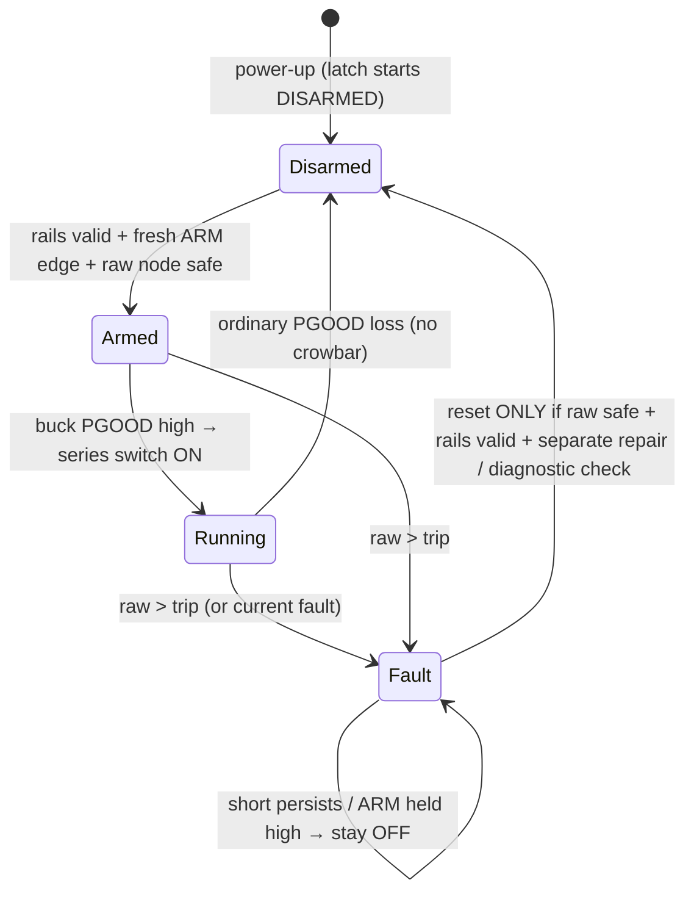
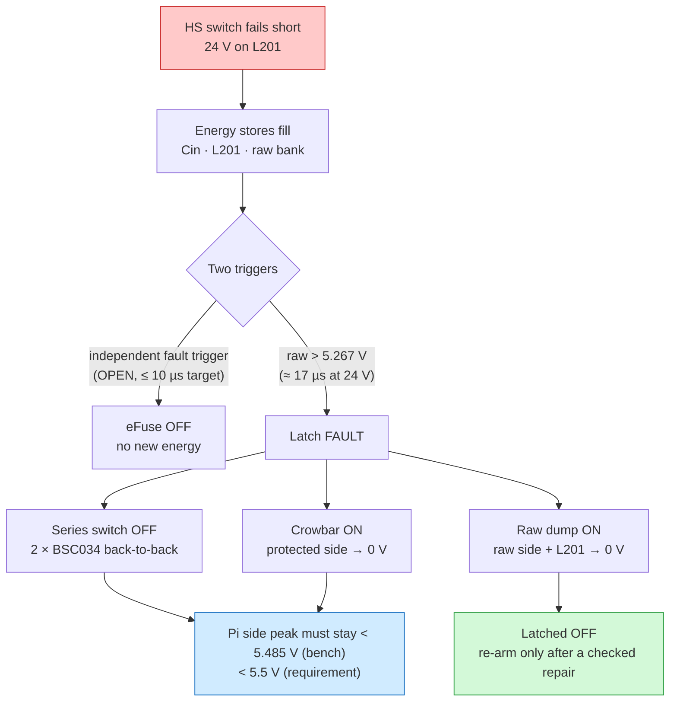

# 03b — Output protection: margins and proof

> [!abstract] In one sentence
> Architecture D must fit normal and fault behavior into narrow voltage margins, and the favorable ideal waveform does not close its known implementation gaps.

## 1. An everyday picture: a staircase under a low ceiling

![[f5-01-voltage-staircase.png|850]]
*BATCH_F F5.1. Going down too many steps leaves too little voltage at the computer. Raising the starting floor also brings normal operation closer to the protection ceiling.*

Imagine moving furniture down a staircase under a low ceiling. You need enough room above your head and a safe landing below your feet. Fixing only one end can make the other worse. V1A likewise needs enough voltage at 5 A, yet must avoid false trips and stay strictly below the fault peak limit.

[[03 Output protection|Part A]] follows the short and energy paths. This half reads their voltage budget, explains three failure mechanisms, and asks what evidence architecture D still owes.

> [!warning] Status
> **PRELIMINARY V1A SHEET-03 ARCHITECTURE (TEST BOARD). Gate 4a-FIX BLOCKED. NOT FOR FABRICATION — ENGINEERING REVIEW REQUIRED.** All waveforms and margins here are conditional calculations, not measurements. The autonomous trigger, power-loss/re-arm construction and rated fixture remain unresolved. No Pi before all required gates pass.

## 2. Picture walkthrough: the voltage ladder: why the margins are thin

Put every important voltage on one ruler and the design problem becomes visible.

![[v2-p03-09-voltage-ladder.png|850]]

Read it from the bottom:

- **Between 5.171 V (the highest healthy regulation) and 5.220 V (the lowest trip)** there are only about **49 mV**. If the detector tripped inside the healthy band, a normal load release would turn the robot's computer off. That is a *nuisance trip*. The 49 mV is a static screen; real load-release overshoot is measured in bench test T06.
- **Between 5.315 V (highest trip) and 5.5 V (Pi limit)** there are about **185 mV** for everything that happens *after* the trip decision: comparator overdrive, logic and gate delays, and cable ringing.
- With a **substantiated 15 mV uncertainty**, the recorded fault peak must be **strictly below 5.485 V**. The 15 mV is a planned uncertainty budget, not a calibrated instrument result; 5.490 + 0.015 = 5.505 V would fail that screen.

## 3. Worked example: the 5 A drop budget

The protection parts sit *in series* with the Pi's power, so they also cost voltage in normal operation.

![[v2-p03-10-drop-budget.png|950]]

**CALCULATED (Gate 4a allocations):**

$$
V_{Pi} = V_{buck,min} - I\,(R_{send}+R_{return}) - V_{trough}
= 5.026 - 5\times0.042673 - 0.020 = 4.793\ \text{V}
$$

That leaves **43 mV** above the 4.75 V minimum. The two red giants are the **series switch (13.6 mΩ hot)** and the **Pi contacts (13.3 mΩ, ASSUMED)**. If a real load step dipped 100 mV instead of the assumed 20 mV, the result would be **4.713 V: FAIL**. So you cannot "just raise the setpoint" to buy low-side margin. Every 10 mV you add at the bottom is taken from the 49 mV nuisance margin at the top.

> [!important] The squeeze in one line
> Too little series resistance is impossible (the switch must exist). Too much, and the Pi browns out at 5 A. A higher setpoint causes nuisance trips. The upper static trip-to-limit allowance is about 185 mV; the separate low-voltage delivery budget must also close.

---

## 4. What goes wrong: three traps the gates found

### Trap 1: the detector is too slow to be the source trigger

![[v2-p03-08-detector-latency.png|850]]

The large raw bank makes the voltage rise *slowly*. That is good for the Pi. But it means a voltage detector cannot see the fault for **16–30 µs** (CALCULATED, Gate 4a-FIX), while the source-energy contract needs the source **off within 10 µs** of the short. So Sheet 03 needs a *second, independent* trigger that sees the fault itself, for example from current. In Gate 4a-FIX that circuit is **not yet designed**. This is the top blocker (R4A-01).

### Trap 2: the cable can ring above the module

![[p03-11-d-vs-e.png|900]]
*D and E are alternative functional placements. D avoids E’s **additional** Pi-end loss; D itself still has series-switch loss.*

The harness is not a perfect wire. It has inductance, and both ends have capacitance. When the module side is suddenly clamped, the cable's current keeps flowing into the Pi's capacitance and can overshoot. Gate 3b's conditional model found **5.542 V at the Pi** while the module node stayed below 5.5 V. That is a paper counterexample, and it remains **BLOCKING** until a reviewed design and real far-end measurements establish compliance across the applicable conditions. One favourable trace cannot erase the counterexample.

![[f3-04-fault-bench-no-pi.png|800]]
*(BATCH_F prompt F3.4.) The bench that settles Trap 2: a dummy load at the far end of the real harness, with the Pi locked away.*

### A second failed screen: the capacitor bank is not its ideal model

Gate 4a-FIX keeps the proposed four-capacitor protected bank as a test candidate. It **does not** establish the inherited minimum capacitance / 0.5 mΩ equivalent series resistance (ESR) contract. The retained sensitivity reaches **5.713 V at the module**. This differs from the **5.542 V far-end harness** example: two models, two nodes, two unresolved obligations. Capacitance, ESR and application margins are **(still open)**. The 5.28 V blue teaching curve closes neither gap.

### Trap 3: "latched" must survive power loss and repair

A volatile latch forgets everything when power drops. Gate 4a's policy says:

The subtle part is the last arrow. With power off and the capacitors empty, a healthy buck and a buck with a *still-shorted* switch look identical to the detector. So "the voltage is low now" is **not** proof that it is safe to re-arm. Gate 4a requires a diagnostic check or a documented repair lockout. That circuit is also **OPEN**.

---

## 5. Why this design and not another

| Option (Gate 3) | Idea | Why not (or why) for R2 |
|---|---|---|
| A: crowbar + bounded source | Short the output, limit the source | Useful *ingredient* (the source bound), heavy qualification on its own |
| B: fuse-blowing crowbar | Short the output hard enough to blow a fuse | The 4.5 A eFuse limit cannot guarantee blowing a normally rated fuse. Rejected |
| C: two-stage conversion | Lower intermediate voltage | A shorted stage still gives about 6 V. Still needs D or E. Extra heat |
| **D: module disconnect + absorber** | Series switch + crowbar on V1A | **Chosen by the owner for the fault-test board**: fits on the module, no extra series stage at the Pi |
| E: Pi-end protection | Final switch/absorber at the GPIO header | Gate 3's recommendation. Watches the exact Pi voltage, but adds FETs, wiring, auxiliary power and drop (49.6 mΩ loop) |

The honest summary: **D was chosen for practicality, not because it proved a better fault margin.** D keeps everything on one board, which simplifies a board intended for controlled fault qualification with a rated dummy-load fixture. Destructive testing is not assumed or authorized by this lesson. The price is Trap 2. D must prove with the real harness that fault peak plus established uncertainty stays below 5.5 V (recorded peak below 5.485 V if uncertainty is 15 mV).

---

> [!warning] Common misconceptions
> The comparator is not a complete source-energy bound. Cutting input power leaves charged capacitors and inductor current. The latch depends on valid control power. Architecture D is a development decision, not a measured protection result. Trip thresholds, hot pulse limits and full timing remain **(still open)**; the input/C/L development allocations remain **(still open)**.

## 6. Check yourself

1. The eFuse's OVP is set around 27.6 V. Why does it do nothing during a high-side short at 24 V?
2. Using ½CV², why is the raw bank a bigger fault problem than the 30 µF input bank, even though it sits at only 5 V?
3. Why do we need a latch after the comparator? Describe what happens without one.
4. Why does the series switch use two MOSFETs instead of one?
5. The source is cut perfectly at 10 µs. Why can the Pi still see more than 5.5 V without Sheet 03?
6. Why can the 5 V detector not be the trigger that meets the 10 µs source-off target?
7. Somebody suggests raising the buck setpoint by 50 mV to fix the thin 4.75 V margin. What breaks?
8. *(Part A follow-up)* At 9 V input, is the "stored energy only" peak above or below 5.5 V?

> [!question]- Answers
> 1. OVP watches the **input**, which is a normal 24 V. The danger is at the output, which only a separate output-side detector can see.
> 2. Energy grows with C. The raw bank is about 2.4–5.6 mF, roughly 100× the input bank. Up to about 85 mJ at 5.5 V, against 8.6 mJ for 30 µF at 24 V.
> 3. The crowbar pulls the voltage down, so the comparator would un-trip, the switch would re-close, the fault would push the voltage up again, and the board would oscillate. The latch holds the fault until a deliberate, checked re-arm.
> 4. Each MOSFET's body diode conducts one way even when the MOSFET is off. Back-to-back, the diodes face away from each other, so the pair blocks both directions and each side keeps its own energy.
> 5. The energy already stored in the input bank and in L201 (≈ 12.3 mJ at 24 V) still flows into the 5 V bank: √(5.17² + 2·0.0123/0.0024064) ≈ 6.07 V.
> 6. The big raw bank makes the voltage rise slowly. The detector crosses 5.267 V only after 16–30 µs, which is later than 10 µs. An independent trigger that sees the fault directly is needed, and it is still OPEN.
> 7. The top of healthy regulation moves up by the same 50 mV, which uses up almost all of the 49 mV nuisance margin below the lowest trip point. Normal load releases could then turn the Pi off.
> 8. Below. At 10 µs I_L ≈ 8 + 0.39 × 10 ≈ 11.9 A, so ½LI² ≈ 0.71 mJ. The input bank holds ½(30 µF)(9 V)² ≈ 1.22 mJ. The raw node is ≈ 5.14 V at 10 µs. √(5.14² + 2(0.00193)/0.0024064) ≈ 5.29 V. So at low input voltage the danger is smaller, but the detector is slowest (29.6 µs).

---

## 7. One-page visual summary

| Remember | Number | Label |
|---|---|---|
| Inductor ramp during the short at 24 V | 1.89 A/µs | CALCULATED |
| Source must be off within | 10 µs of the short | ASSUMED contract |
| Detector trip (window) | 5.267 V (5.220–5.315 V) | CALCULATED, WIP |
| Voltage-detector latency at 9–27 V | 29.6–15.9 µs | CALCULATED |
| Stored energy alone (no Sheet 03) | ≈ 6.08 V at the Pi | CALCULATED, ideal |
| Pi limit / bench pass line | 5.5 V / 5.485 V | REQUIREMENT / TEST |
| Normal 5 A at the Pi | 4.793 V (43 mV margin) | CALCULATED |
| Top blockers | independent source trigger, aux startup, reset/re-arm, rated fault fixture | OPEN |

---

> [!info]- Sources and reproducibility
> - Gate 4a / Gate 4a-FIX (WIP): `feat/r2-testboard-freeze` at `2b99ac7`, `docs/evidence/r2/gate4a/` (GATE4A_FREEZE.md, TIMING_AND_LOGIC.md, CALCULATIONS.md, calculate_gate4a.py).
> - Gate 3b source bound: `0a853c7`, `docs/evidence/r2/sheet03/gate3b/GATE3B_SOURCE_BOUND.md` (5.542 V counterexample, 15.217 mJ packet).
> - Gate 3 options A–E: `65a8698`, `docs/evidence/r2/sheet03/GATE3_ARCHITECTURE_OPTIONS.md`.
> - Path budget: `ebe51b9`, `docs/evidence/r2/path_budget/PATH_CALCULATIONS.json`.
> - Figures: `python3 -B docs/lessons/figures/src/make_figures.py` (needs matplotlib and numpy). The ideal model in [fault_model.py](figures/src/fault_model.py) reproduces the Gate 4a-FIX OV-only latencies (29.56 / 16.91 / 16.24 / 15.94 µs) exactly.
> - Content baseline: fact-checked lesson 03 on `docs/illustration-audit` (commit 4b33d83, see [FACTCHECK_LOG](FACTCHECK_LOG.md)).

Previous: [[03 Output protection]] · Next: [[04 Monitoring]] · Terms: [[99-Glossary]]
